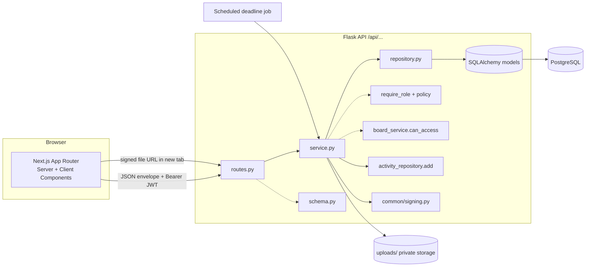
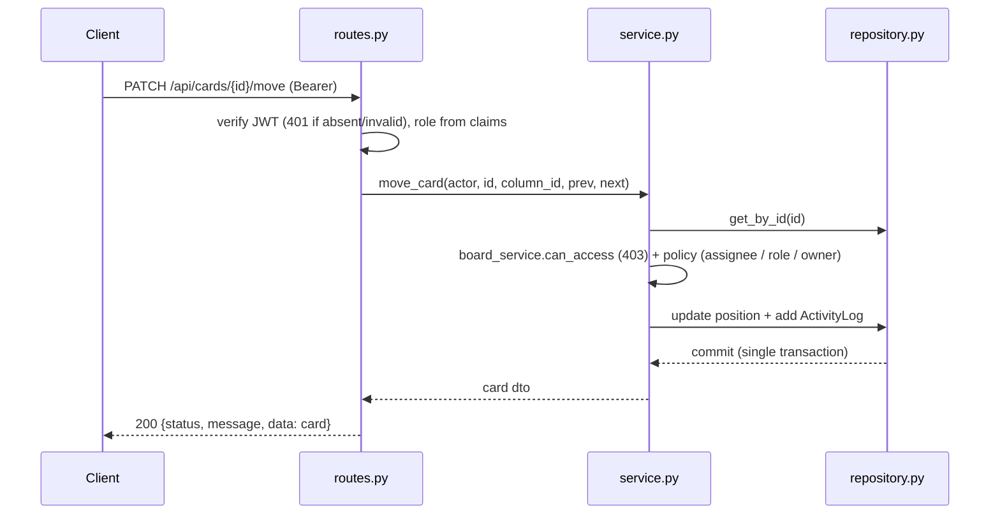
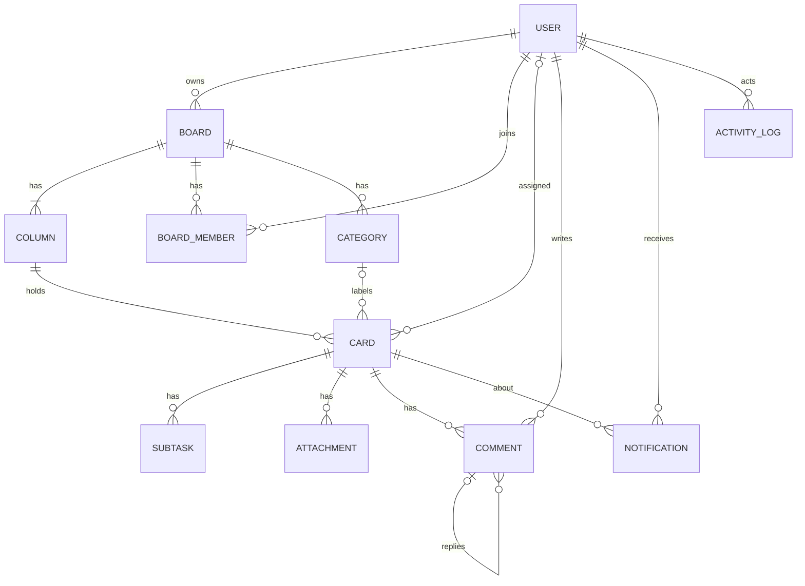
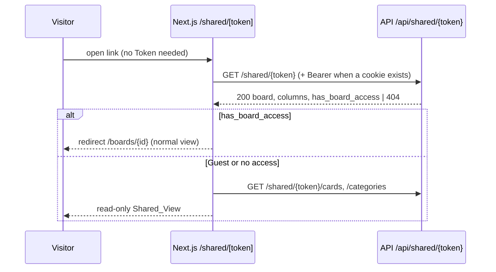
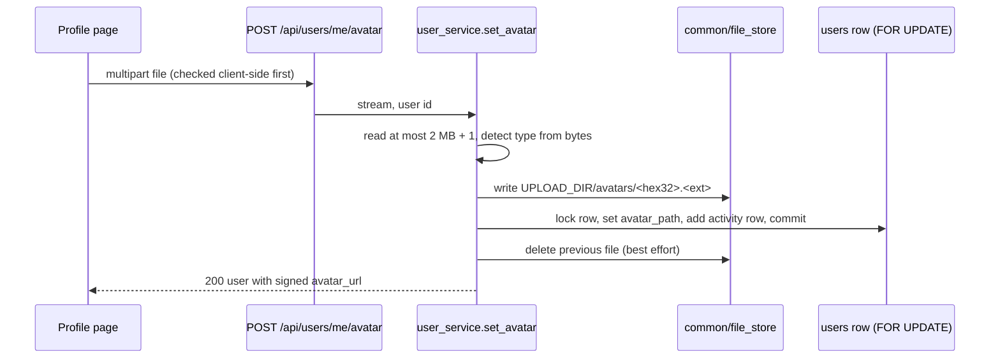
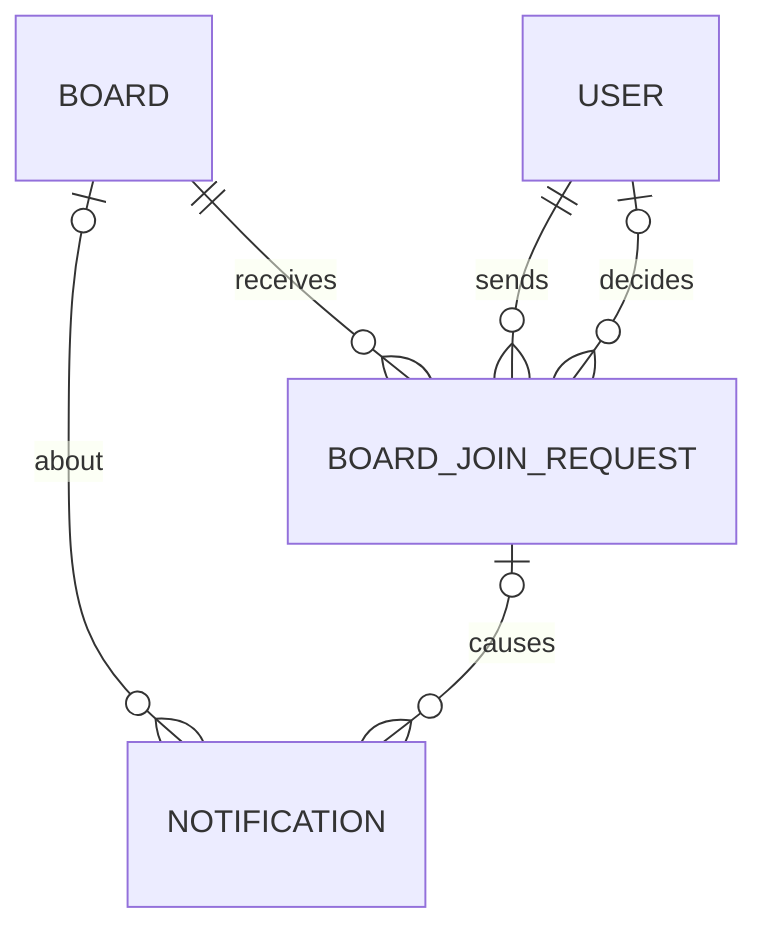

# Design Document

## Overview

This document is the technical design for the Kanban Task Management application (Version V12). It implements the V10 `requirements.md` using the stack and conventions fixed in the workspace steering (updated to V10 in this revision): a Flask + SQLAlchemy + flask-smorest REST API (marshmallow schemas, generated OpenAPI) organized as one blueprint per domain, and a mobile-first Next.js (App Router, TypeScript) frontend. Requirement references use the criterion numbers of the current `requirements.md`. "Decision 1" to "Decision P" refer to the Decisions Log in `requirements.md`; Decisions K to P are new in V10 and are summarised in the section "V10 Design: Share Links, Identity, Header, Rate Limiting, Route Guard". V12 (Decisions Y to AF) is described in the section "V12 Design" at the end of this document and overrides any older section it contradicts.

Key design decisions:

| Decision | Choice | Rationale |
|---|---|---|
| Backend layering | `routes.py → service.py → repository.py → model`, plus `schema.py` holding the marshmallow schemas. Routes are `flask_smorest.Blueprint` views; services and repositories never import marshmallow or Flask | Services are unit-testable against a fake repository (Req 15.4, 13.7, 13.14). |
| Board access | `board_service.can_access(user, board)` (Board_Access) gates every board-scoped read and comment; `board_service.can_write_staff(user, board)` (Board_Staff_Access) gates Supervisor, Manager, and Admin writes (Decision A) | "Private" must gate unrelated signed-in users and cannot drift per endpoint (Req 11.6, 11.11, 12.7); an unrelated Supervisor must not write on a public Board (Req 3.4, 4.1, 6.1). **V12: `can_access` no longer has a public branch; see "V12 Design: Access model" (Decision Y).** |
| Authorization | `require_role(...)` decorator for the role gate, plus service-level policy functions that combine role, `can_access`, `can_write_staff`, and assignment | Role comes only from the Token (Req 2.7). Ownership and assignment rules need data, so they live in services. |
| Role model | Numeric rank for guest < member < supervisor < manager; admin is a separate capability set | Additive hierarchy without duplicated rules (Req 2.2, 2.3). Admin is deliberately not a Manager superset (Decision B). |
| Status codes | No Token returns 401; valid Token with insufficient role or access returns 403, everywhere. A Guest requesting any Board outside the shared routes gets 401 (V10); a rate-limited request gets 429 with `Retry-After` | Req 2.8, 2.9, 11.5, 12.7, 13.10, 20.5. |
| Auth transport | Stateless JWT bearer token, fixed 24-hour expiry, no revocation list; passwords hashed with argon2 (`argon2-cffi`). A Postgres-backed Rate_Limiter guards login and availability; registration is not limited (Decisions O and Q) | Req 1.13, 1.14, 1.16, Requirement 20. |
| Login identity | Two columns, `username` and `email`, each unique case-insensitively through a functional unique index on its lower-cased value; login takes one `identifier` and the service classifies it (Decisions M and N). `login_identifier` is dropped by the V10 migration | Req 1.1 to 1.5, 1.43 to 1.54. Replaces Decision C. |
| Ordering | `Float` `order`; first = `min - 1`, last = `max + 1`, empty = `1.0`, otherwise average; renumber the whole sibling list when the gap falls below `1e-6` | Req 4.13, 5.1, 5.10, 5.11. |
| Deletion | `deleted_at` / `archived_at` on Board and Card only; child rows are hidden through a join on the parent Card's `deleted_at` | Req 3.8, 4.23, 4.29. |
| Audit | `ActivityLog` row written by the service in the same transaction as the change | Req 8.1. |
| Guest privacy | A Guest has no Board_Access and no Token-bearing route. The only Token-free Board reads are the `/api/shared/{token}` routes (Decision K), whose schemas contain no `comments`, `activity`, or `activity_log` field; the comment and activity endpoints answer a Guest with 401 | Absence of the field is the access control (Req 7.16, 8.5, 14.3, 18.15). |
| Attachment files | Signed, 15-minute file URLs (HMAC over attachment id and expiry); no permanent public URL (Decision D) | Req 4.18, 4.24 to 4.27. This replaces the V1 design, which returned a stable public `file_url`. |
| Deadline job | Scheduled job (APScheduler, or a platform cron calling `flask notify-deadlines`); "today" is computed in `APP_TIMEZONE` | Req 9.2. |
| Route guard | `frontend/proxy.ts` (Next.js 16 `proxy`, formerly `middleware`) redirects a request for any `(app)` page without the `kanban_token` cookie to `/login`; the Backend 401 remains the authority (Decision P) | Req 14.27. The check is optimistic because a proxy cannot verify the JWT cheaply and must not be the only gate. |
| Frontend rendering | Server Components by default; Client Components only for the board (drag-and-drop), card modal, comment composer, sort toggle, search input, side panel | Req 14.11. |
| Frontend styling | Tailwind CSS v4 + shadcn/ui (Radix). `styles/tokens.css` stays the single source of the look (palette from the product owner's visual reference); a Tailwind `@theme` block and shadcn's variables alias to the tokens. `BaseButton`, `BaseBadge`, `BaseModal` wrap shadcn `Button`, `Badge`, `Dialog`; nothing else imports `components/ui/` (Decision H) | Consistent utilities and accessible primitives while one token file carries the look (Req 14.9, 14.10, 14.13 to 14.15). |
| API framework | `flask-smorest`: one `Api` instance, every blueprint a `flask_smorest.Blueprint`, request and response declared with marshmallow schemas (Decision E) | One declaration per endpoint drives validation, serialization, and the OpenAPI document (Req 13.12, 17.1). |
| Response envelope | Success `{status: true, message, data}`; error `{status: false, message, error: {code, details?}}`; `status` is a boolean, true exactly when the HTTP status is 2xx; the numeric code travels on the HTTP line only; the message text appears once at the top level; mutating endpoints pass a descriptive message and reads default to "OK" (Decision G, supersedes the numeric `status` of Decision E) | The frontend unwraps in one place, branches on `error.code`, and two message strings cannot drift (Req 13.2 to 13.4, 13.11). |
| Validation status | smorest/webargs 422 is mapped to `400 VALIDATION_ERROR`; `error.details` maps each field to the list of marshmallow messages (Decisions E and G) | Req 13.13. |
| Relationships and loading | Five declared relationships (`Board.columns`, `Board.members`, `Card.subtasks`, `Card.attachments`, `Comment.replies`), `back_populates`, `lazy="raise"`, no cascade; each repository loads what its caller reads with `selectinload`/`joinedload` (Decision F) | An accidental lazy load fails in tests instead of becoming a hidden N+1 query; list endpoints keep a constant query count (Req 13.16, 13.18, 14.12). |
| Serialization | No `to_dict` on models; marshmallow schemas serialize, taking the viewer as context (Decision F) | Output depends on the viewer (guest privacy, `can_create_card`, signed file URLs), so it cannot live on the model (Req 13.17). |
| API documentation | Generated by smorest; Swagger UI and `/api/openapi.json` are enabled only through `OPENAPI_*` config when `APP_ENV` is `development` or `testing`; `flask export-openapi` writes `backend/openapi.json` | Req 17.1, 17.3 to 17.5. Replaces the hand-written `openapi.yaml`, `flask-swagger-ui`, and `pyyaml`. |

### Research summary

- Flask blueprints, application factory, and `flask-cors` with an explicit origin list match the steering. See the [Flask blueprint docs](https://flask.palletsprojects.com/en/latest/blueprints/).
- `flask-jwt-extended` provides `create_access_token(expires_delta=timedelta(hours=24))` and `get_jwt()`. Claims (user id, role) are signed, so the role cannot be forged from a request body. See the [Flask-JWT-Extended docs](https://flask-jwt-extended.readthedocs.io/).
- Case-insensitive uniqueness in PostgreSQL is done with a functional unique index on `lower(column)`. Lookups use `func.lower(...)` so the index is used.
- Signed expiring URLs: an HMAC-SHA256 over `"{attachment_id}.{exp}"` with a server secret, compared with `hmac.compare_digest`, gives a stateless token that a plain browser tab can present. `itsdangerous` offers an equivalent timed serializer; the explicit HMAC is chosen because the clock can be injected in tests.
- Fractional (Float) ordering is the usual cheap reorder technique. Repeated averaging exhausts float precision after roughly 50 consecutive inserts in the same gap, so the service renumbers the sibling list when the gap falls below `1e-6`.
- flask-smorest: `Api(app)` collects `flask_smorest.Blueprint`s; `@blp.arguments(Schema, location=...)` validates bodies and queries (webargs, default failure status 422); `@blp.response(status, Schema)` serializes and documents the response; `abort()` and `HTTPException` go through `Api.handle_http_exception`, which a subclass can override to render the project's error envelope. The OpenAPI document is served only when `OPENAPI_JSON_PATH` (with `OPENAPI_URL_PREFIX`) is set, and Swagger UI only when `OPENAPI_SWAGGER_UI_PATH` and `OPENAPI_SWAGGER_UI_URL` are set; leaving them unset registers no route. See the [flask-smorest docs](https://flask-smorest.readthedocs.io/).
- Property-based testing: `hypothesis` for Python services, `fast-check` for TypeScript pure helpers.

Content from these sources was summarized, not quoted.

## Architecture



### Backend layout

```
backend/app/
  __init__.py            # create_app(): config, CORS, db, blueprints, error handlers, CLI
  extensions.py          # db, migrate
  api.py                 # EnvelopeApi(flask_smorest.Api) instance, error mapping, OpenAPI config by APP_ENV, bearerAuth scheme, export-openapi CLI
  common/
    auth.py              # require_role, current_user, role rank, Actor
    errors.py            # AppError subclasses (plain Python, no Flask import)
    envelope.py          # envelope(DataSchema, many=False) -> marshmallow Schema {status: Boolean, message, data}; ErrorEnvelopeSchema {status, message, error{code, details}}
    responses.py         # ok(data, message=None, status=200) -> {status: true, message, data}; default message = "OK"
    ordering.py          # between(a, b), position_for(...), needs_rebalance, rebalance
    signing.py           # sign_file_url(attachment_id, now), verify_file_signature(...)
    clock.py             # today(tz), now(): injectable for tests
    rate_limiter.py      # V10: check/record/reset against rate_limit_attempts; pure policy + a repository-backed store
  models/                # one module per entity, UUID PKs, TimestampMixin (V10 adds RateLimitAttempt)
  blueprints/
    auth/ boards/ columns/ cards/ categories/ comments/
    notifications/ analytics/ users/ shared/    # each: routes.py service.py repository.py schema.py (shared = read-only Share_Link routes, V10)
  jobs/deadlines.py      # daily deadline notifications
backend/tests/           # pytest + hypothesis, fake repositories
backend/openapi.json     # generated export (flask export-openapi), never edited by hand
backend/API.md           # hand-written human-readable reference, same endpoints as the generated document
```

Activity has no public blueprint of its own. Activity reads are exposed through the `cards` blueprint (`GET /api/cards/{id}/activity`) and the `boards` blueprint (`GET /api/boards/{id}/activity`). Writes go through `activity_repository.add(...)`, called by each service inside its own transaction. Board members are handled inside the `boards` blueprint (`board_service`, `board_repository`); attachments are a sub-resource of `cards`.

### Environment variables (listed in each app's `.env.example`, never a real `.env`)

Backend: `DATABASE_URL`, `JWT_SECRET`, `ALLOWED_ORIGINS`, `FILE_URL_SECRET` (HMAC key for signed file URLs, separate from `JWT_SECRET`), `APP_TIMEZONE` (IANA name, for example `UTC`), `UPLOAD_DIR` (attachments at its root, avatars under `UPLOAD_DIR/avatars/`), `APP_ENV` (`development`, `testing`, or `production`; optional, defaults to `production`; selects whether the smorest `OPENAPI_*` documentation settings are applied, see Requirement 17). V10 adds the optional `RATE_LIMIT_WINDOW_SECONDS` (default 900), `RATE_LIMIT_LOGIN_PAIR_MAX` (default 5), `RATE_LIMIT_LOGIN_IP_MAX` (default 20), `RATE_LIMIT_AVAILABILITY_MAX` (default 60, kept, Decision W), `RATE_LIMIT_CHANGE_PASSWORD_MAX` (default 5, round 3), and `TRUSTED_PROXY_COUNT` (default 0); each is listed in `backend/.env.example` with a placeholder, and `create_app(config_overrides)` accepts the same keys so tests use small limits without `APP_ENV` (Req 20.10). Frontend: `NEXT_PUBLIC_API_URL`, and for the Playwright suite `E2E_BASE_URL`, `E2E_USER_IDENTIFIER`, `E2E_USER_PASSWORD` (V9). The app refuses to start when `ALLOWED_ORIGINS`, `JWT_SECRET`, `FILE_URL_SECRET`, or `APP_TIMEZONE` is missing, or when `ALLOWED_ORIGINS` contains `*`.

### Backend dependencies

`requirements.txt` lists: `flask`, `flask-sqlalchemy`, `flask-migrate`, `flask-cors`, `flask-jwt-extended`, `argon2-cffi`, `psycopg[binary]` (or the driver in use), `flask-smorest` (brings `marshmallow`, `webargs`, `apispec`), and dev/test packages `pytest`, `hypothesis`. V10 adds no Backend package: the Share_Token uses `secrets.token_urlsafe(32)`, the limiter key uses `hmac`, and the proxy handling uses `werkzeug.middleware.proxy_fix.ProxyFix`, which ships with Flask. V10 adds one Frontend package, `@radix-ui/react-dropdown-menu`, behind `BaseMenu`. Removed: `flask-swagger-ui` and `pyyaml` (Req 17.10). Services and repositories import none of `flask`, `flask_smorest`, or `marshmallow`.

### Frontend layout

```
frontend/
  app/
    (auth)/login/page.tsx, register/page.tsx
    shared/[token]/page.tsx          # V10: Shared_View, outside (app), no guard, sends no-referrer and noindex headers
    (app)/layout.tsx                 # AppHeader + Sidebar + Main shell, side panel host
    (app)/profile/page.tsx           # V10: Profile_Page
    (app)/boards/[id]/page.tsx       # Server Component, fetches board
    (app)/boards/[id]/categories/page.tsx
    (app)/boards/[id]/members/page.tsx   # owner, Manager, Admin
    (app)/admin/users/page.tsx
  components/ui/                     # shadcn/ui primitives (Button, Badge, Dialog), imported only by components/shared/
  components/shared/                 # BaseButton, BaseBadge, BaseModal, BasePopover, BaseCalendar: thin wrappers over components/ui/
  components/                        # Sidebar, Board (client), CardModal (client), ...
  proxy.ts                           # V10: redirect (app) requests without kanban_token to /login (Decision P)
  lib/api.ts                         # single envelope unwrap/throw
  lib/ordering.ts                    # pure drop-order computation
  lib/utils.ts                       # cn(): clsx + tailwind-merge
  styles/tokens.css                  # design tokens (single source of the look)
  styles/globals.css                 # @import "tailwindcss"; @theme mapping to the tokens; shadcn variable aliases; base layer
```

### Request flow for a mutating call



## Components and Interfaces

### Cross-cutting backend components

- **`common/auth.py`**
  - `ROLE_RANK = {"guest": 0, "member": 1, "supervisor": 2, "manager": 3}`; `admin` is outside the ladder.
  - `require_role(*roles)`: reads the JWT claims, returns 401 when absent or invalid, 403 when the role is not listed. Never reads `role` from the request body.
  - `Actor` dataclass `(id, role)`; a Guest is `None`. Services never touch Flask globals.
- **`common/errors.py`**: plain-Python `AppError` subclasses carrying `status`, `code`, and `message`: `ValidationError` (400, `VALIDATION_ERROR`), `Unauthorized` (401, `UNAUTHORIZED`), `Forbidden` (403, `FORBIDDEN`), `NotFound` (404, `NOT_FOUND`), `Conflict` (409, `CONFLICT`). They import nothing from Flask, so services can raise them.
- **`app/api.py`**: creates the single `Api` instance as `EnvelopeApi(Api)`. It registers every blueprint, declares the `bearerAuth` HTTP bearer scheme once, and owns all error mapping: `AppError` → its status and code (a `ValidationError` may carry `details`); smorest/webargs `422` → `400 VALIDATION_ERROR` with top-level `message` "Validation failed" and `error.details` built from the marshmallow `messages` (field name → list of message strings; location keys such as `json` or `query` are unwrapped); other `HTTPException`s (including 404 and 405) → their status with codes `NOT_FOUND`, `METHOD_NOT_ALLOWED`, etc.; any other exception → `500 INTERNAL_ERROR` with a generic message. Every error renders `{ "status": false, "message", "error": { "code", "details"? } }`; `details` appears only for `VALIDATION_ERROR`, and `error` has no `message` field (Decision G). The JWT error callbacks (missing, invalid, expired token) call the same renderer so they return the 401 envelope. `Api.ERROR_SCHEMA` is `ErrorEnvelopeSchema`, so error responses are documented with the same shape.
- **`common/envelope.py`**: `envelope(DataSchema, many=False)` returns (and caches) a marshmallow `Schema` subclass named `<DataSchema>Envelope` or `<DataSchema>ListEnvelope` with `status = Boolean`, `message = String`, and `data = Nested(DataSchema, many=many, allow_none=True)`. For `data: null` responses (logout) a `NullEnvelopeSchema` is used.
- **`common/responses.py`**: `ok(data, message=None, status=200)` returns `{ "status": true, "message": message or "OK", "data": data }`. The integer `status` argument is the HTTP status for the response line only and is not placed in the body; it must equal the status in the route's `@blp.response`. Mutating routes pass a short descriptive `message` such as `"Card moved"`; reads leave the default `"OK"`.
- **`common/ordering.py`**: pure functions (see Ordering below).
- **`common/signing.py`**: pure functions (see Attachments below).
- **Blueprint layering with flask-smorest**: each `routes.py` declares a `flask_smorest.Blueprint`, validates input with `@blp.arguments(XSchema)` (body) or `@blp.arguments(QuerySchema, location="query")`, declares output with `@blp.response(201, envelope(CardSchema))`, and marks protected operations with `@blp.doc(security=[{"bearerAuth": []}])`. The view calls one service function and returns `ok(dto, "Card created", 201)`. `schema.py` holds the marshmallow request, query, and payload schemas of the blueprint; `service.py` receives plain Python values (validated dicts) and returns plain DTOs, and imports neither marshmallow nor Flask. Rules that need data (uniqueness, access, ordering) stay in the service and raise `AppError`s.
- **Envelope rule**: the body `status` is a boolean, true exactly when the HTTP status is 2xx, and the numeric HTTP status is never in the body; `message` is a non-empty string stated once at the top level; mutating endpoints supply a descriptive message and reads default to "OK". The signed file route returns raw bytes on success and the error envelope on failure (Req 13.11). The documentation routes (`/api/docs`, `/api/openapi.json`) return the raw Swagger page and OpenAPI JSON and are the only responses outside the envelope (see V4 Revision Notes).
- **CORS**: `CORS(app, origins=os.environ["ALLOWED_ORIGINS"].split(","))`. No cookies are used, so `supports_credentials` stays off.

### Board access: `board_service.can_access(user, board)`

> **Superseded in V12 (Decision Y).** The `visibility` branch below no longer exists: every Board is private. See "V12 Design: Access model". The code is kept for history.


```python
def can_access(user: Actor | None, board: Board) -> bool:
    if board.deleted_at is not None:
        return False                      # callers translate to 404
    if user is None:
        return False                      # V10 (Decision K): a Guest has no Board_Access, public or private -> caller raises 401
    if board.visibility == "public":
        return True                       # every signed-in user (Decision A, unchanged)
    if user.role in ("manager", "admin"):
        return True
    return board.owner_id == user.id or board_repository.is_member(board.id, user.id)
```

Callers translate a `False` result with one helper, `require_access(user, board)`: soft-deleted board raises `NotFound`; a Guest on any board raises `Unauthorized` (401, V10); a signed-in user without access raises `Forbidden` (403). Every board-scoped read and write calls it: columns, cards (including search and filter), categories, comments, activity, attachments (including file URL issue), board members, and analytics. A Card, Column, Comment, Attachment, or Category resolves its Board first, then calls `require_access`.

A second helper, `can_write_staff(user, board)`, implements Board_Staff_Access. It is true for a Manager, an Admin, or a Supervisor who is the Board's owner or a BoardMember, and false for everyone else, including a Supervisor who is unrelated to a public Board.

```python
def can_write_staff(user: Actor | None, board: Board) -> bool:
    if user is None or board.deleted_at is not None:
        return False
    if user.role in ("manager", "admin"):
        return True
    return user.role == "supervisor" and (
        board.owner_id == user.id or board_repository.is_member(board.id, user.id))
```

Staff write paths call `require_access` first (401, 403, or 404), then `can_write_staff`, raising `Forbidden` when it is false. Member writes use `can_access` plus the assignee rule; comments use `can_access` plus the role rule. Board ownership alone, `is_owner(user, board)`, gates analytics for Supervisors and board member management together with Manager and Admin.

### Role policy matrix (service layer)

> **Superseded in V12 (Decision Y).** Replaced by the V12 access matrix in the section "V12 Design" (no public Boards, the Public_Link and Invite_Link columns, Board_Owner and Manager and Admin rows). Rows "Set visibility", "List boards", and "Enable, disable, regenerate, read a Share_Link" changed.


"Access" means `can_access` (Board_Access) is true. "Staff" means `can_write_staff` (Board_Staff_Access) is true. Every row also requires a valid Token; the Guest column lists the only Token-free access (the shared routes), and every other Guest request returns 401.

| Action | guest | member | supervisor | manager | admin |
|---|---|---|---|---|---|
| List boards | no (401) | public + accessible | public + accessible | public + accessible | public + accessible |
| View a board's columns, cards, categories | only through a Share_Link, read-only (shared routes) | with Access | with Access | yes | yes |
| View comments / activity | no (401; never through a Share_Link) | with Access | with Access | yes | yes |
| Enable, disable, regenerate, read a Share_Link | no | no | owner only | yes | yes |
| Create board, assign or clear owner, archive board, soft-delete board | no | no | no | yes | yes |
| Set visibility | no | no | Staff | yes | yes |
| Add / remove BoardMember | no | no | owner only | yes | yes |
| Create column | no | no | Staff | yes | yes |
| Create / delete / archive card, assign or unassign | no | no | Staff | yes | yes |
| Edit / move card | no | own assigned only, with Access | Staff | yes | yes |
| Manage categories | no | no | Staff | yes | yes |
| Subtasks and attachments of a card | no | on own assigned card, with Access | Staff | yes | yes |
| Create comment / reply | no | with Access | with Access | with Access | no |
| Flag comment priority | no | no | no | yes | no |
| Board analytics | no | no | owned board only | any board | no |
| Cross-board analytics | no | no | no | yes | no |
| Manage users | no | no | no | no | yes |

Notes:
- Admin has no comment, reply, or priority-flag permission and no analytics permission. This is Decision B and is intentional.
- A Supervisor who is only a BoardMember has Board_Staff_Access and can manage the board's content but never gets analytics (Req 10.2, 10.7) and cannot add or remove BoardMembers (Req 3.12).
- Supervisor, Manager, and Admin writes (Card create, delete, archive, assign, unassign, edit, move; Subtask and Attachment writes; Column and Category writes; visibility) require Board_Staff_Access through `can_write_staff` (Req 3.4, 4.1, 4.4, 4.10, 6.1, 6.4, 11.2, 11.3). An unrelated Supervisor therefore cannot write on a public Board. Members keep Board_Access plus the assignee rule; reads and comments keep Board_Access.
- A user who cannot reach the board at all gets 401 (Guest) or 403 (signed-in) from `require_access` before the role check runs.

### Blueprints, endpoints, and service functions

All paths are under `/api`. Every response uses the envelope.

**auth**
- `POST /auth/register` → `auth_service.register(full_name, username, email, password, client_ip)`. Registration is not rate limited (Decision Q, Req 20.18): the only refusals are 400 and 409. `normalize_username` and `normalize_email` trim and lower-case; marshmallow validates the formats (Req 1.47, 1.48). 400 `VALIDATION_ERROR` with `error.details` per failing field; 409 `CONFLICT` with `error.details` naming each duplicate field (`username`, `email`, or both, found by two lookups on the lower-cased values, with the unique indexes as the final guard against a race: an `IntegrityError` is mapped to the same 409). New accounts get role `member`.
- `POST /auth/login` → body `{ identifier, password }`; `auth_service.login(identifier, password, client_ip)`: (1) `classify_identifier` returns `("email", value)` when the lower-cased value contains `@` and has the Email shape, `("username", value)` when it has no `@` and matches the Username format, and otherwise raises `ValidationError` (400, `details.identifier`, nothing counted); (2) `rate_limiter.check_login(identifier, client_ip)` raises `RateLimited` before any password comparison (Req 20.14); (3) look up by `lower(email)` or `lower(username)`; (4) when the user is unknown, verify the password against a fixed dummy argon2 hash so response time does not reveal whether the account exists; (5) on any mismatch `rate_limiter.record_login_failure(...)` commits the failure row, then the service raises one `Unauthorized("Invalid credentials")`, the same for unknown user and wrong password; (6) on success `rate_limiter.reset_pair(...)` and issue the Token. Register and login return the same `{ user: {id, full_name, username, email, avatar_url}, token }`.
- `GET /auth/availability?username=&email=` → `auth_service.availability`; rate limited under its own scope; returns `{ "username": {"available": bool}, "email": {"available": bool} }` for the supplied parameters; 400 when none is supplied or a format check fails (Req 1.49). No Token needed.
- `POST /auth/logout` → returns `{ "status": true, "message": "Logged out", "data": null }`. Nothing is revoked. The client discards the token, which stays valid until expiry.
- `GET /auth/me` (Token) returns the current user in the `user` shape. `PATCH /auth/me` (Token) takes `full_name` only (round 3, Decision V: `email` is no longer editable, so no 409 exists here); the schema is `unknown=RAISE`, so `email`, `avatar_url`, `username`, `role`, and any other field return 400 (Req 19.11, 19.27). `POST /auth/change-password` (Token) takes `current_password` and `new_password` (min 8); a wrong current password returns 400 `VALIDATION_ERROR` with `details.current_password`, never 401 (Req 19.16), and counts one failure in the Rate_Limiter scope `change_password`, keyed by user id; a blocked user gets 429 before any password comparison (round 3, Decision W, Req 20.19 to 20.21). Each success writes one `user.profile_updated` or `user.password_changed` row with `target_type = "user"` and no secret in `metadata` (Req 19.15). These routes live in the `auth` blueprint, not `users`, so they need no admin role.
- **Avatar (round 2, Decision R, Req 19.18 to 19.33):** `POST /users/me/avatar` (Token, `multipart/form-data`, part `file`) → `user_service.set_avatar(user, stream)`; `DELETE /users/me/avatar` (Token) → `user_service.clear_avatar(user)`; `GET /users/{user_id}/avatar/file?exp=&sig=` (no Token, signature only) → `user_service.open_avatar(user_id, exp, sig, now)`. Round 3 (Decision U) moved all three from `/auth/me/avatar` and `/auth/avatars/{user_id}/file` to the `users` blueprint and the service functions to `user_service`, with no change in behaviour. Role checks are per route (Req 2.7): the admin-only decorator sits on each admin route and not on the blueprint, so the two avatar routes need only a Token and the file route only a signature. `PATCH /users/{id}` uses a UUID path converter, so `/users/me/avatar` never matches it. `GET|PATCH /auth/me` and `POST /auth/change-password` stay in `auth`. Details are in the sections "Round 2 within V10" and "Round 3 within V10".

**users** (admin only, except the self-service avatar routes of round 3)
- `GET /users`, `POST /users`, `PATCH /users/{id}` (edit, assign role). `POST` and `PATCH` take `username` and `email` under the same validation and uniqueness rules as registration (Req 1.54). Each mutation logs an `ActivityLog` row (`user.created`, `user.updated`, `user.role_changed`). Non-admin returns 403, no token returns 401.

**boards**
- `GET /boards`: a request without a Token returns 401 (V10, Req 11.4); a signed-in user gets `(public AND deleted_at IS NULL) OR (non-deleted AND can_access)`. Implemented as one repository query `list_visible(user)`: Manager and Admin get every non-deleted board; others get public boards, boards where `owner_id = user.id`, and boards joined through `BoardMember`.
- `GET /boards/{id}` → `require_access` (a Guest gets 401). `serialize_board(board, viewer)` never includes `share_token`; only the share endpoints below return it.
- `GET /boards/{id}/share`, `POST /boards/{id}/share`, `POST /boards/{id}/share/regenerate`, `DELETE /boards/{id}/share` → `board_service.get_share`, `enable_share`, `regenerate_share`, `disable_share`. Allowed to the Board_Owner, a Manager, or an Admin (`is_owner or role in (manager, admin)`); a BoardMember Supervisor gets 403. `enable_share` creates `secrets.token_urlsafe(32)` (256 bits) only when `share_token` is null and returns the existing one otherwise; `regenerate_share` always replaces it; `disable_share` sets null. A unique violation on the new token (practically impossible) retries once. Each state change writes one `board.share_enabled`, `board.share_regenerated`, or `board.share_disabled` row in the same transaction with `metadata` `{ board_name }` and never the token (Req 18.8). Response: `{ enabled, token, path }` with `path = "/shared/<token>"`.
- `POST /boards` (manager, admin; seeds columns in one transaction), `PATCH /boards/{id}` (name, `visibility`, `owner_id`), `POST /boards/{id}/archive`, `POST /boards/{id}/unarchive`, `DELETE /boards/{id}` (soft; manager, admin), `GET /boards/{id}/activity`.
- `PATCH /boards/{id}` with `owner_id`: the new value must reference a user with role `supervisor`, otherwise 400 `VALIDATION_ERROR`; `null` clears the owner. Reassigning or clearing writes one `board.owner_changed` activity row in the same transaction (Req 3.2, 3.16 to 3.19). Only Manager and Admin may change `owner_id`; a visibility change is also allowed to owner/BoardMember Supervisors (Req 11.2).
- `GET /boards/{id}/members` (requires `can_access`; returns `id`, `full_name`, `username` per member, and `email` too only with `?include=email`, which answers 403 without `can_write_staff` and 401 without a Token, Decision S, Req 3.30), `POST /boards/{id}/members` body `{ "user_id" }` (owner, Manager, Admin; 409 when the pair exists; 404 when the user does not exist), `DELETE /boards/{id}/members/{user_id}` (same actors; 404 when the pair does not exist). Each add or remove writes one `board.member_added` / `board.member_removed` activity row in the same transaction (Req 3.11 to 3.15).
- `GET /boards/{id}/cards?search=&filter[priority]=&filter[assignee]=&filter[category]=` is served by the `cards` blueprint, nested under boards per API conventions.

**columns**
- `POST /boards/{board_id}/columns` (`can_write_staff`: Manager, Admin, or owner/BoardMember Supervisor) appends with `order = max + 1`, or `0` when the board has no columns beyond the seeded ones (the seeded columns use `0..4`, so the next is `5`).

**cards** (subtasks and attachments are sub-resources; no separate blueprint)
- `POST /columns/{column_id}/cards`, `GET /cards/{id}`, `PATCH /cards/{id}` (including `assignee_id`), `DELETE /cards/{id}` (soft), `POST /cards/{id}/archive`, `POST /cards/{id}/unarchive`, `PATCH /cards/{id}/move`, `GET /cards/{id}/activity`.
- Setting `assignee_id` to a user creates an `assigned` Notification and a `card.assigned` activity row. Setting it to `null` writes a `card.unassigned` activity row and creates no Notification (Req 4.28).
- `POST /cards/{id}/subtasks`, `PATCH /subtasks/{id}` (`title`, `is_done`, `order` position), `DELETE /subtasks/{id}`.
- `POST /cards/{id}/attachments` (JSON link or multipart upload), `DELETE /attachments/{id}`.
- `GET /attachments/{id}/url` → `{ "status": true, "message": "OK", "data": { "file_url": "...", "expires_at": "..." } }` after `require_access` on the owning Card's Board (a Guest gets 401; a Guest obtains URLs only through `GET /shared/{token}/attachments/{id}/url`, Req 4.26, 18.14).
- `GET /attachments/{id}/file?exp=&sig=` serves the bytes after verifying the signature and expiry (see Attachments).
- `card_service` exposes `add_subtask`, `toggle_subtask`, `reorder_subtasks`, `delete_subtask`, `move_card`, `assign_card`, `list_for_board(filters)`, `issue_file_url`.

**categories**
- `GET /boards/{board_id}/categories` (`require_access` only, no role check; a Guest gets 401 and reads categories only through `/shared/{token}/categories`), `POST /boards/{board_id}/categories`, `PATCH /categories/{id}`, `DELETE /categories/{id}` (the last three need `can_write_staff`). A duplicate name on the board, compared case-insensitively, returns 409 `CONFLICT` for create and rename. Deleting a category sets `Card.category_id` to null for affected cards. Categories of a soft-deleted board stay stored and are unreachable because `require_access` fails first.

**shared** (V10, Decision K; read-only, no Token; `Cache-Control: private, no-store`)
- `GET /shared/{token}` → `shared_service.get_board(token, optional_actor)`: `board_repository.get_by_share_token(token)` (a hash-free equality lookup on the unique index; the token carries 256 bits, so no timing concern) loads the Board with `selectinload(Board.columns)`; a null, unknown, or soft-deleted result raises the single `NotFound` of Req 18.10. Returns `{ id, name, description, columns, has_board_access }`. `has_board_access` is true only when a valid Bearer Token is sent and `can_access(actor, board)`; an invalid Token is ignored (the route never returns 401).
- `GET /shared/{token}/cards?search=&filter[...]=` → reuses `card_service.list_for_board(board_id, filters)` with the same filter schema as the authenticated route; the shared schema is `SharedCardSchema`, which has no `comments`, `activity`, or `activity_log` field and adds `assignee_name` (one batched `User.full_name` query for all assignees, as for comment authors) and no avatar field (round 3, Decision U).
- `GET /shared/{token}/categories` → `category_repository.list_for_board`.
- `GET /shared/{token}/cards/{card_id}` → the Card must belong to the Board (`Column.board_id`), else 404.
- `GET /shared/{token}/attachments/{id}/url` → the Attachment's Card must belong to the Board, else 404; returns `{ file_url, expires_at }` signed with scope `share` (see Attachments).
- There is no POST, PATCH, PUT, or DELETE under `/shared`, and no comments or activity route (Req 18.15). A static test lists the routes under the prefix and fails on any other method or path. The routes are `GET` only, so the mutating-route 401/403 sweep (Req 15.5) excludes them, and the sweep gets one assertion that the prefix has no mutating route.

**comments**
- `GET /cards/{id}/comments?sort=latest|popular`, `POST /cards/{id}/comments`, `POST /comments/{id}/replies`, `PATCH /comments/{id}/priority`. No like endpoint. Create and reply require a Member, Supervisor, or Manager with `can_access`; Admin gets 403.
- `comment_service.list_for_card(card_id, sort, viewer)` returns priority comments first (newest first), then the rest in the requested order, replies nested oldest-first, and `can_create_card` per comment.

**notifications**
- `GET /notifications` returns `{ items, unread_count }` for the caller only. `PATCH /notifications/{id}/read` and `PATCH /notifications/read-all` act only on the caller's rows. A foreign or unknown id on the single-row call returns 404.

**analytics**
- `GET /boards/{id}/analytics`: Manager any board; Supervisor only when `owner_id == actor.id` (a BoardMember Supervisor gets 403); Member and Admin get 403.
- `GET /analytics/boards` (Manager only; one summary per board).

### Key service algorithms

**Ordering (`common/ordering.py`, shared by cards and subtasks)**

`position_for(prev, next, siblings)` returns the new order, where `prev` and `next` are the orders of the neighbours the client dropped between (either may be absent):
- empty sibling list: `1.0`
- no `prev` (first position): `min_order - 1`
- no `next` (last position): `max_order + 1`
- both present: `(prev + next) / 2`

`needs_rebalance(prev, next)` is true when `next - prev < 1e-6`. In that case the service renumbers the whole sibling list as `1.0, 2.0, ...` preserving the current relative order, inside the same transaction, then recomputes the position from the renumbered neighbours. The service ignores any client-supplied `order` and recomputes it from neighbour ids.

**Move card (`card_service.move_card`)**
1. Load the card (404 if soft-deleted) and resolve its Board; `require_access` (401 or 403).
2. Policy: Member only if `card.assignee_id == actor.id`; Supervisor, Manager, Admin only if `can_write_staff`; otherwise 403.
3. Load the target column. If `target.board_id != card.board_id` raise `ValidationError` (400, Req 5.12).
4. Fetch the target column's other cards ordered by `order`. If the gap between the drop neighbours is below `1e-6`, renumber the column (excluding the moved card) and recompute the neighbours. Compute the order with `position_for`.
5. Update the card, insert one `ActivityLog` (`card.moved`, metadata `{from_column, to_column}`), commit once.

**Comment listing**: as V1 with these changes. A Guest calling a comment endpoint gets 401 whatever the Board's visibility, with no `comments` field (Req 7.16, V10); no shared route returns comments. For signed-in viewers, `require_access` runs first. `can_create_card = viewer.role in {supervisor, manager, admin} and author.role == "manager"` (Req 7.14, 7.15).

**Reply (`comment_service.reply`)**: load target; if `target.parent_id is not None` raise `ValidationError("cannot reply to a reply")`; `require_access`; insert reply; `parent.reply_count += 1`; log activity; commit once.

**Assignment (`card_service.assign_card`)**: set `assignee_id`; when non-null, insert `Notification(type="assigned", notify_date=today)`; insert `ActivityLog(card.assigned | card.unassigned)`; commit once.

**Deadline job (`jobs/deadlines.run(now)`)**: `today = now.astimezone(ZoneInfo(APP_TIMEZONE)).date()`. Select cards with `end_date == today`, `deleted_at is null`, `assignee_id is not null`; insert a `deadline` notification with `notify_date = today` for each, using `INSERT ... ON CONFLICT DO NOTHING` on the unique `(user_id, card_id, type, notify_date)`. Reruns add nothing. No per-user timezone is used (Req 9.2, 9.3).

**Analytics (`analytics_service.summary(today)`)**: one grouped SQL query per board returning `done`, `in_progress`, `overdue`, `total`, and `done_delta` versus the previous 7 days. "Done" is the column named `Done`. "Overdue" is a non-soft-deleted card with `end_date < today` whose column is not `Done`. `today` is in `APP_TIMEZONE`.

**Card filtering**: `search` is a case-insensitive substring match on `title` or `description`; `filter[priority|assignee|category]` combine with AND; unknown filter keys raise `ValidationError`; `deleted_at is null` always applies; `require_access` runs first.

### Attachments: signed file URLs (Decision D)

This replaces the V1 stable public `file_url`. Uploaded files are stored under a private `UPLOAD_DIR` that is not mounted as a static route.

- `sign_file_url(attachment_id, now) -> (path, exp)`: `exp = int(now.timestamp()) + 900`; `sig = hex(HMAC_SHA256(FILE_URL_SECRET, f"{attachment_id}.{exp}"))`; the path is `/api/attachments/{id}/file?exp={exp}&sig={sig}`.
- `verify_file_signature(attachment_id, exp, sig, now) -> bool`: recompute and compare with `hmac.compare_digest`, and require `now.timestamp() <= exp`. A bad or expired signature returns 403 `FORBIDDEN`. The route needs no bearer token because the signature is the credential and the URL must open in a plain browser tab; a missing `exp` or `sig` is treated as an invalid signature (403).
- `card_service.serialize_card(card, viewer)` embeds a freshly signed `file_url` per uploaded attachment, only when the viewer passes `can_access` for the card's Board (a signed-in viewer; Guests get URLs only through the shared route, scoped to the Share_Token). A viewer who fails access gets a 401 or 403 for the whole card, so no URL leaks. Link attachments return `url` exactly as stored (Req 4.27).
- `GET /attachments/{id}/url` re-runs `require_access` and returns a new signed URL (Req 4.26).
- **Share scope (V10, Req 18.14, 18.16):** `sign_file_url(attachment_id, now, scope=None)` signs `f"{attachment_id}.{exp}.{scope or ''}"`. For a shared URL, `scope = "share:" + HMAC(FILE_URL_SECRET, share_token)[:16]` and the path carries `&st=<that value>`. `verify_file_signature` recomputes with the `st` it received, and the file route then loads the attachment's Board and, when `st` is present, requires `"share:" + HMAC(FILE_URL_SECRET, board.share_token)[:16] == st` with `share_token` not null. Disabling or regenerating the Share_Token therefore invalidates every outstanding shared file URL at once with a 403, while ordinary signed URLs (no `st`) are unaffected. The raw Share_Token never appears in a file URL or its logs.
- **Avatar scope (round 2, Decision R, Req 19.24, 19.25):** the same `common/signing.py` signs avatar URLs: `sign_file_url(resource_id, now, scope="avatar", route="avatar")` signs `f"{user_id}.{exp}.avatar"` and builds `/api/users/{user_id}/avatar/file?exp=&sig=`; `verify_file_signature(resource_id, exp, sig, now, scope="avatar")` recomputes with the same scope. Because the scope is inside the signed string, an avatar signature never verifies on the attachment file route and the reverse. No new secret, expiry constant, or verification code exists.
- The file route also re-checks that the attachment's Card and Board are not soft-deleted (404 otherwise).
- Cost note: signed URLs add one signing function, one route, and a re-issue endpoint compared with a public URL (Open Question 2).

Frontend handling: `AttachmentList` renders `<a href={file_url} target="_blank" rel="noopener noreferrer">`. A client wrapper reads the `exp` query value of `file_url`; if it has expired (or a request returns 403), it calls `GET /api/attachments/{id}/url` and opens the fresh URL. No in-app preview (Req 4.19).

### Frontend components

| Component | Type | Notes |
|---|---|---|
| `AppShell` (`(app)/layout.tsx`) | Server | Renders Sidebar, header, Main, side-panel host. |
| `Sidebar` | Client | One column. V10: no profile entry and no Log out item (Decision L). Expanded: nav items with icons and labels, then the Boards list and team members; collapsed: the icon rail only with tooltips; the choice is kept in `localStorage`. Off-canvas drawer below 960px with scrim, toggle in the persistent header. Boards list (from `GET /boards`) is the board switcher; each row shows a lock (private) or open lock (public) icon and wraps a long name. Home is the first entry. Categories entry only for supervisor, manager, admin. V12 round 2 (Open Question 23): the Team members list starts with the Board_Owner (`is_owner` row, tagged "Owner", no remove button for any viewer); the other rows keep the remove button for the owner, Manager, and Admin. |
| `BoardsHome` (`(app)/boards/page.tsx`) | Server | Lists every board the viewer may see with its visibility icon; the default destination after sign-in. |
| `AppHeader` | Client | V10. Persistent top bar of `(app)/layout.tsx`: Sidebar toggle below 960px, a page-context slot (on a Board: `BaseVisibility`, the name, and `ShareButton`), the Inbox bell, and `UserMenu`. The Board's second row (progress, chips, search) stays in `Board`. |
| `UserMenu` | Client | V10. `BaseMenu` with the trigger `aria-label="User menu"` (avatar or user icon); items Profile (link to `/profile`) then Log out (calls `api.auth.logout()`, which always clears the cookie and navigates to `/login`). |
| `ProfilePage` | Client form in a Server page | V10. `/profile`: full name, avatar section, read-only Username and Email, change-password form; field errors from `ApiError.details`. |
| `AvatarUploader` | Client | Round 2 (Decision R). Choose, preview (object URL, revoked on change and unmount), Upload, Cancel, Remove behind `BaseConfirm`; checks type and size before sending; maps `details.file`. |
| `BaseAvatar` | Client | Existing shared component, extended in round 2 and used for every user avatar from round 3 (Decision U): takes `src` (an Avatar_URL or null) and `name`, shows the image or the Initials_Avatar from `initialsOf(name)`, uses the name as tooltip and `alt` text and never the Email; on `onError` calls `api.auth.me()` once, retries once with the fresh URL, then shows initials (Req 19.30). |
| `ShareButton` | Client | V10. Shown only to the Board_Owner, Manager, Admin; `BasePopover` with enable toggle, link field with Copy, Regenerate and Disable behind `BaseConfirm`. |
| `SharedBoard`, `SharedCardModal` | Server page, Client interaction | V10. `/shared/[token]`: read-only board and card modal; no drag, edit, comments, activity, Sidebar, or User_Menu; a "Shared view, read only" banner and a Sign in link. The page calls `GET /shared/{token}` with the cookie Token when present and redirects to `/boards/{id}` when `has_board_access` is true. |
| `SidePanel` | Client | One `toggleSidePanel("inbox" \| "activity")` shared by sidebar items and the header bell. Renders only when the API returned the data. |
| `Board` | Client | Viewport-locked: the header stays fixed, columns scroll sideways, each column scrolls inside itself with its add-card action pinned at the bottom. HTML5 drag-and-drop (draggable cards, `dragover` and `drop` on each column body) with placeholder and FLIP; calls `PATCH /cards/{id}/move` once on drop, reconciles with the response, reverts on failure. **V12: `visibility` removed; `invite_token` (nullable, unique) added (Decisions Y and AA).** |
| `FilterRow` | Client | Chips from `GET /boards/{id}/categories`; search input. |
| `CardModal` | Client | Large two-pane modal. Header: "card title | board name" (live from the draft title) and the column badge. Footer, right-aligned: Archive, Delete, Save changes. Left: Details, Attachments (bordered tiles), and Subtasks cards. Right: a Comments card (composer, thread) and an Activity card. No column select. |
| `CardChips` | Client | Category, Priority, dates, and assignee chips; each opens a `BasePopover` that edits the modal's draft form. |
| `DateRangePicker` | Client | One `BaseCalendar` in range mode plus optional Start date and End date fields; rules in `lib/dates.ts`. |
| `MemberPicker` | Client | Popover with a search box and the board's members (full name and Email, from `GET /boards/{id}/members?include=email`); the search matches full name, Username, and Email; single choice and Remove. Hidden from a Member (Decision S). |
| `CardDescription`, `ActivityList` | Server | Plain rendering. |
| `AttachmentList` | Client | Opens signed URLs with `target="_blank" rel="noopener noreferrer"`; refreshes an expired URL first. |
| `SubtaskChecklist` | Client | Flat checkbox list, inline-editable titles, drag handle. |
| `CommentThread` | Client | Priority first, Latest/Popular toggle with reply-count badge, Reply only where `parentId === null`, create-card button only where `comment.canCreateCard`. |
| `CategoriesScreen` | Client | CRUD scoped to the current board. |
| `BoardMembersScreen` | Client | Add and remove members; shown to the owner, Manager, Admin. |
| `AuthSplitLayout` | Server | Brand panel hidden at mobile width; form card elevated and rounded. V11: the brand panel and the mobile form header show `BrandLogo variant="full"` (section "V11 Design"). |
| `BrandLogo` | Shared (Server) | V11. The only renderer of the logo files: `variant` `mark` or `full`, `decorative`, `size`; `next/image` with `unoptimized`. |
| `BaseCard`, `BaseVisibility` | Shared | `BaseCard` is a titled bordered section (heading bar plus content) used to group the card modal; `BaseVisibility` is the lock or open-lock icon with its label. |
| `BaseMenu` | Shared | V10. Thin wrapper over shadcn/ui `DropdownMenu` (`@radix-ui/react-dropdown-menu`); the only file group that imports it. |
| `BaseButton`, `BaseBadge`, `BaseModal`, `BasePopover`, `BaseCalendar` | Shared | Only place buttons, badges, modals (header, scrolling body, footer slot), popovers, and calendars are defined; thin wrappers over shadcn/ui `Button`, `Badge`, `Dialog`, `Popover`, `Calendar` (Decisions H and I), themed from the tokens. |

`lib/api.ts` adds the Bearer token, unwraps `data` from `{ status, message, data }`, and throws a typed `ApiError(httpStatus, code, message, details)`: `httpStatus` comes from the `Response` object, `code` from `error.code`, `message` from the top-level `message`, and `details` from `error.details` (a field → list-of-messages map, present for `VALIDATION_ERROR`). Forms map `details` onto their fields. A 401 clears the stored token and redirects to login (except on `POST /auth/login`, where a 401 is the Generic_Login_Error); a 429 throws an `ApiError` whose `retryAfter` is read from `error.details.retry_after` (or the `Retry-After` header), which the login and register forms turn into a countdown (Req 20.15); logout calls `POST /auth/logout` and then discards the token whether the call succeeds or fails (Req 19.4). Styles use `min-width` queries (960px breakpoint) over a 360 to 414px base, and only CSS custom properties.

Stretch features (Req 16) are additive: nullable `progress` and `views_count` columns in a later migration, and the decorative tabs behind a feature flag. They are not in the first migration.

## Data Models

All primary keys are `UUID` (`default=uuid.uuid4`). Every table has `created_at` and `updated_at` (`TimestampMixin`), except `ActivityLog`, which has `created_at` only (append-only; this matches the data-model steering). Foreign keys use the default `RESTRICT` behaviour; nothing relies on `ON DELETE CASCADE`, because Boards and Cards are never hard-deleted.



| Entity | Columns |
|---|---|
| `User` | `id`, `full_name`, `username` (String(30), not null, stored lower-case, unique through `uq_users_username_lower` on `lower(username)`), `email` (String(255), stored lower-case, unique through `uq_users_email_lower` on `lower(email)`; **nullable in the database only** so that migrated accounts without an address can exist, and required by every register and admin-create schema), `password_hash` (argon2), `role` enum(`member`,`supervisor`,`manager`,`admin`), `avatar_path` (String(64), nullable; the generated file name `<hex32>.<png|jpg|webp>`, never a URL; the `user` payload computes `avatar_url` from it, Decision R), timestamps. `login_identifier` and `uq_users_login_identifier_lower` are removed by the V10 migration. Guest is the absence of a user. |
| `Board` | `id`, `name`, `description` (nullable, at most 500), `visibility` enum(`public`,`private`, default `private`), `owner_id` (nullable FK User, must reference a supervisor when set), `share_token` (nullable String(64), unique index `uq_boards_share_token` where not null; V10, Decision K), `deleted_at`, `archived_at`, timestamps. **V12: `visibility` removed; `invite_token` (nullable, unique) added (Decisions Y and AA).** |
| `BoardMember` | `id`, `board_id` (FK Board), `user_id` (FK User), timestamps. Unique `(board_id, user_id)`. **V12: never a Manager or an Admin (Decision Y).** |
| `Column` | `id`, `board_id` (FK), `name`, `order` (Float), timestamps. |
| `Card` | `id`, `column_id`, `category_id` (nullable FK, `ON DELETE SET NULL`), `assignee_id` (nullable FK), `title`, `description`, `priority` enum(`high`,`medium`,`low`), `start_date` (nullable Date), `end_date` (nullable Date), `order` (Float), `deleted_at`, `archived_at`, timestamps. Check constraint `end_date >= start_date` when both set. Stretch: `progress`, `views_count`. A Card's Board is reached through its Column. |
| `Category` | `id`, `board_id` (FK), `name`, `color` (nullable), timestamps. Unique index on `(board_id, lower(name))`. |
| `Subtask` | `id`, `card_id` (FK), `title`, `is_done` (default false), `order` (Float), timestamps. No assignee, no dates, no `deleted_at`. |
| `Attachment` | `id`, `card_id`, `name`, `url` (nullable), `file_path` (nullable), `mime_type` (nullable), timestamps. Check constraint: `url IS NOT NULL OR file_path IS NOT NULL`. Allowed upload MIME types: PDF, Word (`.doc`, `.docx`), RAR. No `deleted_at`. |
| `Comment` | `id`, `card_id`, `author_id`, `parent_id` (nullable self FK), `content`, `is_priority` (default false), `reply_count` (default 0), timestamps. No `deleted_at`. |
| `ActivityLog` | `id`, `actor_id`, `action`, `target_type`, `target_id`, `metadata` (JSON), `created_at`. The repository exposes no update or delete function. |
| `Notification` | `id`, `user_id`, `type` enum(`assigned`,`deadline`), `card_id`, `is_read` (default false), `notify_date` (Date), timestamps. Unique `(user_id, card_id, type, notify_date)`. **V12: three new types, nullable `card_id`, new `board_id`, `actor_id`, `join_request_id`, and three partial unique indexes replace the unique constraint (Decision AE).** |
| `RateLimitAttempt` | `id`, `scope` enum(`login_pair`,`login_ip`,`availability`), `key_hash` (String(64): hex HMAC-SHA256, keyed with `JWT_SECRET` and a `ratelimit:` prefix, of `identifier|ip` for `login_pair` and of the IP for the other scope), `created_at` (timestamptz, server clock via the injectable `clock.now()`). Index `(scope, key_hash, created_at)`. No `updated_at` (rows are only inserted and deleted; a documented exception like `ActivityLog`). V10, Decision O. |

### Relationships (Decision F, Req 13.16)

Only these five relationships are declared. Every one uses `back_populates` (never `backref`), `lazy="raise"`, and no `cascade` (Boards and Cards are never hard-deleted). Other links (`Card.assignee_id`, `Card.category_id`, `Comment.author_id`, `Board.owner_id`, `Card.column_id`) stay plain foreign-key columns with no relationship attribute.

| Side | Attribute | Target | Inverse (`back_populates`) | `lazy` | `order_by` | Cascade |
|---|---|---|---|---|---|---|
| Board | `Board.columns` | `Column` | `Column.board` | `"raise"` | `Column.order` | none |
| Column | `Column.board` | `Board` | `Board.columns` | `"raise"` | n/a | none |
| Board | `Board.members` | `BoardMember` | `BoardMember.board` | `"raise"` | `BoardMember.created_at` | none |
| BoardMember | `BoardMember.board` | `Board` | `Board.members` | `"raise"` | n/a | none |
| Card | `Card.subtasks` | `Subtask` | `Subtask.card` | `"raise"` | `Subtask.order` | none |
| Subtask | `Subtask.card` | `Card` | `Card.subtasks` | `"raise"` | n/a | none |
| Card | `Card.attachments` | `Attachment` | `Attachment.card` | `"raise"` | `Attachment.created_at` | none |
| Attachment | `Attachment.card` | `Card` | `Card.attachments` | `"raise"` | n/a | none |
| Comment | `Comment.replies` | `Comment` (children) | `Comment.parent` | `"raise"` | `Comment.created_at` ascending | none |
| Comment | `Comment.parent` | `Comment` (`remote_side=id`) | `Comment.replies` | `"raise"` | n/a | none |

```python
subtasks = db.relationship("Subtask", back_populates="card", lazy="raise", order_by="Subtask.order")
```

The relationships are mapper-level only. They add no column, constraint, or index, so no Alembic migration is needed.

### No `to_dict` on models (Decision F, Req 13.17)

Models carry no `to_dict()` or other serialization method. What a response contains depends on the viewer: a shared (Guest) payload has no `comments` or `activity` field, `can_create_card` depends on the viewer's role and the comment author's role, and `file_url` is signed per request for a viewer with Board_Access. The marshmallow schemas in each `schema.py` therefore serialize plain DTOs, with the viewer passed as schema `context`. Putting this on the model would force the model to know the viewer, or would leak unfiltered fields.

Notes:
- Board and Card queries add `deleted_at IS NULL` by default. Subtask, Attachment, and Comment queries join their parent Card and filter on `Card.deleted_at IS NULL`, so a soft-deleted Card hides its children (Req 4.29).
- Categories of a soft-deleted Board remain in the table; they are unreachable because every category route resolves the Board and `can_access` rejects a soft-deleted one.
- The `assigned` Notification uses `notify_date = today` in `APP_TIMEZONE`. Reassigning the same card to the same user on the same day inserts at most one row because of the unique constraint; the service ignores a conflict.
- The board activity feed joins Cards and Columns that belong to the Board by `target_type` and `target_id`. Board-level actions (owner change, member add or remove, visibility) are stored with `target_type = "board"` and are included in the feed.

### Repository loading (Decision F, Req 13.18, 14.12)

Because relationships are `lazy="raise"`, the repository function that returns rows is the only place that decides what is loaded. Services and schemas never trigger a load. A list endpoint's query count is a constant in the number of rows.

| Repository function | Returns | Loads |
|---|---|---|
| `board_repository.get_detail(board_id)` | one Board | `selectinload(Board.columns)` (Req 3.10) |
| `board_repository.list_visible(user)` | Boards | nothing (list rows only) |
| `board_repository.list_members(board_id)` | BoardMembers | nothing; a plain query on `BoardMember` with `user_id` |
| `card_repository.list_for_board(board_id, filters)` | Cards with Subtasks and Attachments | `selectinload(Card.subtasks)`, `selectinload(Card.attachments)` |
| `card_repository.get_detail(card_id)` | one Card | `selectinload(Card.subtasks)`, `selectinload(Card.attachments)` |
| `comment_repository.list_for_card(card_id, sort)` | top-level Comments with Replies | `selectinload(Comment.replies)` |
| `comment_repository.get_by_id(id)` | one Comment | nothing (a reply check reads `parent_id`, a column) |

Notes:
- Card assignee and category are only ids in the payload (`assignee_id`, `category_id`), and neither is a declared relationship, so no `joinedload` is used for them. From round 3 the Card payloads also carry `assignee_name` and `assignee_avatar_url`; the service reads them with the same batched lookup as comment authors (`user_repository.identities(ids)`, one `IN` query that returns `id`, `full_name`, and `avatar_path` and never `email`), not with a relationship (Req 13.16 lists the only allowed relationships).
- The card's Board is reached through `Card.column_id` and a join on `Column`, in the repository query (`WHERE Column.board_id = :board_id`), not through a relationship.
- `can_create_card` needs each comment author's role. `comment_repository.list_for_card` selects `Comment` together with `User.role` in one joined query, and loads replies with `selectinload`, so the author lookup adds no per-comment query. The same applies to author names in replies, loaded in one extra batched query.
- Subtask and attachment lists are ordered by the relationship's `order_by`, so the schema never sorts.

Constant query count rule: for the board cards list, the query count is 3 whatever the number of cards: one for the Cards (joined to `Column` and filtered), one `SELECT ... WHERE card_id IN (...)` for Subtasks, and one for Attachments.

```python
def list_for_board(board_id, filters):
    stmt = (
        select(Card)
        .join(Column, Card.column_id == Column.id)
        .where(Column.board_id == board_id, Card.deleted_at.is_(None))
        .options(selectinload(Card.subtasks), selectinload(Card.attachments))
        .order_by(Column.order, Card.order)
    )
    return db.session.scalars(apply_filters(stmt, filters)).all()   # 3 queries for 5 cards or 50
```

Any query that reads a relationship the repository did not load raises `sqlalchemy.exc.InvalidRequestError` (`lazy="raise"`), which fails a test instead of silently adding queries.

Existing repositories (tasks 1 to 13, migrated in V4) are plain column queries. The relationships and the eager loads are added by a refactor task that needs no migration, because only mapper configuration changes.

### API payload shapes (examples)

```json
{ "status": true, "message": "OK", "data": { "id": "…", "title": "Fix login", "priority": "high", "order": 1.5,
  "column_id": "…", "category_id": null, "assignee_id": "…",
  "assignee_name": "Ada Lovelace", "assignee_avatar_url": "/api/users/…/avatar/file?exp=…&sig=…",
  "start_date": "2025-01-01", "end_date": "2025-01-05",
  "subtasks": [],
  "attachments": [
    { "id": "…", "name": "spec.pdf", "mime_type": "application/pdf",
      "file_url": "/api/attachments/…/file?exp=1735689600&sig=…" },
    { "id": "…", "name": "Design doc", "url": "https://example.com/doc" } ],
  "comments": [], "activity": [] } }
```

Shared card payloads (`/api/shared/{token}/cards/{id}`) omit `comments` and `activity` entirely and add `assignee_name`; a Guest has no other card payload. `file_url` is present only for uploaded files and is valid for 15 minutes.

```json
{ "status": true, "message": "OK", "data": [ { "id": "…", "content": "…", "is_priority": true, "reply_count": 3,
  "can_create_card": true, "author": { "id": "…", "role": "manager" },
  "replies": [ { "id": "…", "parent_id": "…", "content": "…" } ] } ] }
```

## Correctness Properties

*A property is a characteristic or behavior that should hold true across all valid executions of a system-essentially, a formal statement about what the system should do. Properties serve as the bridge between human-readable specifications and machine-verifiable correctness guarantees.*

Reflection notes: the many per-endpoint 401/403 criteria collapse into the permission-matrix property (3) and the 401-versus-403 property (5). Activity-row criteria collapse into one "exactly one row per state change" property. All guest-privacy criteria collapse into one property. Comment ordering is split into top-level ordering and reply ordering because they vary independently. Card order and Subtask order share one property because they use the same function. The V1 properties on guest board visibility and analytics are revised for Board_Access and the V2 Overdue definition.

### Property 1: Registration and login round trip

*For any* valid registration (non-blank full name; a Username of 3 to 30 characters from `a-z`, `0-9`, `_`, `.` in any letter case; a valid Email of at most 255 characters in any letter case; a password of at least 8 characters), registering returns a user and token, the stored `username` and `email` are the lower-cased values, the stored password hash differs from the plaintext, and logging in with the same password and either the Username or the Email, in any letter case, returns the same user and a valid token. *For any* different password, and *for any* well-formed Identifier that belongs to no account, login returns the same 401 status, code, and message.

**Validates: Requirements 1.1, 1.2, 1.3, 1.13, 1.44, 1.45**

### Property 2: Registration validation and unique username and email

*For any* registration with a missing or blank field, a Username outside the Username format, an Email outside the Email format or longer than 255 characters, or a password shorter than 8 characters, the Backend returns 400 `VALIDATION_ERROR`, `error.details` has an entry for exactly each failing field, and no user is created. *For any* registration whose Username equals an existing Username, or whose Email equals an existing Email, ignoring letter case, the Backend returns 409 `CONFLICT`, `error.details` names exactly the duplicated fields, and the user count is unchanged. *For any* two concurrent registrations of the same Username, one succeeds and one returns 409.

**Validates: Requirements 1.4, 1.5, 1.12, 1.43, 1.47, 1.48**

### Property 3: Permission matrix and role source

*For any* (role, action, board relationship) triple, where role is one of guest, member, supervisor, manager, admin and the relationship is one of owner, BoardMember, unrelated, or assigned-card-owner, on a public or private board, the permission function allows the action exactly when the policy matrix allows it. In particular, `can_write_staff` is true exactly for a Manager, an Admin, or a Supervisor who is the owner or a BoardMember, and Supervisor, Manager, and Admin writes are allowed only when it is true, even on a public board. Manager actions are a superset of Supervisor actions, and Supervisor actions are a superset of Member actions, except where the matrix lists Admin as a separate track. The result is independent of any `role` value in the request body. Admin is denied comments, priority flags, and analytics.

**Validates: Requirements 1.8, 2.1, 2.2, 2.3, 2.4, 2.5, 2.6, 2.7, 3.3, 3.4, 3.5, 3.7, 4.1, 4.4, 4.7, 6.1, 6.4, 7.3, 7.8, 10.4, 11.3, 11.9**

### Property 4: Board_Access function

*For any* board and any user (or Guest), `can_access` is true exactly when the board is not soft-deleted, the user is signed in, and either the board is public, or the user is the owner, a BoardMember, a Manager, or an Admin; a Guest never passes it. *For any* board-scoped read or write routed through a Card, Column, Comment, Category, or Attachment, access equals `can_access` on the owning board.

**Validates: Requirements 3.4, 6.5, 7.1, 8.3, 8.4, 11.6, 11.11, 12.1, 12.7**

### Property 5: 401 versus 403 versus 404

*For any* board-scoped or role-gated endpoint and any request, the status is 401 when no valid Token is present and the endpoint requires one (every Board route outside `/api/shared`, public Boards included); 403 when a valid Token is present but the role or Board_Access is insufficient; 404 when the target is unknown or soft-deleted. The routes that need no Token are register, login, availability, and `/api/shared/...`. The same status is returned on every endpoint for the same condition.

**Validates: Requirements 2.8, 2.9, 11.5, 12.7, 13.10**

### Property 6: Board creation seeds default columns

*For any* valid board name created by a manager or admin, the board has exactly five columns named Todo, In Progress, Review, Revision, Done with `order` values 0 to 4 in that sequence, created in the same transaction as the board.

**Validates: Requirements 3.1**

### Property 7: Column append order

*For any* board with any existing columns, creating a column gives it an `order` strictly greater than every existing column's `order`.

**Validates: Requirements 3.4**

### Property 8: Soft delete hides without removing

*For any* board or card, soft-deleting it sets `deleted_at`, keeps the row in storage, and excludes it from default list, search, and filter results. *For any* soft-deleted card, its subtasks, attachments, and comments are excluded from every query result while their rows remain stored.

**Validates: Requirements 3.6, 3.8, 4.5, 4.23, 4.29, 12.3**

### Property 9: Archive round trip

*For any* board or card, archiving then unarchiving restores `archived_at` to null and leaves every other field unchanged.

**Validates: Requirements 4.6, 11.8, 11.10**

### Property 10: Card field validation

*For any* card submission whose priority is not one of `high`, `medium`, `low`, or whose `end_date` is earlier than `start_date`, the Backend returns 400 `VALIDATION_ERROR` and stores nothing. *For any* valid submission by an allowed actor, the card is stored with the submitted values.

**Validates: Requirements 4.1, 4.2, 4.3**

### Property 11: Member edit and move scope

*For any* card and any member with Board_Access, an edit or move succeeds exactly when the card's `assignee_id` equals the member's id. *For any* supervisor who is the owner or a BoardMember, and any manager or admin (that is, any user with Board_Staff_Access), edits and moves of any card on that board succeed. *For any* supervisor who is neither, edits and moves return 403, including on a public board.

**Validates: Requirements 4.8, 4.9, 4.10, 5.4, 5.5, 5.6**

### Property 12: Assignment and unassignment effects

*For any* card and any assignee, assigning sets `assignee_id` and creates exactly one `assigned` notification for that user and one `card.assigned` activity row, atomically. *For any* card, setting `assignee_id` to null clears it, writes exactly one `card.unassigned` activity row, and creates no notification. If the commit fails, no change persists.

**Validates: Requirements 4.11, 4.28, 9.1**

### Property 13: Subtask toggle round trip and deletion

*For any* subtask, toggling `is_done` twice returns it to its original state, and deleting it removes it from its card's subtask list. *For any* new subtask, `is_done` is false.

**Validates: Requirements 4.12, 4.13, 4.14**

### Property 14: Attachment validity

*For any* attachment submission, it is accepted exactly when it has a `url`, or a `file_path` with a MIME type in {PDF, Word, RAR}. Submissions with neither, or with another file type, return 400 `VALIDATION_ERROR`. *For any* stored link attachment, the returned `url` equals the stored value.

**Validates: Requirements 4.15, 4.16, 4.17, 4.27**

### Property 15: Drop order and rebalance (cards and subtasks)

*For any* sibling list and any drop position, the computed order is `1.0` for an empty list, `min_order - 1` at the first position, `max_order + 1` at the last position, and the average of the two neighbours otherwise, so the moved item sorts at the requested position. *For any* drop where the neighbour gap is below `1e-6`, the whole list is renumbered `1.0, 2.0, ...` preserving relative order before placement, and after any drop the sorted order of all items equals the intended sequence. Without a rebalance, no sibling's `order` changes.

**Validates: Requirements 4.13, 5.1, 5.10, 5.11**

### Property 16: Move persists, logs once, and stays on the board

*For any* successful move to a column and position, reloading the column's cards sorted by `order` shows the card at that position, and exactly one `card.moved` activity row exists for that move, with the source and target column. *For any* move whose target column belongs to a different board than the card, the Backend returns 400 and changes nothing.

**Validates: Requirements 5.2, 5.8, 5.9, 5.12**

### Property 17: Categories are board-scoped and name-unique

*For any* set of categories distributed across boards, listing a board's categories returns exactly the categories whose `board_id` equals that board, for any signed-in viewer with Board_Access; a Guest gets 401 here and reads categories only through `GET /api/shared/{token}/categories`. *For any* create, rename, or delete, the call succeeds exactly when the actor has Board_Staff_Access; a Member or an unrelated Supervisor gets 403, and no Token gets 401. *For any* create or rename whose name equals an existing name on the same board ignoring letter case, the Backend returns 409 `CONFLICT`; the same name on a different board is accepted. Categories of a soft-deleted board are unreachable but remain stored.

**Validates: Requirements 6.1, 6.2, 6.3, 6.4, 6.5, 6.6, 6.7, 6.8, 6.12**

### Property 18: BoardMember add and remove

*For any* board and user, adding the user as a member by an owner, Manager, or Admin creates exactly one BoardMember and one activity row; adding the same user again returns 409 and leaves the member set unchanged; removing the member deletes the record and writes one activity row. Adding then removing restores the original member set. Any other actor gets 403, or 401 without a Token.

**Validates: Requirements 3.11, 3.12, 3.13, 3.14, 3.15**

### Property 19: Owner reassignment validation

*For any* board and any candidate user, setting `owner_id` succeeds exactly when the actor is a Manager or Admin and the candidate has the supervisor role; any other candidate returns 400 `VALIDATION_ERROR` and leaves `owner_id` unchanged. Clearing sets `owner_id` to null. Every successful reassignment or clear writes exactly one activity row.

**Validates: Requirements 3.2, 3.16, 3.17, 3.18, 3.19**

### Property 20: Signed file URL validity and expiry

*For any* attachment id and issue time `t`, a URL signed at `t` verifies for every `now` in `[t, t + 900 s]` and fails for every `now > t + 900 s`. *For any* tampering with the attachment id, `exp`, or `sig`, or a missing `exp` or `sig`, verification fails, and a failed verification returns 403 (never 401) without serving bytes.

**Validates: Requirements 4.18, 4.24, 4.25**

### Property 21: Attachment access gating

*For any* uploaded attachment and viewer, `GET /attachments/{id}/url` and the card payload include a signed `file_url` exactly when the signed-in viewer passes `can_access` for the owning card's board; an unrelated Member on a private board gets 403, and a Guest gets 401 on this route (a Guest's only route is the share-scoped one of Property 41). A re-issued URL is valid for 15 minutes from its issue time.

**Validates: Requirements 4.18, 4.26, 15.7**

### Property 22: Blank comments rejected

*For any* comment body that is empty or only whitespace, creating a comment returns 400 `VALIDATION_ERROR` with `error.details.content` as a list whose first string is `content is required` (Req 7.2) and stores nothing. *For any* non-blank body from a Member, Supervisor, or Manager with Board_Access, a top-level comment with null `parent_id` is created.

**Validates: Requirements 7.1, 7.2**

### Property 23: Reply count invariant and depth cap

*For any* top-level comment with n successful replies, its `reply_count` equals n. *For any* reply target that already has a non-null `parent_id`, the Backend returns 400 and creates nothing.

**Validates: Requirements 7.4, 7.5**

### Property 24: Priority flag toggle round trip

*For any* comment, a manager toggling `is_priority` twice returns it to its original value, and any non-manager toggle returns 403 (or 401 without a Token) and leaves it unchanged.

**Validates: Requirements 7.7, 7.8**

### Property 25: Top-level comment ordering

*For any* set of comments and any `sort` in {latest, popular, omitted}, the listing places all priority comments first ordered by `created_at` descending, followed by the remaining top-level comments ordered by `created_at` descending for latest and omitted, or by `(reply_count desc, created_at desc)` for popular.

**Validates: Requirements 7.9, 7.10, 7.11**

### Property 26: Reply ordering independent of sort

*For any* top-level comment and any `sort` value, its replies are nested inline and ordered by `created_at` ascending.

**Validates: Requirements 7.12**

### Property 27: Comment flags

*For any* returned comment and viewer, the comment includes `reply_count`, `is_priority`, and `can_create_card`, and `can_create_card` is true exactly when the viewer is a supervisor, manager, or admin and the comment author's role is manager, independent of `is_priority`.

**Validates: Requirements 7.13, 7.14, 7.15**

### Property 28: Guest responses never include comments or activity

*For any* request without a Token to a board, card, search, comment, or activity endpoint outside `/api/shared`, the status is 401 and the body has no `comments`, `activity`, or `activity_log` field, whatever the board's visibility. *For any* response of a shared route, for a public or a private board, and for any query string that asks for these fields, the body contains no `comments`, `activity`, or `activity_log` field at any depth.

**Validates: Requirements 7.16, 8.5, 11.4, 11.5, 11.7, 12.6, 12.7, 14.3, 18.9, 18.15**

### Property 29: One activity row per state change

*For any* successful state-changing service call, exactly one `ActivityLog` row is inserted with the actor, action, target type, and target id, in the same transaction. *For any* failed call, no row is inserted. No repository function updates or deletes an `ActivityLog` row.

**Validates: Requirements 1.7, 8.1, 8.2**

### Property 30: Activity queries return the right rows

*For any* set of activity rows, a card's activity is exactly the rows with `target_type = card` and `target_id` equal to that card, and a board's feed is exactly the rows for cards and columns belonging to that board, returned only to a viewer with Board_Access.

**Validates: Requirements 8.3, 8.4**

### Property 31: Deadline job notifies once, in APP_TIMEZONE

*For any* set of cards, any instant, and any `APP_TIMEZONE`, running the job creates one `deadline` notification for each card whose `end_date` equals the date of that instant in `APP_TIMEZONE`, whose `deleted_at` is null, and that has an assignee, and none for other cards. *For any* number of repeated runs on the same date, the notification set equals the set after one run.

**Validates: Requirements 9.2, 9.3**

### Property 32: Inbox isolation and read marking

*For any* set of notifications across users, a user's inbox contains exactly that user's notifications, and `unread_count` equals the number of those with `is_read` false. Marking one own notification read decreases the count by one if it was unread; `read-all` makes the count zero; marking another user's or an unknown notification returns 404 and changes nothing.

**Validates: Requirements 9.5, 9.8, 9.9, 9.10**

### Property 33: Analytics access and correctness

*For any* board and requester, analytics are returned exactly when the requester is a Manager, or a Supervisor whose id equals the board's `owner_id`; a Supervisor who is only a BoardMember, a Member, or an Admin gets 403, and no Token gets 401. *For any* set of cards and any date, `overdue` equals the number of non-soft-deleted cards with `end_date` earlier than that date whose column is not `Done`, `done` and `in_progress` equal counts computed directly from the cards, and the payload contains no per-card data.

**Validates: Requirements 10.1, 10.2, 10.3, 10.4, 10.5, 10.7**

### Property 34: Board list visibility

*For any* set of boards, memberships, and viewer, a request without a Token for the board list returns 401. A signed-in viewer's list is exactly the public non-deleted boards plus the non-deleted boards for which `can_access` is true; a Member sees every public board (Decision A). Fetching a board by id succeeds exactly when `can_access` is true.

**Validates: Requirements 11.4, 11.6, 11.12, 11.13**

### Property 35: Search and filter correctness

*For any* set of cards and any combination of `search` and `filter[priority|assignee|category]`, every returned card is on the board, not soft-deleted, has `title` or `description` containing the search text as a case-insensitive substring, and matches every supplied filter, and no matching card is omitted. Adding a filter never increases the result set. An unsupported filter field returns 400 `VALIDATION_ERROR`.

**Validates: Requirements 12.1, 12.2, 12.3, 12.4**

### Property 36: Response envelope

*For any* `/api` endpoint (excluding the documentation routes and the successful bytes of the signed file route) and any request, the body carries a boolean `status` that is true exactly when the HTTP status is 2xx, a non-empty string `message`, and no numeric HTTP status. A success body is exactly `{ "status": true, "message", "data" }`. A failure body is exactly `{ "status": false, "message", "error": { "code", "details"? } }` with a status in {400, 401, 403, 404, 405, 409, 429, 500}; `error` contains `code` and no `message` field. *For any* request body or query that fails marshmallow validation, the HTTP status is 400 (never 422), `error.code` is `VALIDATION_ERROR`, and `error.details` maps every failing field to a non-empty list of strings. *For any* failure other than validation, `error.details` is absent, with two exceptions: the 409 `CONFLICT` of a registration or an email save carries `details` per duplicated field, and a 429 `RATE_LIMITED` carries `details.retry_after`, an integer of at least 1 that equals the `Retry-After` header (V10, Decision O).

**Validates: Requirements 13.2, 13.3, 13.4, 13.11, 13.13, 20.5**

### Property 40: Share_Token lifecycle

*For any* board, any sequence of enable, regenerate, and disable calls by the owner, a Manager, or an Admin, and any earlier token `t`: enabling when off creates a token of at least 43 URL-safe characters and writes one row; enabling when on returns the same token and writes no row; regenerating returns a token different from every earlier token and writes one row; disabling sets `share_token` to null. After any call, every shared route answers 200 for the current token and the same 404 for every other token, including `t` after a regenerate or disable. A call by anyone else gets 403 (401 with no Token). No Activity_Log `metadata` contains any token.

**Validates: Requirements 18.1, 18.2, 18.3, 18.4, 18.5, 18.6, 18.7, 18.8, 18.10**

### Property 41: Shared routes stay inside the token's board

*For any* two boards with Share_Tokens, any card or attachment id, and any token, a shared card, shared attachment, or shared categories request returns data only when the card, attachment, or category belongs to the board of that token, and 404 otherwise. *For any* Signed_File_URL issued through a Share_Token, the file route returns the bytes before the token is disabled or regenerated and within 15 minutes of issue, and 403 after the board's token changes or is cleared, or after expiry. A signed URL issued on the authenticated route (no `st`) is unaffected by the token. No route under `/api/shared` accepts a method other than GET.

**Validates: Requirements 18.11, 18.12, 18.13, 18.14, 18.15, 18.16**

### Property 42: Login identifier classification

*For any* string `x`, `classify_identifier(x)` (after trim and lower-casing) returns `email` exactly when `x` contains `@` and has the Email shape, returns `username` exactly when `x` contains no `@` and matches the Username format, and otherwise the login returns 400 `VALIDATION_ERROR` with `details.identifier`, performs no user lookup, and adds no row to the Rate_Limiter. The frontend helper `classifyIdentifier` gives the same answer as the backend function for every generated string.

**Validates: Requirements 1.44, 1.45, 1.46, 1.51**

### Property 43: Username and Email normalisation and uniqueness

*For any* Username or Email `x` accepted by the format rules, the stored value is `x.strip().lower()`, and `availability` reports `available = false` exactly when a stored value equals it. *For any* two users, the stored Usernames differ and the stored Emails differ when both are present; two null Emails are allowed. *For any* string with a character outside `a-z0-9_.` after lower-casing, or of length below 3 or above 30, the Username is rejected with 400 and an entry in `details.username`.

**Validates: Requirements 1.43, 1.47, 1.48, 1.49**

### Property 44: Rate limit window

*For any* sequence of timed login attempts (success, wrong password, unknown identifier, malformed identifier) from any set of Identifiers and Client_IPs, with any thresholds `P` (pair) and `I` (IP) and window `W`, using the injectable clock: an attempt is blocked (429) exactly when the pair has at least `P` counted failures in the half-open window `(now - W, now]` or the IP has at least `I`; a 401 adds one counted failure; a 400 and a 429 add none; a successful login removes the pair's failures and leaves the IP's; a blocked pair is blocked even with the correct password. When blocked, `retry_after` equals `ceil(t + W - now)` for the oldest counted failure `t` whose expiry brings the count below the limit, is at least 1, equals the `Retry-After` header, and waiting that long (clock advanced) makes the next attempt unblocked. Counters of different pairs and different IPs are independent. Availability blocks exactly when the IP has more than its maximum in the window; registration is never blocked, whatever the number of requests (Decision Q). A change-password call is blocked exactly when the user has at least `C` counted failures (400 with `details.current_password`) in the window; every other 400, a 401, and a 429 add none; a success removes the user's failures; counters of different users are independent and do not depend on the Client_IP (Decision W). Rows older than `W` are deleted on the next record.

**Validates: Requirements 20.1, 20.2, 20.3, 20.4, 20.5, 20.6, 20.7, 20.8, 20.13, 20.14, 20.19, 20.20, 20.21**

### Property 45: Migration reset
*For any* generated set of rows in `users` and in the tables that reference it, `upgrade` with `APP_ENV` equal to `development` or `testing` leaves `users` and every referencing table empty, leaves `username` and `email` NOT NULL with case-insensitive unique indexes, and leaves no `login_identifier` column; with any other `APP_ENV`, including unset, `upgrade` raises before it changes a row or the schema; `downgrade` after `upgrade` restores a `login_identifier` column with its unique index. *For any* seed run, every seeded user has a valid Username, a valid Email, and a non-blank full name, the Test_Account `member` logs in with its Username and with its Email, and a second run creates no duplicate (Decision V).
**Validates: Requirements 1.43, 1.63, 1.64, 15.18, 15.27**
### Property 46: Profile update rules

*For any* `PATCH /auth/me` body: an unknown field (including `username` and `role`) returns 400 and changes nothing; `email` is an unknown field and returns 400 (Decision V); `full_name` follows the format of Req 19.10, and `avatar_url` is an unknown field and returns 400 (Req 19.27). *For any* `change-password` call, a wrong `current_password` returns 400 with `details.current_password` (never 401), a `new_password` under 8 characters returns 400, and a valid call lets the user log in with the new password only. Each success writes exactly one Activity_Log row with no secret in `metadata`.

**Validates: Requirements 19.9, 19.10, 19.11, 19.12, 19.15, 19.16**

### Property 47: Avatar image type and size

*For any* byte string and any file name and declared Content-Type, `detect_image_type(head)` returns `png` exactly when the bytes start with the eight PNG signature bytes, `jpg` exactly when they start with `FF D8 FF`, `webp` exactly when bytes 0 to 3 are `RIFF` and bytes 8 to 11 are `WEBP`, and nothing otherwise; the upload is accepted exactly when the type is detected and the length is from 1 to 2,097,152 bytes, whatever the file name or declared type; an accepted upload yields a stored name that matches `^[0-9a-f]{32}\.(png|jpg|webp)$` and contains no part of the original name.
**Validates: Requirements 19.19, 19.20, 19.21**

### Property 48: Safe return path and usable Token

*For any* string `next`, `safeReturnPath(next)` returns it unchanged exactly when it starts with a single `/` (not `//`, not `/\`), has no control character, has at most 512 characters, and starts with `/boards`, `/profile`, or `/admin`, and returns `/boards` otherwise; the result never has a scheme or host. *For any* cookie value and time, `isUsableToken(value, now)` is true exactly when the value has three base64url segments, the payload is a JSON object with string `sub`, string `role`, and numeric `exp`, and `exp > now`; the function never throws.
**Validates: Requirements 1.57, 1.59**

### Property 49: Email exposure

*For any* Board, viewer role and relationship, and any search text, the candidate response contains `email` exactly when the call is allowed (Board_Owner, Manager, Admin) and the trimmed search has at least 2 characters (a shorter search returns 400 with `details.search` and queries nothing); `GET /boards/{id}/members` contains `email` exactly when `include=email` is sent by a viewer with Board_Staff_Access (403 otherwise); and *for any* generated Board with Comments, Activity_Log rows, Notifications, and a Share_Token, no Comment, activity, notification, shared, or default member response body contains the Email of a user other than the viewer. Round 2 within V12: `GET /boards/{id}/join-requests` contains `email` for the Board_Owner, a Manager, and an Admin (and answers 403 to any other signed-in user and 401 without a Token), and *for any* generated join request no create response, decision response, Notification, or Activity_Log `metadata` contains an Email.
**Validates: Requirements 3.25, 3.30, 3.31, 15.24, 24.13, 24.27, 24.28**
### Property 50: Avatar exposure and query count
*For any* generated Card with Comments and Replies by up to 50 distinct authors, Board members, candidates, and an assignee, each `author_avatar_url`, `avatar_url`, and `assignee_avatar_url` is null exactly when that user has no `avatar_path`, and otherwise is a signed URL that verifies with the scope `avatar` for exactly that user id and fails for another user id, for an Attachment id, and after 15 minutes; none of these fields, and no Email, appears in a shared, Activity_Log, or Notification response; the number of SQL statements of the Comment list and of the Card list is the same for 5 and for 50 distinct users; and *for any* full name, `initialsOf(name)` returns the upper-cased first letters of the first two whitespace-separated words, one letter for one word, and `?` for a blank name, and never contains an `@`.
**Validates: Requirements 7.21, 19.34, 19.35, 19.36, 19.37, 19.39, 15.25**

## Error Handling

Every row renders `{ "status": false, "message": <text>, "error": { "code": <Code> } }` with the HTTP status on the HTTP line; the `VALIDATION_ERROR` row also carries `"details": { "<field>": ["<message>", ...] }` inside `error`. The message text appears once, at the top level. V10 (Decision O): `details` also appears on a registration or email-save `CONFLICT` (per field) and on `RATE_LIMITED` (`retry_after`).

| Condition | Status | Code |
|---|---|---|
| Missing or malformed body field or query value (smorest's default 422 is mapped to 400, with `error.details`), bad priority, `end_date < start_date`, unsupported filter, bad attachment, blank comment, reply to a reply, password under 8 characters, a Username, Email, or login `identifier` outside its format (`details` per field), a bad profile or avatar value, a wrong current password on change-password (`details.current_password`), a second email save, move to a column of another board, owner reassigned to a non-supervisor | 400 | `VALIDATION_ERROR` |
| Missing, invalid, or expired Token; bad login credentials (one generic message for unknown user and wrong password); a request without a Token to any board, card, comment, activity, or attachment route outside `/api/shared`, public boards included | 401 | `UNAUTHORIZED` |
| Valid Token but role, Board_Access, or Board_Staff_Access insufficient; Member editing a card not assigned to them; Supervisor without Board_Staff_Access writing, or without ownership requesting analytics; a non-owner (including a BoardMember Supervisor) calling a share endpoint; Admin commenting or requesting analytics; expired, invalid, or missing file signature | 403 | `FORBIDDEN` |
| Unknown or soft-deleted resource id; another user's notification id; removing a non-member; an unknown, disabled, replaced, or soft-deleted Share_Token; a card or attachment outside the token's board | 404 | `NOT_FOUND` |
| Duplicate Username or Email (case-insensitive; `details` names each duplicate field), duplicate category name on a board (case-insensitive), adding an existing BoardMember | 409 | `CONFLICT` |
| A login or availability request over its Rate_Limiter threshold (`details.retry_after`, header `Retry-After`) | 429 | `RATE_LIMITED` |
| Unknown route (not a resource id) | 404 | `NOT_FOUND` |
| Wrong HTTP method for a route | 405 | `METHOD_NOT_ALLOWED` |
| Unhandled exception | 500 | `INTERNAL_ERROR` (generic message, details logged server-side only) |

- Services raise `AppError` subclasses; `EnvelopeApi` (`app/api.py`) is the one place that renders the error envelope, including for validation failures (422 → 400 with `error.details`), 404, 405, JWT errors, and 500. Routes contain no try/except. An error without a custom text uses the HTTP reason phrase as its top-level `message`; a success without a custom text uses "OK".
- `require_access` is the only place that maps an access failure to 401, 403, or 404, so the rule is identical on every endpoint.
- Every service call that writes runs in one transaction. On any exception the session rolls back, so no partial state or orphan `ActivityLog` row remains.
- Frontend: `lib/api.ts` throws `ApiError(httpStatus, code, message, details)`. A 401 clears the session and redirects to login. A 403 shows an inline message. A failed move reverts the card to its pre-drag position. An expired attachment URL triggers one re-issue through `GET /attachments/{id}/url`.
- Startup validation: the app refuses to start when `ALLOWED_ORIGINS`, `JWT_SECRET`, `FILE_URL_SECRET`, or `APP_TIMEZONE` is missing, when `ALLOWED_ORIGINS` contains `*`, or when `APP_TIMEZONE` is not a valid IANA name.
- Upload errors (wrong type, oversize) return 400 before anything is written to storage.

## Testing Strategy

### Approach

Property-based testing applies to the service layer, because services are pure business logic running against fake repositories (permission matrix, `can_access`, ordering, comment sorting, validation, analytics counting, deadline selection, URL signing). It does not apply to UI rendering, layout, or plain CRUD wiring, which use example-based and end-to-end tests.

### Property-based tests

- Libraries: `hypothesis` for the backend, `fast-check` for TypeScript helpers (`lib/ordering.ts`, `lib/session.ts`, `lib/return-path.ts`, `lib/initials.ts`).
- Each of Properties 1 to 50 is implemented by a single property-based test, run with at least 100 iterations (`@settings(max_examples=100)`).
- Each test carries a tag comment in the form `Feature: kanban-task-management, Property N: <property text>`.
- Services are tested against in-memory fake repositories, never a real database. Properties that need atomicity (12, 16, 29) use a fake unit of work that can be forced to fail. Time-dependent properties (20, 31, 33, 44) use the injectable clock. Property 44 runs the Rate_Limiter against the real table on a test PostgreSQL session (advisory locks and `ON COMMIT` behaviour need Postgres) with two app instances sharing it, to show the counts hold across workers; Property 45 runs the migration functions (reset and abort) on generated user rows in a test database; Properties 40, 41, and 46 use the Flask test client with fake repositories. Properties 47 and 48 are pure functions (`detect_image_type`, `safeReturnPath`, `isUsableToken`) and run without a database; Property 49 uses the Flask test client; Property 50 uses the Flask test client with the real repositories on a test database (statement count through the same event listener as Property 39) and a fast-check test of `initialsOf`.
- Property 39 runs against an in-memory SQLite or test PostgreSQL session with the real repositories, counting statements through a SQLAlchemy `before_cursor_execute` event listener on the engine, for boards seeded with 5 and with 50 cards (each with subtasks and attachments), and asserts the two counts are equal (Req 15.8). The generator varies the number of cards, subtasks, and attachments per card.
- Property 36 runs against the Flask test client with the real routes and fake repositories, over generated requests to every registered `/api` route except the documentation routes, including unknown routes and wrong methods, plus the 429 response of an over-limit login. Properties 37 and 38 run against the app built with each `APP_ENV` value.

### End-to-end tests (Playwright)
- The Kanban journey (task 20.1) and the sign-in and sign-out suite (V9, section "Auth End-to-End Tests (V9)") run against the deployed URL with web-first assertions and no `waitForTimeout`. They are example-based, not property-based, because the behaviour does not vary meaningfully with generated input.
### Unit and example tests (pytest)

- Comment creation: success, validation failure (blank body), unauthenticated (401), unauthorized (guest 401, admin 403). Mandatory per Req 15.1.
- **Board_Access matrix**: every combination of {guest, member, supervisor owner, supervisor BoardMember, supervisor unrelated, manager, admin} against {public board, private board} for read and write on columns, cards, categories, comments, activity, search, and attachments, with the expected 200, 401, or 403. This includes an unrelated Supervisor getting 403 on writes to a public board (Board_Staff_Access), and a Guest getting 401 on every board, comment, and activity endpoint outside `/api/shared` whether the board is public or private (V10). This includes the unrelated Member getting 403 on a private board (Req 15.6).
- **401 and 403 for every mutating endpoint**: a test enumerates the registered mutating routes (POST, PATCH, PUT, DELETE) and asserts 401 with no Token and 403 with a Token of an insufficient role, except the public auth routes. A fixture fails the build if a mutating route is missing from the list (Req 15.5, 2.10).
- **Attachment signature and expiry**: permitted viewer gets a working URL; unrelated Member gets 403 on re-issue; Guest on a private board gets 401; a URL used after 15 minutes returns 403; a URL with a modified `sig` or `exp` returns 403; a Guest gets 401 on the authenticated route and a URL only through the share-scoped route, which stops working after disable or regenerate (Req 15.7, 15.17).
- Token expiry is 24 hours after issue; `POST /auth/logout` returns `{ "status": true, "message": "Logged out", "data": null }` and the token still validates.
- Validation failures from `@blp.arguments` (body and query) return 400 `VALIDATION_ERROR` and never 422; 404, 405, 401 from JWT errors, and a forced 500 all render the error envelope with `status` false and no `error.message`; a blank comment body returns `error.details.content` as a list of strings; the success `status` is the boolean `true`, never the number 200.
- Board seed order, owner assignment, cross-board analytics shape, CORS origin parsing (rejects `*`), `.env.example` lists the five backend variables.
- Static check: no `.query` call outside a `repository.py` file (Req 13.7), and no `import flask`, `flask_smorest`, or `marshmallow` in any `service.py` or `repository.py` (Req 13.14).
- Schema check: every blueprint view carries `@blp.response` with an `envelope(...)` schema (Req 13.15).
- **lazy="raise" check** (Req 15.9): load a Card without `selectinload` and access `card.subtasks`; assert `sqlalchemy.exc.InvalidRequestError` is raised. Repeat for `Board.columns`, `Board.members`, `Card.attachments`, and `Comment.replies`. A second assertion confirms the same access succeeds when the repository function loads it.
- Static check: no model defines `to_dict` (Req 13.17); each of the five relationships has `lazy="raise"`, `back_populates`, and no `cascade` (Req 13.16).
- Category deletion sets affected cards' `category_id` to null; soft-deleted board's categories are unreachable (integration test with a test database, including the functional unique indexes on `lower(username)`, `lower(email)`, and `(board_id, lower(name))`).

### Frontend tests

- V10 component tests: `UserMenu` lists Profile above Log out and Log out clears the cookie even when the call fails; `Sidebar` has neither item; the login form chooses email or username validation by `@` and disables submit with a countdown on a 429; the register form maps `details.username` and `details.email` onto fields and shows availability results; `ShareButton` shows only for the owner, Manager, and Admin and asks for confirmation before Regenerate and Disable; `SharedBoard` renders with no edit, comment, or activity control; `proxy.ts` redirects a request without the cookie for each `(app)` path and passes `/login`, `/register`, and `/shared/x`, and (round 2) also redirects a malformed or expired cookie with the cookie removed on the response; `AvatarUploader` shows a preview, the two client-side error messages, and a server `details.file` message, and `BaseAvatar` falls back to initials after one refresh; `MemberSearch` and `MemberPicker` show the Email, and the Sidebar member rows and `CommentThread` show none; `BaseAvatar` renders the image, or the initials when the URL is null; `CommentThread`, the Sidebar member rows, `MemberSearch`, `MemberPicker`, the board Card, and the Card modal chip render it; `MemberSearch` sends no request below 2 characters; the Profile password form shows a countdown on a 429 and keeps the session.
- Component tests (React Testing Library): `CommentThread` shows Reply only on top-level comments and the create-card button only when `canCreateCard`; sections are omitted when the API omits `comments`, `activity`, or inbox data; filter chips come from the API response; `AttachmentList` renders `target="_blank" rel="noopener noreferrer"` and requests a fresh URL when `exp` has passed.
- Pure helper tests: `computeDropOrder` (fast-check, Property 15 mirror).
- Responsive checks at 360, 414, and 960 pixel widths via Playwright viewport tests.

### End-to-end (Playwright)

- One Kanban journey against the deployed URL: register (with Username and Email), log in, open a board, add and drag a card, reload and confirm position, open the card modal, comment, reply, toggle Latest and Popular.
- No `waitForTimeout` anywhere; use `expect(locator).toBeVisible()` and other web-first assertions (Req 15.3). A CI grep step fails the build if `waitForTimeout` appears.
- Performance (Req 14.1, 14.2) is checked by a load script for p95 latency and a Lighthouse run on a 200-card seeded board with Fast 3G throttling. These are integration checks, not property tests.

### Requirements not covered by automated tests

Visual qualities of the auth layout (1.9) and the FLIP animation (5.3) are verified by manual review against `design/kanban-prototype.html`.

## V2 Revision Notes

Changes from V1 to V2:

- Marked the design V2. Removed the "data model addition beyond steering" note: `owner_id`, `BoardMember`, `login_identifier`, the Notification unique constraint, and `ActivityLog` without `updated_at` are all in steering now.
- Data model: added `BoardMember`; replaced `email_or_username` with `login_identifier` (case-insensitive unique index); Category unique on `(board_id, lower(name))`; removed reliance on cascade deletes; children of Card are hidden by a join on `Card.deleted_at`; ER diagram updated.
- Access control: introduced `board_service.can_access` and `require_access`, applied to every board-scoped read and write. Updated the permission matrix, board list query, and serialization rules. Standardized 401 (no Token, Guest on a private board), 403 (insufficient), 404 (unknown or soft-deleted).
- Endpoints added or changed: board members (`GET|POST /boards/{id}/members`, `DELETE /boards/{id}/members/{user_id}`), owner reassign or clear through `PATCH /boards/{id}`, `POST /auth/logout`, notification read and read-all, card unassign, `GET /attachments/{id}/url`, category duplicate 409, cross-board move 400.
- Attachments: replaced the stable public file URL with 15-minute HMAC-signed URLs, re-issue endpoint, and frontend refresh handling. Added `FILE_URL_SECRET` and `APP_TIMEZONE` to the `.env.example` list.
- Ordering: first `min - 1`, last `max + 1`, empty `1.0`, rebalance below `1e-6`, shared by cards and subtasks.
- Auth: password minimum 8, argon2, JWT 24 hours, no revocation, rate limiting deferred.
- Search matches title and description; Overdue excludes the `Done` column; deadline job uses `APP_TIMEZONE`.
- Properties renumbered to 1 to 36; added Board_Access, 401/403/404, BoardMember, owner reassignment, signed URL expiry, and attachment gating; revised permission, board visibility, ordering, uniqueness, analytics, and notification properties.

Resolved design and requirements inconsistencies (this section previously listed them as unresolved):

- Board_Staff_Access: `requirements.md` now defines it (Manager, Admin, or a Supervisor who is owner or BoardMember). The design adds `board_service.can_write_staff(user, board)` next to `can_access` and uses it for all Supervisor, Manager, and Admin writes; `can_manage_board` is removed. Properties 3, 11, and 17 and the test matrix were updated, and Properties 3 and 17 gained Req 3.4, 4.1, 6.1 to 6.4.
- Req 7.14: the viewer must be a supervisor, manager, or admin and the author a manager. Steering is aligned, so the design and steering agree.
- Req 7.16: a Guest on the comment endpoints gets 403 on a public Board and 401 on a private Board, with no `comments` field. Reflected in the comment service text, Property 28, the error table, and the tests.
- Req 4.25: a bad, modified, expired, or missing file signature returns 403 only. Reflected in Property 20.

Unresolved Open Questions carried from `requirements.md`:

1. `login_identifier` format: the design applies trim, non-empty, 255 maximum, and case-insensitive uniqueness only.
2. Attachment delivery cost: signed URLs add a signing module, a file route, and a re-issue endpoint; the owner of the estimate has not confirmed the cost.
3. Decision A interpretation: the design keeps public boards readable by every signed-in user, pending product owner confirmation.

## API Documentation (Requirement 17)

- **Source of truth:** the OpenAPI 3 document generated by flask-smorest from the `@blp.arguments`, `@blp.response`, and `@blp.doc` declarations of every blueprint (Req 17.1). There is no hand-written `openapi.yaml`, no `flask-swagger-ui`, and no `pyyaml` (Req 17.10). Each operation lists its method, path, path and query parameters, request schema, the Envelope response schema, the `bearerAuth` requirement, and the error responses 400, 401, 403, 404, and 409 (declared with `@blp.alt_response` or the `Api.ERROR_SCHEMA` default error response).
- **Config gating by `APP_ENV`:** `app/api.py` builds the smorest config from `APP_ENV` (default `production`, so a missing variable fails closed). Always set: `API_TITLE`, `API_VERSION`, `OPENAPI_VERSION = "3.0.3"`. Only when `APP_ENV` is `development` or `testing`: `OPENAPI_URL_PREFIX = "/api"`, `OPENAPI_JSON_PATH = "openapi.json"` (serves `/api/openapi.json`), `OPENAPI_SWAGGER_UI_PATH = "docs"` (serves `/api/docs`), and `OPENAPI_SWAGGER_UI_URL` set to the Swagger UI asset location. In production these keys are absent, so smorest registers no documentation route and both URLs fall through to the 404 envelope (Req 17.4 to 17.6). The app still starts when `APP_ENV` is missing.
- **Export:** `flask export-openapi` writes `api.spec.to_dict()` as formatted JSON to `backend/openapi.json`. It reads the spec object directly, so it works under any `APP_ENV` (Req 17.3).
- **API.md:** a hand-written reference (Envelope with `status` and `message`, error codes, role-to-endpoint matrix, one request and response example per blueprint group), kept in line with the generated document by review (Req 17.2).
- **Public, read-only docs routes:** they carry no secrets and are excluded from the 401/403 mutating-route sweep and from the envelope property (Req 17.7).
- **Route coverage test:** iterate `app.url_map` rules under `/api` (excluding `static` and the documentation routes), convert `<id>` to `{id}`, and assert each `(method, path)` has an operation in `api.spec.to_dict()["paths"]`. A route with no operation fails the test (Req 17.8).

### Property 37: Every route is documented

*For any* registered `/api` route and method (excluding `static` and the documentation routes), the generated OpenAPI document contains an operation for the same method and path, and no documented operation lacks a registered route.

**Validates: Requirements 17.1, 17.8**

### Property 38: Documentation hidden outside development and testing

*For any* `APP_ENV` value, `GET /api/docs` and `GET /api/openapi.json` return 200 when the value is `development` or `testing`, and return the 404 error envelope when the value is `production`, unset, or any other string.

**Validates: Requirements 17.4, 17.5, 17.6, 17.9**

### Property 39: Constant query count for list endpoints

*For any* two boards that differ only in their number of cards (and in the number of subtasks and attachments on each card), the number of SQL statements executed by `card_repository.list_for_board` and the cards list endpoint is the same, and accessing no relationship that the repository did not load. Likewise, for any number of top-level comments and replies, the comment listing executes the same number of statements.

**Validates: Requirements 14.12, 13.18, 15.8**

## Frontend Styling (Decision H)

- **Stack:** Tailwind CSS v4 (CSS-first config, `@import "tailwindcss"` and an `@theme` block in `styles/globals.css`) and shadcn/ui primitives in `components/ui/` (`Button`, `Badge`, `Dialog`, built on Radix UI, with `class-variance-authority`, `clsx`, `tailwind-merge`). No `tailwind.config.js` is needed.
- **Single source of the look:** `styles/tokens.css` holds the design tokens (`:root` custom properties). The `@theme` block does not define new values; it maps utility names to those variables, and sets the default theme namespaces to empty first (`--color-*: initial; --spacing: ...`) so Tailwind's default palette and arbitrary scale are unavailable.
- **Mapping:**

| Tailwind utility family | Maps to |
|---|---|
| `bg-brand`, `text-brand`, `bg-brand-strong`, `bg-accent`, `bg-danger`, `ring-ring` | `--brand`, `--brand-strong`, `--accent`, `--danger`, `--ring` |
| `bg-surface`, `bg-surface-raised`, `bg-surface-hover`, `text-ink`, `text-ink-muted`, `border-line` | `--surface-100`, `--surface-200`, `--surface-hover`, `--ink`, `--ink-muted`, `--border` |
| `bg-label-green`, `text-label-green-fg` (and yellow, orange, red, purple, blue) | `--label-*-bg`, `--label-*-text` |
| `p-1`, `gap-3`, `m-4` (steps 1, 2, 3, 4, 6, 8, 12) | `--space-1` to `--space-12` |
| `rounded-sm`, `rounded-md`, `rounded-lg`, `rounded-full` | `--radius-sm`, `--radius-md`, `--radius-lg`, `--radius-full` |
| `shadow-card`, `shadow-dragging`, `shadow-hover` | `--shadow-card`, `--shadow-dragging`, `--shadow-hover` |
| shadcn variables `--primary`, `--background`, `--foreground`, `--border`, `--ring`, `--destructive`, `--muted` ... | aliases of the tokens above |

- **Breakpoint:** `--breakpoint-lg: 60rem` (960px). Unprefixed utilities are the 360 to 414 pixel base; `lg:` adds the desktop layout. `max-*` variants are not used for layout.
- **Shared components:** `BaseButton`, `BaseBadge`, and `BaseModal` keep their props (`variant`, `size`, `tone`, `open`, `title`, `onClose`, `size`) and wrap shadcn `Button`, `Badge`, and `Dialog`, so feature code and tests do not change when the primitives change. Focus management, Escape, and ARIA come from Radix.
- **Look:** the product owner's visual reference (a light project-management dashboard) sets palette and layout; the prototype keeps the behaviour and content. Refinements allowed by Decision H: a clearer type scale, softer elevation on cards and the side panel, spacing rhythm, and short motion on drawer, panel, modal, and hover, all honoring `prefers-reduced-motion`.
- **Look refresh (V7 pass):** white surfaces with a navy brand and pastel `--label-*` tags; `--tone-*` solid hues for column dots and progress fills. The sidebar is an icon rail (`--rail-w`: boards, activity, inbox, categories, members, users, log out) beside a panel with the boards list (active board in the brand colour), team members with an online dot, and a dashed "Add Board" button. The board header has a grey search field with settings, bell, and user chip; the board icon, title, a thin progress bar with percent, an avatar stack, and "Add Member"; then the category filter. Columns are flat: a tone dot, name, and count, then a bordered "Add New Card" button above the cards. Cards have a 10px radius, pastel category and priority tags, a bold title, a three-line description, a bordered subtask chip (green when complete), and a footer with the assignee avatar, due date, and attachment count. Items without data in this app (views counter, time widget, decorative tabs and view switch, kebab menus) are not rendered; the Overview, Notes, and Questions tabs stay behind the Req 16 feature flag.
- **No magic numbers:** sizes (avatars, dots, icons, progress bars, rail, search field), layers (`z-header` to `z-modal`), durations (`duration-fast`, `-base`, `-slow`), opacities (`opacity-muted`, `-disabled`, `-faint`), the focus ring (`focus-ring`), and the drop placeholder (`drop-placeholder`) are named tokens in `styles/tokens.css`, exposed through `@theme` or `@utility` in `globals.css`. Components use the names, never the numbers.
- **Static checks:** no `components/**` file contains a hex color, an arbitrary-value utility (`[...]` in a class), or an import from `components/ui/` outside `components/shared/`.
- **Tests:** component tests assert roles, names, and attributes, not CSS class names.

## V4 Revision Notes

Changes from V2 to V4 (the design skipped V3, which changed requirements only; property numbers 1 to 36 are unchanged, 37 and 38 are redefined):

- Decision E added: flask-smorest with marshmallow schemas, Envelope with `status` and `message` on every response, 422 mapped to 400 `VALIDATION_ERROR`, generated OpenAPI.
- Architecture: added `app/api.py` (`EnvelopeApi`, error mapping, config gating, export command) and `common/envelope.py`; `common/responses.py` and `common/errors.py` redefined; removed `docs.py` and `openapi.yaml`; added `openapi.json` export and a dependency list without `flask-swagger-ui` and `pyyaml`.
- Layering text, payload examples, request-flow diagram, frontend `lib/api.ts`, error table, and testing strategy updated for the new Envelope.
- Property 36 now covers `status`, `message`, 405, 500, and the 400-not-422 rule. Properties 37 and 38 now describe the generated document and the `APP_ENV` gating.
- URLs, HTTP status codes, role rules, data model, and all other properties are unchanged.

## V4 Migration Notes

The code built for tasks 1 to 13 is plain Flask: blueprints are `flask.Blueprint`, `app/common/responses.py::ok()` returns `{ "data": ... }`, request validation is hand-rolled per `schema.py`, and `app/common/errors.py` classes are rendered by an app-level handler. It does not yet meet V4 and must be migrated. The migration keeps every URL, HTTP status code, and role rule unchanged; the 36 existing pytest tests stay green except for assertions on the old body shape.

1. Add `flask-smorest`; create `app/api.py` and `common/envelope.py`; register the `AppError` handler, the 422 → 400 mapping, 404, 405, JWT error callbacks, and 500 on `EnvelopeApi`; remove the old app-level error handler.
2. Change `ok()` to return `{ status, message, data }` with the HTTP reason phrase as default message, then give each route a descriptive message.
3. Per blueprint: turn each `schema.py` into marshmallow schemas (request, query, payload); switch `flask.Blueprint` to `flask_smorest.Blueprint`; replace hand-rolled validation with `@blp.arguments`, keep data-dependent rules in the service; add `@blp.response(status, envelope(...))`. Keep services free of marshmallow and Flask imports.
4. Update tests that assert `{ "data": ... }` or `{ "error": ... }` bodies to the new shape; add the Property 36 to 38 tests, the 400-not-422 tests, and the route coverage test.
5. Remove `flask-swagger-ui`, `pyyaml`, `docs.py`, and `openapi.yaml` if present; add `flask export-openapi` and commit the generated `backend/openapi.json`; update `backend/API.md` and `.env.example` (`APP_ENV`).
6. Frontend: update `lib/api.ts` to the new envelope.

## V5 Revision Notes

Changes from V4 to V5 (Decision F; URLs, status codes, role rules, and Properties 1 to 38 are unchanged):

- Overview: version V5; key-decision rows for relationships and loading, and for serialization.
- Data Models: added the relationship table (five relationships with `back_populates` inverses, `lazy="raise"`, `order_by`, no cascade) and the no-`to_dict` decision with its reason (viewer-dependent serialization in marshmallow schemas).
- Added "Repository loading": which repository function loads which relationship, the constant query count rule, and an example.
- Added Property 39 (Constant query count for list endpoints), the statement-counting test approach, and a `lazy="raise"` unit test in the Testing Strategy.
- Requirements covered: 13.16, 13.17, 13.18, 14.12, 15.8, 15.9.

## V5 Migration Notes

Existing repositories are plain column queries and the models declare no relationships. A refactor task, with no database migration (mapper-level change only), does the following:

1. Declare the five relationships and their inverses on the models.
2. Add `selectinload` to `board_repository.get_detail`, `card_repository.list_for_board` and `get_detail`, and `comment_repository.list_for_card`; fix any code that now raises because it read an unloaded relationship.
3. Remove any `to_dict` still on a model and move the output to the blueprint's marshmallow schema.
4. Add the Property 39 test, the `lazy="raise"` test, and the static checks.

## V6 Revision Notes

Changes from V5 to V6 (Decision G; URLs, HTTP status codes, role rules, and property numbers 1 to 39 are unchanged):

- Envelope: `status` is a boolean (true exactly when the HTTP status is 2xx); the numeric HTTP code is on the HTTP line only. Success is `{ "status": true, "message", "data" }`; error is `{ "status": false, "message", "error": { "code", "details"? } }`. The message text appears once at the top level and `error` has no `message` field.
- `common/envelope.py`: `status` is a `Boolean` field; `ErrorEnvelopeSchema` documents `error.code` and `error.details`.
- `common/responses.py`: `ok(data, message=None, status=200)` returns `status: true`; the default message is "OK" (not the HTTP reason phrase); the integer argument only sets the HTTP response status. Mutating routes pass descriptive messages.
- `EnvelopeApi` and `errors.py`: 422 maps to 400 `VALIDATION_ERROR` with top-level "Validation failed" and `error.details` (field → list of marshmallow messages). Other errors have no `details`. Error responses without a custom text still use the HTTP reason phrase as the top-level message.
- Frontend: `ApiError(httpStatus, code, message, details)`.
- Property 36 rewritten for the boolean `status`, no `error.message`, and `details` on validation errors. Tests, payload examples, the error table, and migration notes updated.

## V6 Migration Notes

1. Change `ok()`, the envelope schemas, and `EnvelopeApi` error rendering to the V6 shape: boolean `status`, no `error.message`, `error.details` for validation.
2. Update pytest assertions that read the numeric `body["status"]` or `body["error"]["message"]` (use `response.status_code` and `body["message"]`), and update `lib/api.ts` and its callers to `ApiError(httpStatus, code, message, details)`.
3. Update `backend/API.md` and regenerate `backend/openapi.json` with `flask export-openapi`.

## Board and Card Modal Interaction (Decision I)

- **Main layout:** the shell is `h-screen` with the Sidebar and Main side by side; `Main` is a column of a fixed `BoardHeader` and a `Board` that fills the rest (`min-h-0 flex-1`). Columns sit in a horizontal scroller; each column body is `overflow-y-auto` with the header and the add-card button outside the scrolling part (pinned). Below 960px the same structure holds with the drawer and the persistent mobile header.
- **Sidebar states:** `sidebarCollapsed` lives in a small client hook that reads and writes `localStorage` (try/catch, default expanded). Collapsed shows `--rail-w` only (the boards list is reached from Home); each rail item keeps its text as an accessible name and a CSS tooltip revealed on hover and focus. Expanded shows the text label beside each icon, then the Boards list and team members. The mobile drawer is always expanded.
- **Visibility icon:** `Lock` for `private`, `LockOpen` for `public` (lucide), with `aria-label` "Private board" or "Public board" and a tooltip; display only (changing visibility stays an API action for now).
- **Home:** `/boards` renders a grid of board cards (name, visibility icon). Sign-in navigates there; the Home rail icon links there.
- **Font:** `@fontsource-variable/inter` is imported once in `app/layout.tsx`; `--font-stack` starts with `"Inter Variable"` then the system stack. No request leaves the app.
- **Drag:** `Board` uses the HTML5 API: `CardTile` is `draggable`; `onDragOver` on a column body (`data-column-id`) computes the target index with `dropIndex` over the card centres and inserts the placeholder; `onDrop` calls `onMove` once; the browser scrolls a column body natively during a drag. The dragged card is hidden after the drag image is taken, as in the first V8 build.
- **Pane scrolling:** the modal body is a flex column that does not scroll; the pane grid is `lg:grid-rows-1` so its single row is as tall as the body, and each pane is `lg:overflow-y-auto`. Without the fixed row the grid grows to its content and the panes clip instead of scrolling. `BaseCard` is `shrink-0` (it has `overflow-hidden`, so in a flex-column pane it would otherwise shrink to fit and clip its content instead of letting the pane scroll).
- **Names:** `activity_repository.serialize_many` (via `actor_names`) and `comments_repository.author_names` each run one `IN` query on `User.id` for all actors or authors of a response, and the serializers add `actor_name` and `author_name` (from round 3 the author, member, candidate, and assignee lookups also select `avatar_path`, so the serializers add `author_avatar_url`, `avatar_url`, and `assignee_avatar_url` without a further query); the models gain no relationship (Decision F). The frontend reads those fields first, then the board-member map, then shows "Someone" only when the API sent no name.
- **Brand and radii:** the application is named RevoTask (Sidebar, page titles, sign-in layout). `--radius-sm` is 4px, `--radius-md` and `--radius-card` 6px, `--radius-lg` 8px; columns, cards, buttons, popovers, and the modal take those tokens.
- **Card modal draft:** the modal keeps one `form` state. Chips and popovers write to it; `Save changes` diffs it against the loaded card and sends one `PATCH`. Save is disabled while the dates are invalid.
- **Dates (`lib/dates.ts`):** `normalizeRange(start, end, picked)` implements the rules: picking a day when no start exists sets the start; picking later than the start sets the end; picking earlier than the start restarts the range at that day; moving the start past an existing end clears the end; start equal to end is valid. `isRangeValid(start, end)` is true when either is empty or `end >= start`. The calendar passes `disabled` for days before the start while the end is being picked. Dates are ISO `YYYY-MM-DD` strings, no time zone and no time of day.
- **Member picker:** filters the already loaded board members by name or login identifier, case-insensitively, on the client; selecting sets `assignee_id` in the draft; Remove sets it to null. A Member never sees the control.
- **Footer:** `BaseModal` takes a `footer` node rendered in a bordered bar under the scrolling body. Delete confirms with a second click inside the footer.
- **Tokens:** new named tokens for the modal margin, the popover widths, the calendar cell size, and the tooltip offset. No numeric literals in components (Req 14.9).

## V7 Revision Notes

Changes from V6 to V7 (Decision H; the backend, API, data model, and property numbers 1 to 39 are unchanged):

- Frontend styling moves from hand-written CSS to Tailwind CSS v4 and shadcn/ui, themed from the prototype's design tokens. The look follows the prototype and may be refined (Req 14.13).
- Req 14.5 now speaks of base styles plus `min-width` variants; 14.9 forbids Tailwind's default palette and arbitrary values; 14.10 makes the `Base*` components thin wrappers over shadcn/ui and forbids direct imports elsewhere; 14.14 sets `lg` to 960px; 14.15 states the focus-ring rule with the `--ring` token (the guideline said `--focus-ring`, which never existed in the tokens).
- Layout adds `components/ui/`, `lib/utils.ts`, and a Tailwind `globals.css`.
- Test approach: component tests assert roles and names, not class names.

## V7 Migration Notes

The frontend built for tasks 15 to 18 uses `styles/globals.css` and `styles/shell.css` with class names such as `.btn` and `.card-tile`. The restyle task group keeps component props, `lib/`, `hooks/`, and the API client unchanged:

1. Install Tailwind CSS v4 (`tailwindcss`, `@tailwindcss/postcss`), `class-variance-authority`, `clsx`, `tailwind-merge`, `@radix-ui/react-dialog`, `@radix-ui/react-slot`, and `tw-animate-css`; add `postcss.config.mjs`.
2. Replace `globals.css` with the Tailwind entry and `@theme` mapping; keep `tokens.css`; delete `shell.css`.
3. Add `components/ui/{button,badge,dialog}.tsx`; rewrite `BaseButton`, `BaseBadge`, `BaseModal` as wrappers.
4. Replace class names with utilities across auth, shell, board, and card components.
5. Update the shared-component tests; add the static check; run build, typecheck, and tests.

- **Modal header:** `BaseModal` takes a `title` node and shows it (no longer screen-reader-only for the card); `CardModal` passes `${form.title || "Untitled card"} | ${board.name}`, so the header follows the draft title on every keystroke; the column badge stays in `headerAside`.
- **Footer:** one right-aligned group, Archive, Delete (second click confirms), Save changes; no Close button (the header icon and Escape close).
- **Control and type scale:** tokens `--size-control: 40px` (utility `min-h-control`), `--size-control-sm: 32px`, and `--space-5: 20px` (utility `p-5`); text uses the existing `--text-sm` (14px, controls and body), `--text-meta` (13px, secondary), and `--text-xs` (12px, labels and tags); cards in the modal are `gap-6` (24px) apart with `p-5` padding and `gap-4` (16px) inside. `Input`, `NativeSelect`, `Button` default, and the chips in `CardChips` take `min-h-control`; `Button` `sm` and `BaseChip` (the header filter chips) take `min-h-control-sm`. `size-touch` (44px) stays for the sidebar rail items.
- **Attachment tiles:** `AttachmentList` renders each attachment as a bordered tile (`border border-line rounded-sm p-2`) with an icon chosen by `iconFor(attachment)` in `lib/attachments.ts` (`FileText` for PDF and Word, `FileArchive` for RAR, `Link` for a link), the name in `text-label`, and a small `X` button labelled "Remove <name>".
- **Activity card:** `CardModal` renders `ActivityList` in its own `BaseCard` titled "Activity" under the Comments card; the card is omitted when `card.activity` is absent.
- **Activity wording (`lib/activity.ts`):** `describeActivity` returns parts, not a string: `{ actor, verb, object, detail }`. `detail` is `{ kind: "move", from, to }`, `{ kind: "change", field, from, to }`, or `{ kind: "assign", to }`. Names come from the row's `metadata` first (`card_title`, `from_column_name`, `to_column_name`, `assignee_name`, `changes`, `title`, `name`), then from the columns and members maps, then generic wording. `ActivityList` renders the actor bold, the object quoted, column names as `BaseBadge`, and the time on a second line. The side panel's board feed uses the same function.
- **Backend metadata (additive, Decision I):** `cards/service.py` and `comments/service.py` pass the extra keys to `activity.add`: `card_title` on every card event, `changes` on `card.updated` (the service already knows the changed fields; it records old and new values, and the Category name through one extra lookup in the same request), `from_column_name` and `to_column_name` on `card.moved`, `assignee_name` on `card.assigned`, subtask `title`, and attachment `name`. No model, migration, or relationship change: `metadata` is a JSON column. Old rows keep their old keys.
- **Tooltips:** the rail tooltip shows on `group-hover` and on `group-has-focus-visible`, never on plain focus, because a clicked button keeps focus and `group-focus-within` kept the tooltip open after the pointer left; the variant is `group-has-focus-visible`.
- **Board card and columns:** `--column-w` is `clamp(17rem, 22vw, 20rem)` (272 to 320px); the card uses `p-4` (16px), `--text-card-title` (15px, 16px from 1280px wide), `--text-card-meta` (13px, 14px) and `--text-card-tag` (12px, 13px), set in a `@media (min-width: 80rem)` block in `tokens.css`, and `line-clamp-2` for the description.

## Round 4: Visual System, Searchable Selects, and Paging (Decisions I and J)

- **Type and spacing system:** tokens `--text-page-title: 18px` (semibold) for page and modal titles; section headings `text-sm font-semibold`; body and controls `text-sm`; secondary `text-meta text-ink-muted`; labels `text-xs font-medium text-ink-muted`. Spacing on the 8px grid: `p-4` (16px) inside every card and section, `gap-3` (12px) between rows, `gap-6` (24px) between sections. This supersedes the round 3 values of 20px card padding and 16px inner gap.
- **Sidebar:** one `NavItem` component renders every navigation entry and Board row (same height `min-h-control`, same left padding `px-3`); brand `text-heading font-semibold`; section labels `text-2xs uppercase tracking-wide text-ink-muted`; member rows name `text-meta font-medium`, login `text-xs text-ink-muted`. The "Members" nav entry is removed; the Team members section has an add button (opens `MemberSearch`) and a remove button per member (opens the confirmation popover) for the owner, Manager, and Admin.
- **`MemberSearch`:** a search field over `GET /api/boards/{id}/candidates?search=`, debounced, each result showing the full name and, beneath it, the Username and the Email (round 2, Decision S); renders in a `BasePopover`, or in a `BaseModal` when the viewport is below 960px; choosing a user calls `POST /api/boards/{id}/members`.
- **Board header:** one row (`flex items-center gap-4`): `BaseVisibility` and the Board name, a progress bar `w-progress-track` with the percent, `FilterRow` (`overflow-x-auto`, chips `border border-line`, active `border-brand`), then search, bell, and user. No Add Member and no settings gear. Below 960px the search is an icon button that opens a `BaseModal` holding the search field.
- **`BaseTooltip`:** wraps shadcn `Tooltip` (`@radix-ui/react-tooltip`), with one `TooltipProvider` in `AppShell`; it replaces the CSS tooltips on the Sidebar and wraps every `BaseAvatar` (the avatar takes the name as the tooltip text).
- **`BaseCombobox`:** wraps shadcn `Command` (`cmdk`) inside `BasePopover`; props `options`, `value`, `onChange`, `placeholder`, `searchable` (default: six or more options). The trigger is a 40px button that shows the selected option. It replaces every `BaseSelect` (attachment type, new board visibility, and the Card modal Category, Priority, and assignee pickers; the assignee picker keeps the member avatars in its options).
- **Confirmation popover:** `BaseConfirm` (a `BasePopover` with a message, a secondary Cancel, and a danger confirm button) guards deleting a Subtask, removing an Attachment, removing a board member, and deleting a Card.
- **Button roles:** danger for delete and remove, secondary for archive and cancel, primary for submit, save, and add.
- **Card modal attributes:** one `AttributeRow` per attribute: icon (`size-icon`, `text-ink-muted`), then the value text in `text-sm`, 40px high; the row is the trigger of its combobox or popover. Column (read-only, `Columns3` icon), Category (`Tag`), Priority (`Flag` coloured by `--tone-*`), Dates (`Calendar`, red text when overdue), Assignee (`User`, or the avatar). No captions, no pills.
- **Card modal header:** only the title text and the close icon, `items-center` on one line; the column badge is removed.
- **Attachment staging:** the draft holds `attachmentsToAdd` (links and `File` objects) and `attachmentsToRemove` (ids). The list shows staged additions with a "pending" mark and hides staged removals. Save runs the `PATCH`, then the uploads and link posts, then the deletes, and reloads the card; a failure keeps the remaining staged items and shows the error. Closing with a non-empty draft opens a "Discard changes?" confirmation.
- **Attachment tiles:** tile and add button both `min-h-control`, `border border-line`, `rounded-sm`.
- **Comment thread:** each comment is a row: `BaseAvatar` left, then a column with the name (`text-sm font-semibold`) and time (`text-xs text-ink-muted`) on one line, the text, and the actions as small text buttons; replies render inside a `pl-` indented block with `border-l border-line` aligned under the parent's avatar. No card box per comment; priority comments keep a small flag next to the name.
- **Paging (Decision J):** `notifications` and `activity` repositories take `limit` and `before`; `before` is resolved to the row's `(created_at, id)` and the query keeps rows strictly older in the existing sort order. `limit` defaults to 20 and is capped at 100. The response shape is unchanged. The frontend computes the first `limit` from the panel height divided by an estimated row height, rendering a Load more button below the list.
- **Categories screen:** built now (task 30.8) at `app/(app)/boards/[id]/categories/page.tsx`; the board members screen of task 19.2 is dropped in favour of the Sidebar section.

## Round 5: Header, Home, and Badges (Decision I)

- **Board header:** row 1 `flex items-center justify-between` (visibility icon, `text-page-title` name | bell, avatar, name); row 2 is a flex row of three `rounded-sm border border-line p-2` sections (progress and search keep their width; the chip strip takes the rest, `min-w-0 flex-1`). Progress shows `done of total done · N%` and the bar. The chip strip is `overflow-x-auto` with hidden scrollbar; `ChipStrip` watches `scrollLeft`, `scrollWidth`, and `clientWidth` (on scroll and with a `ResizeObserver`) and shows a left or right arrow button (`ChevronLeft`, `ChevronRight`, `size-control-sm`) only when chips are hidden on that side; a click scrolls by the strip's visible width. Search sits in the right section; below 960px it stays an icon that opens the search modal.
- **Board list counts:** `boards/repository.list_visible` adds four aggregates in one `GROUP BY` query per count kind over the visible board ids (`card_count`, `done_count` via a join on the `Done` column, `overdue_count` with the Overdue_Card rule and `APP_TIMEZONE`, `member_count` from `BoardMember`), merged into `BoardSchema` as integers; no per-board query.
- **Board description:** `Board.description` `Text`, nullable; Alembic migration `add board description`; `CreateBoardSchema` and `UpdateBoardSchema` accept `description` (trimmed, empty becomes null, max 500); `BoardSchema` returns it. `NewBoardModal` adds an optional `BaseTextarea`.
- **Home tiles:** `BoardsHome` renders `BoardTile` cards: the name and `BaseVisibility` at the top of a plain bordered card (no cover band), `line-clamp-2` description, the progress bar and percent, a row of counts with icons (`LayoutList` cards, `AlertTriangle` overdue in red when non-zero, `Users` members), and up to three `BaseAvatar` from `GET /boards/{id}/members` (fetched in parallel on the server, at most one call per tile) plus `+N`. Grid: one column, two from 960px, three from 1280px.
- **Analytics strip:** a Server Component on Home; for a Manager it calls `GET /api/analytics/boards` once and sums the rows; for a Supervisor it calls `GET /boards/{id}/analytics` for each board they own (`owner_id` equals the session user); three stat tiles (In progress, Done, Overdue). Members and Admins never render it, and the API already refuses them.
- **Card modal fixes:** the title shows as `text-page-title` text with an Edit button (`editingTitle` state) like the description; the date rows use a three-column grid (`grid-cols-date-row` utility defined in `globals.css` from tokens: checkbox, `--size-date-label`, `1fr`); the File mode of the attachment popover becomes a `FileDropZone` (dashed `border-line`, `min-h-tile-cover`, `onDragOver`/`onDrop`, a hidden file input opened on click or Enter, accepted types unchanged); the close icon renders as the last child of `DialogHeader` (flex, `ml-auto`) instead of an absolutely positioned button.
- **Badges:** `BaseBadge` gains `shape="outline"` (transparent fill, `border` in the tone's solid colour, tone text colour) for Priority with a `Flag` icon; Category keeps `shape="tag"` with `dot`; both render their text with `lowercase`. Category names render through a `CategoryName` span with `lowercase` everywhere they appear.

## V8 Revision Notes

Changes from V7 to V8 (Decision I; the backend, API, data model, and property numbers 1 to 39 are unchanged):

- Req 3.20 to 3.22: visibility icons, wrapped board names, a Home page of boards. Req 4.36 to 4.38: two-column attachments, subtasks in their own card, pane scrolling. Req 7.21 and 8.8: `author_name` and `actor_name` in the API.
- Req 4.20 and 4.21 reworded (large modal, new section grouping, activity under the comments, Save in the footer); 4.30 to 4.35 added (attribute chips and popovers, one range calendar, the start-not-after-end guard, the assignee popover, no column select, the footer).
- Req 5.2 now says "on drop" (the code never used `dragend`); 5.13 added (HTML5 drag-and-drop on scrolling column bodies).
- Req 14.10 adds `BasePopover` and `BaseCalendar` and the modal footer slot; 14.16 to 14.18 added (Sidebar collapse, Inter, the viewport-locked board).
- New dependencies: `@fontsource-variable/inter`, `@radix-ui/react-popover`, `react-day-picker`.
- New layout entries: `components/ui/{popover,calendar}.tsx`, `components/shared/{BasePopover,BaseCalendar}.tsx`, `components/card/{CardChips,DateRangePicker,MemberPicker}.tsx`, `lib/dates.ts`, `hooks/useSidebarState.ts`.
- Test approach: pure functions (`lib/dates.ts`, `lib/ordering.ts`) get property tests with fast-check; popovers and the footer are tested by role and name.

## V8 Migration Notes

1. Install the three packages; import the Inter font in `app/layout.tsx`; update `--font-stack`.
2. Add `ui/popover`, `ui/calendar`, `shared/BasePopover`, `shared/BaseCalendar`; give `BaseModal` a `footer` slot and a viewport-sized `full` size.
3. Rebuild `Sidebar`, add `useSidebarState`, add the Home page.
4. Rework `AppShell`, `BoardHeader`, `Board`, and `CardTile` for the locked layout.
5. Keep the HTML5 drag handlers; only the column bodies become scroll containers.
6. Rebuild `CardModal` around `CardChips`, `DateRangePicker`, `MemberPicker`, and the footer; delete the column select and `moveTo`.

## V8 Revision Notes, round 3

- Req 4.20, 4.35, and 4.36 reworded; 4.39 and 4.40 added; 8.9 and 8.10 added (activity metadata and wording); 14.20 to 14.22 added (scale, tooltips, board card).
- Backend: additive `metadata` keys on new Activity_Log rows; no API field, schema, or migration change.
- Frontend: `BaseModal` title node, footer order, control scale tokens, attachment tiles, activity parts renderer, tooltip variant, board card sizes.

## V8 Revision Notes, round 4

- Decision J (paging of the Inbox and the two activity feeds) added.
- Requirements: 3.23 to 3.25, 4.41 to 4.45, 6.13, 7.22, 8.11, 8.12, 9.11, 9.12, 13.19, 14.23 to 14.26 added; 4.21, 4.35, 14.10, 14.20 reworded.
- Backend: `limit` and `before` on three endpoints; new `GET /api/boards/{id}/candidates`. New frontend packages: `@radix-ui/react-tooltip`, `cmdk`.

## V8 Revision Notes, round 5

- Requirements: 3.23 reworded (two-row header); 3.26 to 3.29, 4.46 to 4.50, 6.14, 10.8 added.
- Backend: four counts on the board list (one query per count kind), a nullable `Board.description` with a migration.
- Frontend: two-row header with a scrolling chip strip, richer Home with tiles and the analytics strip, modal title and date alignment, a file drop zone, the close icon in the header row, two badge types, lowercase category names.

## Auth End-to-End Tests (V9, updated in V10)

> **Extended in V12.** Requirement 1 criteria 65 to 72 add the V12 tests (`/invite` guard and return, shared link not valid page, no visibility icon, no Save changes button, Member sees no Invite or Public link button, Profile two-column layout). The rest of this section stands, with the Test_Account now also a Board_Member of a seeded Board.


Test specifications only; the product changes of V10 are in the next section. Covers Req 1.19 to 1.42, 1.55, 1.56, and Req 15.10 to 15.19.

- **Layout:** `frontend/tests/e2e/auth/signin.spec.ts`, `signout.spec.ts`, `pages/AuthPage.ts` (the Auth_Page_Object), and `env.ts` (reads and checks the three environment variables). `frontend/playwright.config.ts` sets `testDir: "tests/e2e"`, `use.baseURL` from `E2E_BASE_URL`, and no `webServer`, because the tests target the deployed URL. Vitest only includes `tests/**/*.test.{ts,tsx}`, so `*.spec.ts` files are not picked up by `vitest run`.
- **Environment:** `E2E_BASE_URL`, `E2E_USER_IDENTIFIER` (a Username or an Email), `E2E_USER_PASSWORD` in `frontend/.env.example` (placeholders). `env.ts` throws an error naming the first missing variable (Req 15.12). No credential literal exists in any spec. The Test_Account is seeded outside the suite (Member role assumed).
- **Auth_Page_Object (`AuthPage`), V10 locators:** `getByLabel("Username or email")`, `getByLabel("Password")`, `getByRole("button", { name: "Log in" })`, `getByRole("alert")` for the form error, field error text through `aria-describedby`, `userMenuTrigger = getByRole("button", { name: "User menu" })`, `profileItem = getByRole("menuitem", { name: "Profile" })`, `signOutItem = getByRole("menuitem", { name: "Log out" })`, `sidebar = getByRole("navigation", { name: "Sidebar" })`. Methods: `goto()`, `signIn(identifier, password)`, `openUserMenu()`, `signOut()` (opens the menu, then activates Log out), `sessionCookie()` (reads `kanban_token` through `context.cookies()`), `brandPanel`, `waitTimeText`. The User_Menu lives in the App_Header, which is persistent at every width, so `signOut()` needs no drawer step (V9 opened the Sidebar drawer below 960 pixels). Specs never write a raw selector.
- **Waiting:** only web-first assertions (`expect(locator).toBeVisible()`, `expect(page).toHaveURL(...)`, `expect.poll` for the cookie). Negative paths wait on `page.waitForResponse` for the login or logout call, never on a fixed delay.
- **Network control (negative cases):** `page.route("**/api/auth/logout", ...)` fulfils HTTP 500, aborts, or returns a 401 error Envelope for SO-07 and SO-08; `page.route` returns a 401 Envelope for one client call (for example `GET /api/notifications`) for SO-06. Sign-in negatives use the real Backend.
- **Back button and route guard (SO-03, SO-04, SO-05):** `frontend/proxy.ts` now redirects every `(app)` request without the cookie, so the three tests are real tests (V9 had `test.fixme` for SO-03 and SO-05). SO-04 calls `page.goBack()` after sign-out and asserts `toHaveURL(/\/login/)` with no `User menu` button; the protected pages are dynamic, so Next.js sends `Cache-Control: private, no-cache, no-store` and the browser does not restore a signed-in page from its cache.
- **Password hygiene (SI-10):** assert `page.url()` does not contain the password, the password input has `type="password"`, and `page.content()` does not contain the password string after a failed submit.
- **Case-insensitive login (SI-02):** the test upper-cases `E2E_USER_IDENTIFIER`; if the identifier has no letters the test is skipped with an annotation naming the reason.
- **Identifier validation (SI-08, SI-09, SI-12):** SI-08 submits both fields empty, SI-09 a 256-character value without `@` (username-shape message), SI-12 `"a@b"` (email-shape message); none sends a request, so `page.route("**/api/auth/login", ...)` counts calls and the test asserts zero.
- **Unknown account (SI-07):** a Throwaway_Identifier `e2e-rl-<random>` that matches the Username format and belongs to no account.
- **Rate limit (SI-11):** the test submits wrong passwords for a fresh Throwaway_Identifier (up to 10 attempts, Req 15.19) until `waitTimeText` is visible, then asserts the submit button is disabled and a further click sends no login request (a request counter on `page.route`), and that no cookie is set. It never waits for the block to end (the window is 15 minutes); the unblock path is covered by Property 44 with a fake clock. Because the key is the pair (identifier, IP) and failures against an unknown identifier count the same as against a known one, the test creates no account and never touches `E2E_USER_*`. Each run adds up to 5 failures to the per-IP counter (limit 20) and SI-06 and SI-07 add 2, so three or more runs inside 15 minutes from one address would reach the per-IP limit; the deployed environment for the suite should set `RATE_LIMIT_LOGIN_IP_MAX` above 20, or the suite runs once per window (recorded as a risk in task 32.6).
- **Menu and Sidebar (SO-09, SO-10):** SO-09 opens the menu and compares the vertical order of the two items; SO-10 asserts `sidebar.getByRole("button", { name: /Log out/ })` and `sidebar.getByRole("link", { name: /Profile/ })` have count zero.
- **Findings recorded in the specification:** Open Questions 5 and 6 are resolved (Decisions P and L). Open Question 7 (invalid Token on a server render) was open here and is resolved in round 2 by Decision T (criteria 55 and 56 below).
- **Invalid cookie (SO-11, SO-12, round 2):** SO-11 adds the cookie `kanban_token=bogus` through `context.addCookies`, opens `/boards`, expects the URL path `/login` and the login form, and polls `context.cookies()` until no `kanban_token` remains (the proxy removes it, criterion 57). SO-12 builds a well-formed Token in the test from a fixed header, a payload `{ sub, role: "member", exp: now + 3600 }`, and the signature text `invalid` (no secret is involved), sets it, opens `/boards`, and expects the same end state, which exercises the server-render path (the Backend returns 401, `/session-expired` removes the cookie, criterion 58). Both compare the URL path only (criterion 62) and neither uses the Test_Account. Both are web-first assertions with no fixed delay.
- **Traceability:** each test title starts with its ID (`AUTH-E2E-SI-01 ...`), one test per ID in criteria 19 to 36, 39 to 42, 55, and 56. A static check (task 32.5) fails when an ID has no test or a test title has no ID.

## V9 Revision Notes
- Requirements: 1.19 to 1.38 added (sign-in and sign-out end-to-end criteria with IDs `AUTH-E2E-SI-01` to `-10` and `AUTH-E2E-SO-01` to `-08`); 15.10 to 15.15 added (suite location, environment, `.env.example`, no `waitForTimeout`, isolation); Glossary terms E2E_Auth_Suite, Test_Account, Auth_Page_Object, Sign_Out_Control, Session_Cookie, Generic_Login_Error, Protected_Route; Open Questions 5 to 7.
- Design: section "Auth End-to-End Tests (V9)"; Testing Strategy gains an end-to-end paragraph.
- Backend and Frontend code: unchanged. No API, schema, or UI change.

## V10 Design: Share Links, Identity, Header, Rate Limiting, Route Guard

Implements Decisions K to P and Requirements 1.39 to 1.54, 18, 19, 20, and the criteria reworded in 3, 4, 6, 7, 8, 11, 12, 13, 14, 15, and 17. Endpoint, table, and component details are in the sections above; this section records the algorithms and the decisions that cut across them.

### Share links (Decision K)

> **Amended in V12 (Decision Z).** The Share_Link is the Public_Link and only a Manager or an Admin manages it; read-only for every visitor. See "V12 Design: Public_Link changes".




- The Share_Token is `secrets.token_urlsafe(32)`: 43 URL-safe characters, 256 bits. It is stored as plain text because the owner must be able to copy the link again. Anyone with read access to the database can therefore read links; this is accepted because the same person can already read every card.
- Every shared lookup is one equality query on the unique index. An unknown, cleared, or replaced token and a soft-deleted board all produce the same `NotFound`, so a caller learns nothing about why a link fails (Req 18.10). An archived board stays viewable; archiving hides it from nobody who already holds the link.
- Shared payloads use separate marshmallow schemas (`SharedBoardSchema`, `SharedCardSchema`, `SharedCategorySchema`) that declare no `comments`, `activity`, `activity_log`, `owner_id`, `share_token`, or member field. With marshmallow's default `unknown=EXCLUDE` on output and `only` fields declared explicitly, Property 28 holds by construction and a test walks the response to confirm it.
- The frontend page `/shared/[token]` sets `Referrer-Policy: no-referrer` and `X-Robots-Tag: noindex` through `next.config.ts` `headers()`, so the token does not leak through a `Referer` header when an attachment link opens and the page is not indexed. Attachment links already use `rel="noopener noreferrer"`.
- A share link does not widen any other route: `/api/boards/...` still returns 401 or 403 under `can_access`, so a private board stays private to unrelated signed-in users (Req 18.17).
- No rate limit is applied to `/api/shared`: guessing a 256-bit token is infeasible, and a limit would let an attacker lock out a real viewer sharing the same address. Revisit if tokens get shorter.

### Identity (Decisions M and N)

```python
USERNAME_RE = re.compile(r"^[a-z0-9_.]{3,30}$")

def classify_identifier(raw: str) -> tuple[str, str]:
    value = raw.strip().lower()
    if "@" in value:
        if is_email_shape(value):            # one "@", local part, dotted domain, no spaces, <= 255
            return ("email", value)
    elif USERNAME_RE.fullmatch(value):
        return ("username", value)
    raise ValidationError("Enter a valid username or email", details={"identifier": [...]})
```

- `is_email_shape` is one function in `common/validation.py`, used by the register schema, the login classifier, the profile schema, and the candidate search; the Frontend mirrors it in `lib/validation.ts`, and a fast-check test compares the two against the same table of cases (Property 42).
- Register and admin-create validate `username` and `email` with the same functions. Required in every request schema and NOT NULL in the database after the round 3 reset (Decision V).
- Candidate search: `user_repository.search_candidates(board_id, text)` runs one query: `lower(full_name) LIKE '%t%' OR lower(username) LIKE 't%' OR lower(email) = 't'`, excludes current BoardMembers, orders by `full_name`, limits to 20, and the schema serializes `id`, `full_name`, `username`, `email`, and `avatar_url` (round 2, Decision S; round 3, Decision U). `candidate_service` first rejects a `search` of fewer than 2 characters after trimming with `ValidationError(details={"search": [...]})` and runs no query (round 3, Decision W). `%` and `_` in the search text are escaped for `LIKE`. Because `full_name` matches by substring, the Email of an account is reachable by a 2-character search; the minimum length narrows that exposure and Open Question 16 records what stays.
- Availability intentionally reveals whether a Username or Email is taken (the register form needs it). The Rate_Limiter bounds the abuse, and the 409 on submit gives the same information, so the endpoint adds no new exposure beyond a higher request rate.

### Migration `b7d2e4f6a801` (one revision, local-development reset; Decision V)

The application is not deployed and the only database is a local development one, so the revision resets user data instead of converting it (round 3). Rounds 1 and 2 described a Python backfill, a derived-Username rule, a printed mapping, and a count of dropped `avatar_url` values; all of that is removed.

1. **Guard and reset.** `upgrade()` first reads `APP_ENV`; unless it is `development` or `testing` it raises `RuntimeError("This migration resets local data; set APP_ENV=development to run it")` before any statement runs (the same rule as the seed commands, and `APP_ENV` defaults to `production`, so a deployed database is never reset by accident). It then runs `TRUNCATE TABLE users CASCADE`, which empties every table that references `users`, directly or through `boards`, and prints one line: local data was reset, run `flask seed-users` or `flask seed-data`. Files under `UPLOAD_DIR` are left alone.
2. **Users.** Because the table is empty, add `username VARCHAR(30) NOT NULL` and `email VARCHAR(255) NOT NULL` directly, create `uq_users_username_lower` and `uq_users_email_lower`, drop `uq_users_login_identifier_lower` and `login_identifier`, add `avatar_path VARCHAR(64) NULL`, and drop `avatar_url`.
3. **Boards.** Add `share_token VARCHAR(64) NULL` and the unique index `uq_boards_share_token`.
4. **Rate limiter.** Create `rate_limit_attempts` and its index (scopes `login_pair`, `login_ip`, `availability`, and `change_password`; no `register`).

`downgrade()` re-adds `login_identifier` filled with `email`, recreates its unique index, re-adds `avatar_url` as `VARCHAR(1024)` empty, and drops the new columns, indexes, and the table. Data lost on downgrade: the Username, the Share_Tokens, and the avatar paths (the files stay on disk and are listed in the log). To keep a local database, dump it before upgrading; the dump cannot be loaded into the new schema. Old Signed_File_URLs minted before the change do not verify after the signature string gains a scope suffix; they live 15 minutes, so the Frontend's existing refresh path (`GET /attachments/{id}/url`) covers them.

**Seed.** `app/seed.py` creates every user with `username`, `email`, and `full_name`: `member`, `supervisor`, `manager`, `admin` (`flask seed-users`) and `member2`, `supervisor2` (`flask seed-data`), with Email `<username>@example.com` and full names "Member One", "Supervisor One", "Manager One", "Admin One", "Member Two", "Supervisor Two". The lookup for an existing user uses `lower(username)`. `member` is the Test_Account of the e2e suite (`E2E_USER_IDENTIFIER=member`, password from `SEED_PASSWORD`).

### Rate_Limiter (Decision O)

`common/rate_limiter.py` has a pure policy part and a store part, so the policy tests need no database.

```python
def blocked_until(times: list[datetime], now, window, limit) -> int | None:
    live = sorted(t for t in times if t > now - window)      # half-open window (now - W, now]
    if len(live) < limit:
        return None
    return max(1, ceil((live[len(live) - limit] + window - now).total_seconds()))   # retry_after
```

- **Keys.** `login_pair`: `HMAC(JWT_SECRET, "ratelimit:pair:" + identifier + "|" + ip)`; `login_ip` and `availability`: `HMAC(JWT_SECRET, "ratelimit:<scope>:" + ip)`. The identifier is the lower-cased, trimmed value before classification, so `A@x.com` and `a@x.com` share a counter, and so do a Username and its upper-case form.
- **Login flow.** After classification (400 counts nothing): `check_login` reads both scopes and raises `RateLimited(retry_after = max(pair_wait, ip_wait))` before any password work. A failed login calls `record_login_failure`, which in its own short transaction takes `pg_advisory_xact_lock(hashtextextended(scope || key_hash, 0))`, inserts one row per scope (`login_pair` and `login_ip`), purges rows of that scope older than the window, and commits, and only then does the service raise `Unauthorized`. The error handler rolls back the request's session after an exception, which would discard a row written in that session; the separate commit avoids that (Req 20.9). A success calls `reset_pair`, which deletes the pair's rows.
- **Race.** Two simultaneous wrong guesses both pass `check_login` and both insert, so the counter can exceed the limit by the number of simultaneous requests. The advisory lock serializes the insert but not the earlier check. This overshoot is bounded by the worker count and accepted; the next request sees the true count.
- **Availability only.** Registration has no limiter call (Decision Q, Req 20.18); the limiter on availability is kept by the specifier and can be reversed by deleting the `hit("availability", ip)` call, the scope, and the setting (Open Question 14). `hit(scope, ip)` takes the lock, counts live rows, raises `RateLimited` when the count is already at the maximum (the blocked request adds no row), and otherwise inserts a row, in the same short transaction.
- **IP.** `create_app` wraps `wsgi_app` in `ProxyFix(x_for=TRUSTED_PROXY_COUNT)` when the count is above 0; the route passes `request.remote_addr` to the service as `client_ip`. With the default 0, `X-Forwarded-For` is ignored, so a client cannot choose its own address. Behind one trusted reverse proxy set `TRUSTED_PROXY_COUNT=1`; a wrong value either puts every user behind the proxy's address (one shared limit) or lets a client forge it. The deployment topology is not in this repository, so the value is set per environment.
- **Response.** `RateLimited` is an `AppError` subclass (429, `RATE_LIMITED`, `details={"retry_after": n}`); `EnvelopeApi` renders it and adds the `Retry-After` header. CORS gets `expose_headers=["Retry-After"]` (Req 20.17).
- **Database portability.** Unit tests on SQLite skip the advisory lock (the store checks the dialect); Property 44 runs on PostgreSQL.
- **Frontend.** `useCountdown(retryAfter)` drives the message "Too many attempts. Try again in mm:ss." and the disabled state; the form re-enables when the counter reaches zero. `lib/api.ts` exposes `ApiError.retryAfter`.

### App_Header, User_Menu, Profile (Decision L)

- `(app)/layout.tsx` renders `AppHeader` above the Sidebar and Main on every `(app)` page; the Board page provides the page-context slot (visibility icon, name, `ShareButton`) and keeps its second row. The Board header's old first row (name, bell, signed-in user) is replaced by the App_Header, so there is one header, not two.
- `UserMenu` is a `BaseMenu` (`@radix-ui/react-dropdown-menu`): Radix supplies keyboard navigation, Escape, and focus return (Req 19.6). Items are in the order Profile, Log out.
- `api.auth.logout()` posts, ignores any error, clears the cookie, and calls `router.replace("/login")`.
- `/profile` is a Server Component page that loads `GET /auth/me` and renders a Client form with the `AvatarUploader` (round 2).

### Route guard (Decision P)

```ts
// frontend/proxy.ts  (Next.js 16: the file convention formerly called middleware)
export function proxy(request: NextRequest) {
  if (!request.cookies.has("kanban_token")) {
    return NextResponse.redirect(new URL("/login", request.url));
  }
  return NextResponse.next();
}
export const config = { matcher: ["/boards/:path*", "/profile/:path*", "/admin/:path*"] };
```

The matcher lists the `(app)` paths instead of excluding public ones, so `/login`, `/register`, `/shared/*`, `/`, and assets are untouched. `/` redirects to `/boards` and so reaches the guard. The check is optimistic by design (Next.js guidance: a proxy should not be the only gate): a stale cookie that still decodes passes the proxy and then meets the Backend 401, which round 2 handles through `/session-expired` (Decision T, section "Round 2 within V10").

## Round 2 within V10: Register Limiter Removed, Avatar Upload, Staff Email, Invalid Token (Decisions Q to T)

Implements Decisions Q to T, Requirements 1.55 to 1.62, 3.30 to 3.32, 4.33, 13.10, 14.28, 15.20 to 15.24, 18.24, 19.18 to 19.33, and 20.18, and the reworded criteria 1.6, 3.25, 19.1 to 19.3, 20.7, 20.10, and 20.15. V10 is still unimplemented, so this is an amendment of the V10 design, not a new version. Properties 47 to 49 are new; Properties 44 and 46 are revised.

### Register is not rate limited (Decision Q)

- `auth_service.register` has no limiter call and `rate_limit_attempts.scope` has no `register` value. `RATE_LIMIT_REGISTER_MAX` is removed from config, `create_app` overrides, and `.env.example`.
- Protection left on registration: validation (400), the unique indexes (409), and the argon2 cost per request. The 409 `details` answers the same question as the availability endpoint, so the availability limiter alone does not stop enumeration. The specifier kept that limiter because it is cheap to keep and to remove; it is Open Question 14.
- Reversal is local: restore the `register` scope, one `hit("register", ip)` call at the top of `register`, one setting, and RL-07.

### Avatar upload (Decision R)



- **Detection** is a pure function in `common/images.py`: `detect_image_type(head: bytes) -> "png" | "jpg" | "webp" | None` from the leading bytes only (PNG signature, `FF D8 FF`, `RIFF....WEBP`). The file name and the declared Content-Type are not read. SVG and GIF return `None`.
- **Size.** The route passes `request.files["file"].stream`; the service reads `MAX_AVATAR_BYTES + 1` bytes and rejects an empty or longer body with `ValidationError(details={"file": [...]})`. Werkzeug buffers a multipart body before the route runs, so this bound limits what is kept, not what is received; the reverse proxy should also cap the request body (about 3 MB; recorded as a risk in task 33.28). A `RequestEntityTooLarge` raised by a server-wide limit is mapped to the same 400 `details.file`, not to 413, because 413 is not in the status list of Req 13.3.
- **Storage reuses one module.** Attachments today write inline in `cards/service.py` (`uuid4().hex + ext` under `UPLOAD_DIR`, `os.remove`, a path join in the file route). Task 33.28 extracts those three operations into `common/file_store.py` (`FileStore(upload_dir)` with `save(subdir, name, data)`, `delete(subdir, name)`, `path(subdir, name)`, which rejects any name that is not a bare file name). Attachments call it with `subdir=""` and keep their behaviour; avatars call it with `subdir="avatars"`. The service receives the store as an argument, so it stays free of Flask imports and a fake store works in unit tests (Req 13.14, 15.4).
- **Signing reuses one module.** `common/signing.py` gains the `scope` parameter that V10 already adds for share links; the avatar scope is the literal `avatar`, and the path builder takes the route name. No second secret, TTL, or comparison code exists (see Attachments, "Avatar scope").
- **Serving.** `GET /users/{user_id}/avatar/file` verifies the signature (403 on any failure, as for attachments), loads the user's `avatar_path` (404 when null), and returns `send_file(path, mimetype=<from extension>, as_attachment=False)` with `X-Content-Type-Options: nosniff` and `Cache-Control: private, max-age=300`. The extension was fixed by `detect_image_type` at upload, so the served type is the detected type.
- **Replace, remove, and failure order.** Write the new file first, then change the row and commit, then delete the old file. If the commit raises, the new file is deleted and the error propagates. If the process dies between the write and the commit, one orphan file remains (accepted; no sweep job in V10). `DELETE` sets `avatar_path` to null, commits, then deletes the file.
- **Concurrency.** `user_repository.get_for_update(id)` takes `SELECT ... FOR UPDATE`, so two uploads for one user serialize and the second deletes the first's file; exactly one file remains (Req 19.33).
- **Payload.** `UserSchema.avatar_url` is a `fields.Method` that returns `signing.avatar_url(user.id, clock.now())` when `avatar_path` is set and `None` otherwise. It runs only inside responses to authenticated requests. Round 3 (Decision U) adds an avatar field to the Comment author, member, candidate, and Card assignee schemas (Req 19.34); the shared, activity, and Notification schemas still declare none, so they have none by construction (Req 19.26). Each response that carries a `user` signs a fresh URL, so the URL changes on every response and the browser cache is keyed on a new URL each time; `max-age=300` only helps within one page lifetime. If that costs too much, the fix is a stable `exp` per 15-minute bucket (Open Question 17 records this).
- **Admin endpoints.** `POST /users` and `PATCH /users/{id}` drop `avatar_url` from their schemas and use `unknown=RAISE` for that field, which is a breaking change for any client that sent it (Req 19.27). The admin user list shows each user's signed avatar URL.
- **Frontend.** `api.auth.uploadAvatar(file)` uses the existing `form` option of `lib/http.ts` (the multipart path the attachment upload uses), and `api.auth.removeAvatar()` calls `DELETE`. `AvatarUploader` keeps `file`, `previewUrl`, `error`, and `busy` in state, revokes the object URL when the file changes or the component unmounts, checks `file.type` against the three types and `file.size <= 2 * 1024 * 1024` before any request, and treats those checks as a convenience only. On success it calls `setSession(token, user)` with the stored token to refresh the stored user and a small `useCurrentUser` store so the header trigger and the Profile page update without a reload (Req 19.31). Remove uses `BaseConfirm` and the danger button.
- **Guests.** The Shared_View never receives `avatar_url` and shows initials. No reason was found to do otherwise: a share-scoped avatar URL would need its own scope tied to the Share_Token and a new field on `SharedCardSchema`, for a view that is deliberately status-only (Decision K); round 3 confirms the choice (Decision U, Req 19.37).
- **Privacy note.** The file is stored as uploaded, so EXIF data (including GPS) stays in it, and a polyglot file that begins with valid image bytes would still be accepted. `nosniff` and a fixed served type limit browser impact; decoding and re-encoding with an image library would remove both and is not part of V10 (risk recorded in task 33.28).

### Email shown to staff (Decision S)

- `user_repository.search_candidates` is unchanged; `CandidateSchema` gains `email`. Access is unchanged (`require_role` owner, Manager, Admin through `board_service.can_manage_members`).
- `GET /boards/{id}/members` accepts `include=email`. `MembersQuerySchema` declares `include` as an optional `OneOf(["email"])`. The service calls `can_write_staff(user, board)` when `include == "email"` and raises `Forbidden` otherwise, then `MemberSchema` (without email) or `MemberWithEmailSchema` is chosen. The default path never reads `User.email`, which makes Property 49 true by construction for member lists.
- **Audience differs between the two places.** Candidate search: Board_Owner, Manager, Admin. Assignee popover: Board_Staff_Access, which also includes a Supervisor who is only a BoardMember. A Supervisor BoardMember therefore sees the Email of the Board's members but cannot search all users.
- The Sidebar's Team members rows keep calling the default members endpoint and render name and Username only (V12 round 2: the first row is the owner with an "Owner" tag and no remove button, selected by `is_owner`). `MemberPicker`, `MemberSearch`, and the pending list of `InviteModal` (V12 round 2, Decisions M and S) are the only components that render `email`; a lint rule is not added, and the component tests of Req 15.24 and the design's frontend tests cover it.
- Emails reach logs only if request or response bodies are logged; the Backend logs neither.

### Invalid Token on any request (Decision T)

Two layers, because a Server Component can redirect but cannot remove a cookie:

```ts
// lib/session-token.ts (pure, shared by proxy.ts and tests)
export function isUsableToken(value: string | undefined, nowSeconds: number): boolean {
  if (!value) return false;
  const parts = value.split(".");
  if (parts.length !== 3) return false;
  try {
    const claims = JSON.parse(atob(parts[1].replace(/-/g, "+").replace(/_/g, "/")));
    return typeof claims?.sub === "string" && typeof claims?.role === "string"
      && typeof claims?.exp === "number" && claims.exp > nowSeconds;
  } catch { return false; }
}
// lib/return-path.ts
export function safeReturnPath(next: string | null | undefined): string {
  const ok = typeof next === "string" && next.length <= 512 && /^\/(?![/\\])/.test(next)
    && !/[\u0000-\u001f\u007f]/.test(next) && /^\/(boards|profile|admin)(?=$|[/?#])/.test(next);
  return ok ? next! : "/boards";
}

// frontend/proxy.ts
export function proxy(request: NextRequest) {
  const token = request.cookies.get("kanban_token")?.value;
  const path = request.nextUrl.pathname + request.nextUrl.search;
  if (!isUsableToken(token, Math.floor(Date.now() / 1000))) {
    const url = new URL("/login", request.url);
    url.searchParams.set("next", safeReturnPath(path));
    const res = NextResponse.redirect(url);
    if (token !== undefined) res.cookies.delete("kanban_token");   // Path=/ matches how setSession wrote it
    return res;
  }
  const headers = new Headers(request.headers);
  headers.set("x-return-path", path);                                // read by serverGet
  return NextResponse.next({ request: { headers } });
}
```

- **Layer 1, `proxy.ts`.** Decodes the cookie payload without verifying the signature (the secret is Backend-only), so it rejects `bogus`, a non-JWT, a payload without the three claims, and an `exp` in the past, with no network call. The matcher is unchanged. A forged but well-formed Token with a future `exp` passes this layer by design.
- **Layer 2, server-render 401.** `lib/server.ts` `serverGet` already redirects to `/login` on a 401 when a Token was sent, but it leaves the cookie, so the next click repeats the failure. Round 2 changes the target: `redirect("/session-expired?next=" + encodeURIComponent(safeReturnPath(returnPath)))`, where `returnPath` is the `x-return-path` request header set by the proxy. `app/session-expired/route.ts` is a GET Route Handler outside the matcher: it deletes `kanban_token` on a `NextResponse.redirect` to `/login?next=<safe path>` and has no other target (Req 1.61). `redirect()` inside a streamed Server Component can become a client-side navigation; the handler therefore does not depend on being reached by an HTTP redirect, and a plain link to it works too.
- **Login.** `LoginForm` reads `next` from `useSearchParams`, passes it through `safeReturnPath`, and calls `router.replace` on success (Req 1.59). `/login` never redirects on the presence of a cookie, so there is no loop (Req 1.61).
- **Client calls.** `lib/api.ts` is unchanged: a 401 with a cookie present clears the session and does `window.location.assign("/login")`, and it still skips the login call itself.
- **Public pages.** `/shared/[token]` forwards the cookie as a Bearer Token only to learn `has_board_access`. The shared routes use optional JWT verification that catches every JWT error and treats the caller as a Guest (Req 18.24); the page neither redirects nor clears the cookie (Req 1.60).
- **Logout CSRF.** `/session-expired` is a GET that deletes the cookie, so a third-party page can sign a user out by linking to it. The effect is a forced re-login and nothing more; it is accepted, and the cookie is not HttpOnly today anyway (script on the origin can clear it). A POST-only variant would need a form and JavaScript on the redirect path and is not worth it here.
- **Tests.** Vitest for `isUsableToken`, `safeReturnPath`, and `proxy` (Property 48, Req 15.23). Playwright SO-11 (a malformed cookie, layer 1) and SO-12 (a forged well-formed Token, layer 2) in the auth suite (Req 1.55, 1.56).
- **Scope of "any request".** The rule covers every Protected_Route request and every client call from a signed-in page. It deliberately excludes `/login`, `/register`, and `/shared/{token}`, where redirecting a stale cookie to `/login` would break a Guest's Share_Link.

## Round 3 within V10: Avatar Routes and Payloads, Local Reset, Change-Password Limiter (Decisions U to W)

Implements Decisions U to W, Requirements 1.63, 1.64, 3.25, 3.30, 3.32, 7.21, 7.22, 15.25 to 15.27, 17.11, 18.11, 18.25, 19.34 to 19.40, and 20.19 to 20.23, and the reworded criteria 1.6, 19.11, 19.12, 19.16, 19.26, 20.10, and 20.12. V10 is unimplemented, so this is an amendment of the V10 design, not a new version. Property 50 is new; Properties 44, 45, 46, and 49 are revised.

### Avatar routes (Decision U)

- `POST /users/me/avatar`, `DELETE /users/me/avatar`, and `GET /users/{user_id}/avatar/file` live in `blueprints/users/` (`routes.py`, `service.py`, `repository.py`, `schema.py`). `user_service.set_avatar(user_id, stream, store, now)`, `clear_avatar`, and `open_avatar(user_id, exp, sig, now)` replace the `auth_service` functions of round 2 with the same bodies. The route decorators are `@jwt_required` for the first two and none for the file route (a signature instead of a Token); the admin routes keep `require_role("admin")` one by one. `common/signing.py` builds `/api/users/{user_id}/avatar/file?exp=&sig=` from the route name `avatar`; the signed string is unchanged (`f"{user_id}.{exp}.avatar"`).
- The 401 and 403 sweep (Req 15.5) lists the two mutating avatar routes as "any signed-in user": no Token gives 401, and no role gives 403 for any role. The file route is excluded like the Attachment file route.
- Nothing is redirected from the old paths: V10 is unimplemented, so no client uses them.

### Avatars in viewer-facing payloads (Decision U)

```python
# common/identities.py (no Flask, no model import beyond the row type)
@dataclass(frozen=True)
class Identity:
    full_name: str
    avatar_path: str | None          # never email

def avatar_urls(identities: dict[UUID, Identity], now) -> dict[UUID, str | None]:
    # one signature per distinct user per response; no database access
    return {uid: (signing.avatar_url(uid, now) if i.avatar_path else None) for uid, i in identities.items()}
```

- `user_repository.identities(ids)` runs one `select(User.id, User.full_name, User.avatar_path).where(User.id.in_(ids))`. It selects columns, not the entity, so `email` is never loaded for these payloads (Property 49 holds by construction). It replaces `comments_repository.author_names` and the assignee lookup of the shared Card list.
- **Comments.** `comment_service.list_for_card` collects author ids of the top-level Comments and the Replies, calls `identities` once, and the schema adds `author_name` and `author_avatar_url` from the two maps passed in `context`. The count of queries stays the same as before (one for names).
- **Members and candidates.** `list_members(board_id)` selects `User.id, full_name, username, avatar_path` (and `email` only when `include=email`) through `BoardMember`; `search_candidates` selects the same plus `email`. `MemberSchema`, `MemberWithEmailSchema`, and `CandidateSchema` each gain `avatar_url`, computed by `avatar_urls`.
- **Cards.** `card_service.list_for_board` and `get_card` collect `assignee_id` values, call `identities` once, and the Card schema adds `assignee_name` and `assignee_avatar_url` (both null without an assignee). This adds one query to the Card list, a constant, so Property 39 compares 5 and 50 Cards as before with a new constant. The create, update, move, and assign responses build the same fields for their single assignee.
- **Signing cost.** One HMAC-SHA256 per distinct user per response: 20 assignees on a 200-Card board cost 20 signatures, which is microseconds. The URL changes on every response, so the browser refetches avatars (Open Question 17).
- **Guests.** `SharedCardSchema` keeps `assignee_name` and gains nothing; the Frontend shows initials. A share-scoped avatar URL would add a scope tied to the Share_Token, a schema field, and a file-route branch, so it was not chosen (Req 19.37).
- **Frontend.** `lib/initials.ts` exports `initialsOf(name)`; `BaseAvatar` takes `{ src, name, size }`, renders `` inside a `BaseTooltip` with the name, falls back to initials on `null`, and after one `api.auth.me()` refresh on a load error (Req 19.39). The board-member map keeps `avatar_url`. The board Card tile and the Card modal chip read `assignee_name` and `assignee_avatar_url` first and the member map second, so a removed member still shows a name. `CommentThread` reads `author_avatar_url`. The Sidebar rows, `MemberSearch`, `MemberPicker`, and the Home tiles read `avatar_url` from the members and candidates responses. No component puts an Email in a tooltip or `alt` text (Req 19.40).

### Local reset and seed (Decision V)

See "Migration `b7d2e4f6a801`". The Email is NOT NULL, so `UserSchema.email` is always a string, the `User` type in `lib/types.ts` loses `| null`, the `EmailPrompt` component and its layout hook are not built, `PATCH /auth/me` takes `full_name` only, and Req 1.53 and 19.13 and 19.14 are withdrawn.

### Change-password limiter (Decision W)

- Scope `change_password`; key `HMAC(JWT_SECRET, "ratelimit:chpw:" + str(user_id))`, so it is keyed by the authenticated user and not by address (a stolen Token used from many addresses is still counted once). `RATE_LIMIT_CHANGE_PASSWORD_MAX` defaults to 5 in the shared window.
- `auth_service.change_password(user, current, new, now)`: (1) `rate_limiter.check_change_password(user.id)` raises `RateLimited` before any hashing; (2) a wrong `current` calls `record_change_password_failure(user.id)`, which writes its row in its own short transaction (advisory lock, insert, purge, commit) and then raises `ValidationError(details={"current_password": [...]})`; (3) a `new` under 8 characters raises 400 and counts nothing; (4) success stores the hash, writes the Activity_Log row, and calls `reset_change_password(user.id)`.
- A 429 here leaves the session alone: `lib/api.ts` redirects to `/login` only on 401. The Profile password form reads `ApiError.retryAfter`, shows the countdown, and disables the button with `useCountdown`.

### Candidate search minimum (Decision W)

`candidate_service.search(board, actor, text)` checks `can_manage_members` first (403), then `len(text.strip()) >= 2` (400 `details.search`), then queries. `MemberSearch` debounces input, shows "Type at least 2 characters." below that length, and sends nothing. No per-user request limit is added.

### Shared view (Decision W)

`SharedCardSchema` has `assignee_id` (opaque, as in the Card list) and `assignee_name`; no Username, Email, or avatar. The shared list accepts `search` and the three filters; the shared filter row shows search and Category chips (the Guest has no member list, so no assignee filter control).

### Accepted risks recorded in round 3

- Avatar files keep their EXIF data and no image library re-encodes them; a polyglot file that begins with valid image bytes is accepted (served with `nosniff` and a fixed type). Accepted for V10.
- Werkzeug buffers the multipart body, so the reverse proxy caps the request near 3 MB; the app-level 2 MB check limits only what is stored. Accepted for V10 and recorded in the PR (task 33.28).
- `POST /api/auth/register` still reveals taken Usernames and Emails through its 409, so the availability limiter alone does not stop enumeration (Decision W, Open Question 14 resolved as an accepted gap). Avatars beside activity rows and Notifications stay initials-only (Open Question 18, resolved)..
- Fresh avatar URLs per response cause refetches (Open Question 17, resolved as accepted; a stable `exp` per 15-minute bucket is the later fix).
- The migration deletes local data; the `APP_ENV` guard is the only protection, and a developer whose `.env` leaves `APP_ENV` empty must set it before `alembic upgrade`.

## V10 Revision Notes

- Round 3 within V10 (Decisions U to W): see the section "Round 3 within V10" and `CHANGELOG.md`. It retires the Email_Prompt, the legacy backfill, and Open Question 11.
- Round 2 within V10 (Decisions Q to T): see the section "Round 2 within V10" and `CHANGELOG.md`.
- Requirements: Decisions K to P; Glossary (Guest, Board, Share_Token, Share_Link, Shared_View, Username, Email, Identifier, App_Header, User_Menu, Profile_Page, Email_Prompt, Rate_Limiter, Rate_Limit_Window, Client_IP, User_Menu_Trigger, Throwaway_Identifier; Sign_Out_Control, Test_Account, Protected_Route, Board_Access, Sidebar updated; `login_identifier` retired); criteria 1.1 to 1.5, 1.11, 1.17, 1.18 reworded or withdrawn; 1.19 to 1.37 updated; 1.39 to 1.54 added; 3.23, 3.25, 4.26, 6.6, 7.16, 8.5, 11.4, 11.5, 11.7, 12.6, 12.7, 13.3, 13.10, 13.11, 14.3, 14.10, 14.26, 15.11, 15.15, 17.1 reworded; 11.13, 14.27, 15.16 to 15.19 added; Requirements 18, 19, 20 added; Open Questions 1, 3, 5, 6 resolved and 8 to 13 added.
- Design: this section, the Auth End-to-End Tests section, access function and matrix, auth, users, boards, shared, and attachment sections, the data model (User, Board, RateLimitAttempt), Properties 1, 2, 4, 5, 17, 21, 28, 34, 36 revised and 40 to 46 added, the error table.
- Breaking API changes: see `CHANGELOG.md` V10.
- Code: nothing implemented yet; tasks group 33 carries the work.

## V10 Migration Notes

- Round 2 adds migration part 4 (avatar columns) to the same revision `b7d2e4f6a801`, which is unimplemented, so no new revision exists.
- Round 3 replaces the backfill with a local-development reset (section "Migration `b7d2e4f6a801`"): after `alembic upgrade head` run `flask seed-users` or `flask seed-data` again; local boards, cards, and users are gone, and uploaded files under `UPLOAD_DIR` can be deleted by hand.
- Order: migration, then Backend (user model, auth, boards share, shared blueprint, limiter), then Frontend, then the e2e update. The Backend and the Frontend must deploy together: the login request field and the `user` shape change.
- The existing seed (`backend/app/seed.py`) and `SEED_PASSWORD` create users by `login_identifier`; the seed gets `username`, `email`, and `full_name` values for every user (round 3, Decision V).
- Existing backend tests that register with `login_identifier` or log in with `login_identifier` change to `username`, `email`, and `identifier`.


## V11 Design: Branding, Logo and Favicon (Decision X)
Implements Decision X and Requirement 21 (criteria 1 to 17), and rewords Requirement 14, criteria 16 and 19. No Backend, API, data model, permission, or migration change. Next.js 16.4.6 is installed; the rules below were read from `frontend/node_modules/next/dist/docs/01-app/` (`app-icons.md`, `image.md`), as `frontend/AGENTS.md` requires.

### Files and where they go
| From (untracked) | To | Why this place |
|---|---|---|
| `frontend/images/favicon.ico` | `frontend/app/favicon.ico` | Next.js file convention: a `favicon.ico` in the top level of `app/` produces `<link rel="icon" href="/favicon.ico" sizes="any">` with no code. |
| `frontend/images/logo-revo.svg` | `frontend/public/brand/logo-revo.svg` | `public/` serves static files at `/brand/...`; a folder keeps brand files together. |
| `frontend/images/logo-text-revo.svg` | `frontend/public/brand/logo-text-revo.svg` | Same. |

`frontend/public/` does not exist yet and is created by the move. The move is a plain `mv` (the three files are untracked; `git status` shows `?? frontend/images/`), followed by `rmdir frontend/images` and `git add` of the new paths. No source file refers to `frontend/images/`.

### Favicon (Req 21.1, 21.2)
`app/favicon.ico` is the only icon file. The Favicon_File holds 16, 32, and 48 pixel images, which covers the browser tab and a Windows shortcut. `app/layout.tsx` keeps `metadata = { title: "RevoTask", description: ... }` and gains no `icons` field and no manual `<link>`. `GET /favicon.ico` is answered by Next.js with `image/x-icon`.

### `BrandLogo` (Req 21.3 to 21.7, 21.12, 21.15)
`components/shared/BrandLogo.tsx`, a plain function component without `"use client"`, in the same folder as the other `Base*` primitives and the only file that writes `/brand/...`.
```tsx
type BrandLogoProps = {
  variant: "mark" | "full";
  size?: "sm" | "md" | "lg";   // token height classes, default "md"
  decorative?: boolean;        // alt="" when a name or visible text sits beside it
  className?: string;
};
const FILES = {
  mark: { src: "/brand/logo-revo.svg",      width: 480, height: 480 },
  full: { src: "/brand/logo-text-revo.svg", width: 540, height: 165 },
} as const;
// <Image {...FILES[variant]} alt={decorative ? "" : "RevoTask"} unoptimized loading="eager"
//        className={cn("w-auto", HEIGHT[size], className)} />
```
- **Size.** `width` and `height` are the `viewBox` numbers, so the browser reserves the aspect ratio before the file loads and nothing shifts. The displayed size comes from a height class with `w-auto`. `HEIGHT` maps `sm`, `md`, `lg` to the existing control-size tokens (`size-control-sm`, `size-control`) and, for the brand panel, a new `--logo-lg` token in `styles/tokens.css`; no pixel literal appears in the component, so `tests/styling.test.ts` stays green. The largest use in V11 is `full` about 64 CSS pixels high (about 209 wide) on the brand panel, below the 540 cap of Req 21.6; a `max-w` token class on the component keeps a later caller under the cap.
- **Why `unoptimized`.** Next.js never optimizes SVG, and the optimizer rejects it unless `dangerouslyAllowSVG: true`, which opens an injection path that needs a strict Content-Security-Policy. `next/image` already skips optimization for a `src` ending in `.svg`; the prop is set explicitly so the choice shows in the code and survives a rename. Alternatives considered: a plain `` (simplest, but breaks Req 21.4 and loses `loading` handling), an inline SVG through SVGR (extra loader, and the file is a raster in any case), a CSS `background-image` (no alt text). Choice: `next/image` with `unoptimized`.
- **Loading.** `loading="eager"` because every logo is above the fold. `priority` is deprecated in Next.js 16, and `preload` is not used for a 14 KB file.
- **Alt text.** Default `alt="RevoTask"`. `decorative` gives `alt=""` where the control already has a name (the Sidebar toggle button) or the visible text "RevoTask" sits beside it (the header link).
- **Colour.** The component and its callers use token classes only (`bg-surface-raised`, `bg-brand`). The SVG files contain no colour values of their own, only the embedded PNG.

### Where it is used
| Place | Variant and rule |
|---|---|
| Sidebar toggle, 960px and wider, expanded (`Sidebar.tsx`, 14.16) | `full`, `decorative`, inside the existing `BaseButton` (aria-label "Collapse sidebar", `aria-expanded`). The separate text "RevoTask" is removed because the wordmark is in the image. The button changes from a `size-control` square to `h-control w-auto px-2`. |
| Sidebar toggle, 960px and wider, collapsed | `mark`, `decorative`, in the `size-control` square button; the `BaseTooltip` label stays `RevoTask` (Decision I, on hover and focus only). The `bg-brand` fill and the `LayoutGrid` icon are removed. |
| Sidebar drawer top, below 960px | `full`, not decorative (alt `RevoTask`), non-interactive, replacing the `LayoutGrid` tile and the text. The drawer is opened by the header Menu button. |
| `AuthSplitLayout` brand panel (`aria-hidden`) | `full`, `size="lg"`, `decorative`, on a `bg-surface-raised` rounded tile (opaque raster, Open Question 21), replacing the "R" tile and the small text. |
| `AuthSplitLayout` form card header, below 960px | `full`, not decorative, replacing the "R" tile and the text. This is the visible logo that Playwright checks at 360 px. |
| `AppHeader`, pages that are not a Board, below 960px | The link to `/boards` holds `mark` (`decorative`) and the visible text RevoTask. At 960px and wider the Sidebar shows the logo and the header keeps the text link as today. |
| Board header, shared view, profile | No logo: a Board header needs the space for the board name, and Req 18 gives the shared view no brand slot. |

### Metadata (Req 21.11)
The root `metadata.title` stays `RevoTask` and page titles keep "· RevoTask". Not added in V11: `app/icon.*`, `app/apple-icon.*`, `app/manifest.ts`, `openGraph.images`. `apple-icon` accepts only `jpg`, `jpeg`, and `png`, and a 180 pixel PNG would have to be cut from the Embedded_Raster, a derived opaque image the owner did not supply. Recorded as Open Question 20.

### Finding: the SVG files are wrapped rasters (Open Question 19)
Both files are `<svg>` documents whose only content is `<image xlink:href="data:image/png;base64,...">`. Measured: `logo-revo.svg` embeds a 640 by 640 pixel PNG (9,861 bytes) and `logo-text-revo.svg` a 720 by 220 pixel PNG (10,506 bytes); both are 8-bit RGB with no alpha channel. A group transform of about 0.75 scales them to the `viewBox`, so the `viewBox` size is where the raster has about 1.33 pixels per CSS pixel. Consequences:
- Not scalable: above 480 (mark) and 540 (wordmark) CSS pixels the image blurs, and on a 2x screen it is already soft above 320 and 360 CSS pixels. All V11 uses are smaller; the largest is about 209 CSS pixels wide.
- Not recolourable with CSS (`fill`, `currentColor`) and no dark variant.
- Opaque background: the logo shows as a rectangle on a coloured surface, hence the tile on the brand panel.
- The owner's note gave 480 and 540 as the embedded raster width. Those are the `viewBox` widths; the real raster is 640 and 720 pixels wide. Req 21.6 caps the display at the `viewBox` values because they are the smaller numbers.
- Recommendation: ask for true vector SVGs (transparent background, light and dark variants). Replacing the files in place with the same names and `viewBox` needs no code change (Req 21.16).

### Testing strategy
Example-based. The behaviour does not vary over a generated input space (static files and fixed variants), so V11 adds no numbered Property.
- **Playwright** `frontend/tests/e2e/branding.spec.ts` (against the deployed URL, web-first assertions, no `waitForTimeout`): `request.get("/favicon.ico")` is `ok()` with a content type matching `image/x-icon` or `image/vnd.microsoft.icon`; `page.locator('link[rel="icon"]')` has count 1; on `/login` at 1280 and at 360 pixels the visible logo image has `alt` `RevoTask` (or `alt=""` beside the text RevoTask) and `naturalWidth` above 0, read with `expect.poll`; a `page.on("request")` list for `/login` and for a signed-in `/boards` holds no host other than the application origin and the API origin.
- **Vitest** `frontend/tests/branding.test.tsx`: `BrandLogo` renders `src`, `width`, `height`, and alt for both variants and `alt=""` with `decorative`; the Sidebar renders `full` when expanded and `mark` plus the tooltip `RevoTask` when collapsed; a source scan finds `/brand/` and ` bool:
    if board.deleted_at is not None:
        return False                      # callers translate to 404
    if user is None:
        return False                      # a Guest: caller raises 401
    if user.role in ("manager", "admin"):
        return True
    return board.owner_id == user.id or board_repository.is_member(board.id, user.id)
```

The `visibility` branch is gone. `require_access` keeps its translation (404 soft-deleted, 401 Guest, 403 signed-in without access). `can_write_staff` is unchanged: Manager, Admin, or a Supervisor who is owner or Board_Member. `board_repository.list_for_user(user)` returns every non-deleted Board for a Manager and an Admin, and otherwise `owner_id = :uid OR EXISTS (BoardMember with user_id = :uid)` in one query with the `card_count`, `done_count`, `overdue_count`, and `member_count` aggregates as before (Requirement 3, criterion 26).

Manager and Admin are never Board_Members. `board_service.add_member(actor, board_id, user_id)` is the only writer of BoardMember rows besides `join_request_service.approve`; both call `_ensure_assignable_account(user)`, which raises `ValidationError({"user_id": [...]})` for a `manager` or `admin` role. `user_service.change_role` deletes the user's BoardMember rows and pending requests when the new role is `manager` or `admin` (Requirement 22, criterion 6).

Assignment: `card_service.assign_card` checks `user_id == board.owner_id or board_repository.is_member(board_id, user_id)` and raises `ValidationError({"assignee_id": [...]})` otherwise. `board_service.remove_member` and the owner reassignment path call `card_repository.clear_assignee(board_id, user_id)`, which returns the cleared Card ids so the service writes one `card.unassigned` row per Card (no Notification).

`GET /boards/{id}/members` returns the owner first (`is_owner: true`) and then the BoardMembers, by one query (`UNION` of the owner row and the member rows, avatar paths selected in the same batched lookup). Round 2 within V12 (Open Question 23): a user is listed once even when the owner is also a BoardMember (`UNION` removes the duplicate and the owner row wins); `DELETE /boards/{id}/members/{owner_id}` returns 404 when the owner is not a BoardMember (the Frontend never sends it, ACC-19, ACC-20); `candidates` already excludes the owner (ACC-09).

### Access matrix (V12)

"Rel" is the viewer's relationship to the Board. Columns: **Anon** (no Token, with or without a Public_Link), **Out** (signed in, role Member or Supervisor, no relationship), **Mem** (Member, Board_Member), **MemA** (Member, Board_Member, Card assigned to them), **SupB** (Supervisor, Board_Member), **Own** (Supervisor, Board_Owner), **Mgr**, **Adm**, **PubL** (any visitor holding a current Public_Link and without Board_Access), **Inv** (signed-in Member or Supervisor holding an Invite_Link, no Board_Access). A dash means not allowed; the denial is 401 for Anon and 403 for every signed-in column, except where a 404 is named.

| Action | Anon | Out | Mem | MemA | SupB | Own | Mgr | Adm | PubL | Inv |
|---|---|---|---|---|---|---|---|---|---|---|
| List Boards (Home) | 401 | own none | member Boards | same | member Boards | owned Boards | all | all | - | - |
| Open Board, Columns, Cards, Categories (normal view) | - | 403 | yes | yes | yes | yes | yes | yes | - | - |
| Read-only Shared_View through the Public_Link | yes | yes | redirect to normal | redirect | redirect | redirect | redirect | redirect | yes | yes |
| Comments and Activity | 401 | 403 | read | read | read | read | read | read | never | never |
| Create Comment or Reply | 401 | 403 | yes | yes | yes | yes | yes | no (Decision B) | never | never |
| Delete own Comment or Reply | 401 | 403 | author | author | author | author | author | no (cannot author) | never | never |
| Flag Comment priority | 401 | 403 | - | - | - | - | yes | - | never | never |
| Create, delete, archive Card; Column; Category | 401 | 403 | - | - | yes | yes | yes | yes | never | never |
| Edit Card fields, move Card | 401 | 403 | - | yes | yes | yes | yes | yes | never | never |
| Assign Card (assignee must be owner or Board_Member) | 401 | 403 | - | - | yes | yes | yes | yes | never | never |
| Toggle, add, rename, reorder, delete Subtask | 401 | 403 | - | yes | yes | yes | yes | yes | never | never |
| Add, remove Attachment | 401 | 403 | - | yes | yes | yes | yes | yes | never | never |
| Create, regenerate, disable, read the Public_Link | 401 | 403 | - | - | - | - (403) | yes | yes | - | - |
| Create, regenerate, disable, read the Invite_Link | 401 | 403 | - | - | - | yes | yes | yes | - | - |
| See pending Join_Requests, with each requester's Email | 401 | 403 | - | - | - | yes | yes | yes | - | - |
| Approve or reject a Join_Request | 401 | 403 | - | - | - | - (403) | yes | yes | - | - |
| Send a Join_Request through the Invite_Link | 401 | yes (Member or Supervisor) | 409 | 409 | 409 | 409 | 400 | 400 | - | yes |
| Add a Board_Member directly (Member or Supervisor accounts only) | 401 | 403 | - | - | - | - (403) | yes | yes | - | - |
| Remove a Board_Member | 401 | 403 | - | - | - | yes | yes | yes | - | - |
| Search candidates | 401 | 403 | - | - | - | - (403) | yes | yes | - | - |
| Create Board, set or clear owner, archive, soft-delete Board | 401 | 403 | - | - | - | - | yes | yes | - | - |
| Board analytics | 401 | 403 | - | - | - | owned Board | any | - | - | - |

Notes:
- "never" means the route does not exist for that viewer (the shared routes have no such route) or answers 401 or 403 as the first column says; the Shared_View renders no control.
- A Manager or an Admin opening an Invite_Link is told they already have access (state `staff`), and `POST /api/invite/{token}/requests` answers 400.
- Admin keeps Decision B: no Comment, no priority flag, no analytics. A Comment deleted by its author needs authorship, which Admin cannot have.
- A Supervisor who is only the Board_Owner and not a Board_Member has Board_Staff_Access (owner or Board_Member), as before.

### Data model changes (V12)

| Entity | Change |
|---|---|
| `Board` | Remove `visibility`. Add `invite_token` (nullable String(64), unique index `uq_boards_invite_token`). `share_token` keeps its name and meaning (the Public_Link, Decision Z). |
| `BoardJoinRequest` (new) | `id` (UUID), `board_id` (FK Board), `user_id` (FK User), `status` enum(`pending`,`approved`,`rejected`) default `pending`, `decided_by` (nullable FK User), `created_at`, `updated_at`. Partial unique index `uq_join_requests_pending ON (board_id, user_id) WHERE status = 'pending'`. Index on `(board_id, status, created_at)`. No `deleted_at`; rows are never deleted except by the role-change cleanup (Requirement 22, criterion 6) and the local reset. |
| `Notification` | `type` enum adds `board_join_requested`, `board_added`, `board_join_rejected`. `card_id` becomes nullable. New nullable `board_id` (FK Board; set on every new row), `actor_id` (FK User), `join_request_id` (FK BoardJoinRequest). The composite unique constraint is replaced by three partial unique indexes (below). CHECK `notifications_scope`: `(type IN ('assigned','deadline') AND card_id IS NOT NULL) OR (type IN ('board_join_requested','board_added','board_join_rejected') AND card_id IS NULL AND board_id IS NOT NULL)`. |
| `Card` | `progress` is not stored. The schema computes it (Requirement 27). `views_count` stays a stretch column. |
| `ActivityLog` | New actions (no column change): `board.invite_enabled`, `board.invite_regenerated`, `board.invite_disabled`, `board.join_requested`, `board.join_rejected`, `card.subtask_added`, `card.subtask_updated`, `card.subtask_removed`, `card.attachment_added`, `card.attachment_removed`, `comment.deleted`. `board.visibility_changed` is never written. `board.member_added` gains an optional `metadata.via` of `join_request`. |



#### Notification deduplication (Decision AE)

A unique constraint treats NULL values as distinct, so the V2 constraint `(user_id, card_id, type, notify_date)` would stop deduplicating the moment `card_id` can be null, and a single constraint cannot also let two different join requests notify the same owner on the same day. Options considered:

1. One unique index with `COALESCE(card_id, zero-uuid)` and `COALESCE(board_id, zero-uuid)`: one index, but SQLAlchemy and Alembic need raw expression SQL, and it still cannot tell two join requests apart without a third coalesced column.
2. `UNIQUE NULLS NOT DISTINCT` (PostgreSQL 15 and later): short, but ties the project to a version, and the join-request case still needs a different key.
3. **Chosen: three partial unique indexes**, expressible with `postgresql_where` and each stating one rule:

```sql
CREATE UNIQUE INDEX uq_notifications_card  ON notifications (user_id, card_id, type, notify_date) WHERE card_id IS NOT NULL;
CREATE UNIQUE INDEX uq_notifications_join  ON notifications (user_id, type, join_request_id)      WHERE join_request_id IS NOT NULL;
CREATE UNIQUE INDEX uq_notifications_board ON notifications (user_id, type, board_id, notify_date) WHERE card_id IS NULL AND join_request_id IS NULL;
```

Card notifications keep the exact V2 rule (the deadline job can rerun and insert nothing). Each join request notifies a given user once per type. Board notifications that have no request (`board_added` after an owner change) deduplicate per user, type, Board, and day. The service inserts with `ON CONFLICT DO NOTHING`, so a rerun or a retry never raises.

### Endpoints added or changed (V12)

All under `/api`, all in the shared Envelope. "Status codes" lists every one a test must cover.

| Method and path | Roles | Body or query | Success | Status codes and `error.code` |
|---|---|---|---|---|
| `GET /boards/{id}/invite` | owner, Manager, Admin | none | 200 `{ enabled, token, path }` | 401, 403, 404 |
| `POST /boards/{id}/invite` | owner, Manager, Admin | none | 200 `{ enabled: true, token, path: "/invite/<token>" }` (existing token if on) | 401, 403, 404 |
| `POST /boards/{id}/invite/regenerate` | owner, Manager, Admin | none | 200 same shape, new token | 401, 403, 404 |
| `DELETE /boards/{id}/invite` | owner, Manager, Admin | none | 200 `{ enabled: false, token: null, path: null }` (also when already off) | 401, 403, 404 |
| `GET /invite/{token}` | any signed-in | none | 200 `{ board: {id, name, description}, state, request }` | 401, 404 `NOT_FOUND` |
| `POST /invite/{token}/requests` | Member, Supervisor | none | 201 `{ id, board_id, status: "pending", created_at }` | 401, 404, 400 `VALIDATION_ERROR` (`details.role`, Manager or Admin), 409 `CONFLICT` (`details.board`, member, owner, or pending) |
| `GET /boards/{id}/join-requests?status=` | owner, Manager, Admin | `status` = `pending` (default), `approved`, `rejected`, `all` | 200 list of `{ id, status, created_at, user: {id, full_name, username, email, avatar_url} }`, oldest first (round 2 within V12: `email` is returned here, to these three roles only, Decisions M and S) | 401, 403, 404, 400 (bad `status`) |
| `PATCH /join-requests/{id}` | Manager, Admin | `{ "status": "approved" or "rejected" }` | 200 the request | 401, 403 (owner and all others), 404, 409 `CONFLICT` (not pending), 400 `VALIDATION_ERROR` |
| `DELETE /comments/{id}` | the author | none | 200 `{ deleted: n }` | 401, 403 (not author, or author lost Board_Access), 404 |
| `POST /boards/{id}/share`, `.../regenerate`, `DELETE`, `GET` | Manager, Admin | none | as V10 | 401, 403 (owner, Supervisor, Member), 404 |
| `POST /boards/{id}/members` | Manager, Admin | `{ user_id }` | 201 as V10 | 401, 403, 404, 400 (`details.user_id`: Manager or Admin account), 409 (already member) |
| `GET /boards/{id}/candidates` | Manager, Admin | `search` at least 2 | 200 as V10, only Member and Supervisor accounts | 401, 403, 400 |
| `GET /boards/{id}/members` | any with Board_Access | `include=email` needs staff | 200, owner first (once) with `is_owner` | 401, 403, 404 |
| `GET /notifications` | the caller | `limit`, `before` | 200, rows gain `type`, `board_id`, `board_name`, `card_id`, `card_title`, `actor_name`, `is_read` | 401 |
| `PATCH /boards/{id}` | as V10 | no `visibility` | 200 | a posted `visibility` is rejected as an unknown field with 400 `VALIDATION_ERROR` |
| `PATCH /cards/{id}` | as V10 | no `progress` | 200 | a posted `progress` is 400 `details.progress`; an unchanged value writes no row |

Services: `invite_service` (`get`, `enable`, `regenerate`, `disable`, `preview`) and `join_request_service` (`create`, `list_for_board`, `decide`). The V12 routes live in a new blueprint folder `app/blueprints/invites/` with the four-file layout (`routes.py`, `service.py`, `repository.py`, `schema.py`), registered on the same `Api`; `structure.md` lists the new domain.

```python
def create_request(actor, token):
    board = board_repository.get_by_invite_token(token)         # 404 for every miss
    if board is None or board.deleted_at is not None:
        raise NotFound()
    if actor.role in ("manager", "admin"):
        raise ValidationError({"role": ["Managers and admins already have access to every board."]})
    if board.owner_id == actor.id or board_repository.is_member(board.id, actor.id):
        raise Conflict({"board": ["You are already a member of this board."]})
    try:
        req = join_request_repository.insert_pending(board.id, actor.id)   # partial unique index
    except IntegrityError:
        raise Conflict({"board": ["Your request is already pending."]})
    activity_repository.add(actor.id, "board.join_requested", "board", board.id, {"board_name": board.name})
    for uid in notify_repository.board_approver_ids(board):             # owner + all managers + admins
        notification_repository.add_board(uid, "board_join_requested", board.id, actor.id, req.id)
    return req

def decide(actor, request_id, status):
    req = join_request_repository.get_for_update(request_id)    # SELECT ... FOR UPDATE
    if req is None: raise NotFound()
    if req.status != "pending": raise Conflict({"status": ["Already decided."]})
    if status == "approved":
        user = user_repository.get(req.user_id)
        _ensure_assignable_account(user)                        # 400 if role changed
        board_repository.add_member_if_missing(req.board_id, req.user_id)
        activity_repository.add(actor.id, "board.member_added", "board", req.board_id,
                                {"user_name": user.full_name, "via": "join_request"})
        notification_repository.add_board(req.user_id, "board_added", req.board_id, actor.id, req.id)
    else:
        activity_repository.add(actor.id, "board.join_rejected", "board", req.board_id, {"user_name": ...})
        notification_repository.add_board(req.user_id, "board_join_rejected", req.board_id, actor.id, req.id)
    req.status, req.decided_by = status, actor.id
```

The role check for `decide` sits in `routes.py` as `@require_role("manager", "admin")`, so the owner receives 403 before the service runs. `GET /boards/{id}/join-requests` calls `require_access` and then allows the owner, Manager, or Admin. Round 2 within V12: `join_request_repository.list_for_board(board_id, status)` selects `BoardJoinRequest` columns plus `User.id, full_name, username, email, avatar_path` through one join (constant query count, avatar URLs signed by the batched `avatar_urls`); `JoinRequestUserSchema` has `email`, while the create response, the decision response, `Notification` rows, and Activity_Log `metadata` never carry it (INV-28). The Email is read through the join and is not copied into `board_join_requests`.

The Frontend's `invite` routes use `Cache-Control: private, no-store`. The `invite_token` is excluded from `serialize_board`, from every Activity_Log `metadata`, and from logs, exactly like `share_token`.

### Public_Link changes (Decision Z)

`board_service.get_share`, `enable_share`, `regenerate_share`, and `disable_share` are re-guarded with `@require_role("manager", "admin")`; the owner check is removed. The `shared` blueprint is unchanged except that `shared_service.get_board` returns `has_board_access` by calling `can_access` (it never returns 403). Static route test: every rule under `/api/shared` allows `GET` only; any other method answers 405. The write-endpoint tests of PUB-10 and PUB-11 call the six real write endpoints as a Guest (401) and as a signed-in user without access (403).

Frontend: `/shared/[token]` is unchanged. The banner's right-hand link is "Sign in" for a Guest and "Go to Home" for a signed-in visitor. The Board page for a Manager or an Admin shows a "Public link" button (renamed from "Share"); the popover content is unchanged.

### Card modal Auto_Save (Decision AB)

The V8 draft state (`useCardDraft`, the `dirty` flag, the staged attachments) is removed. One hook owns each field:

```ts
type FieldState = { status: "idle" | "saving" | "saved" | "error"; error?: string };

function useFieldSave<T>(opts: {
  saved: T;                                   // last value the server confirmed
  send: (value: T) => Promise<Card>;          // one PATCH with only this field
  apply: (card: Card) => void;                // merges only the sent keys (SAVE-09)
  isEqual?: (a: T, b: T) => boolean;
}): { state: FieldState; commit(value: T): Promise<void>; retry(): Promise<void>; inFlight: Promise<void> | null };
```

- `commit(value)` returns at once when `isEqual(value, saved)` (SAVE-02, no request, no row). Otherwise it sets `saving`, awaits `send`, then `apply`, sets `saved`, and clears it after 2 seconds with a timer that is cancelled on the next commit. On failure it sets `error`, keeps `value` in the field, and `retry()` repeats the last value.
- Title: `onBlur` and Enter call `commit(trimmed)`; an empty value never reaches `send` (SAVE-03). Description: `onBlur` and Ctrl or Cmd+Enter.
- Chip popovers (`BasePopover`) call `commit` from `onOpenChange(false)` for dates and from the choice handler for category, priority, and assignee (SAVE-04, SAVE-05).
- Subtask, Attachment, and Comment widgets call their own endpoints at once; each has its own `FieldState` (`subtask:<id>`, `attachments`, `comments`) shown beside it.
- `CardModal` keeps a `Set` of in-flight promises. `requestClose()` first blurs the active element (which commits a pending text field), then `await Promise.allSettled(set)`, then checks whether any field is in `error`; if so it opens the `BaseConfirm` dialog of SAVE-14, otherwise closes (SAVE-13). While waiting the header shows "Saving…".
- `aria-live="polite"` region per field renders `Saving`, `Saved`, or the error text (SAVE-08).
- The Backend needs no change for the PATCH body, but `card_service.update_card` computes `changes` against the stored row and returns early with no Activity_Log row when it is empty (SAVE-11). Subtask and Attachment services add their `card.*` rows in the same transaction (SAVE-12).
- Last write wins (SAVE-10): there is no `If-Match`. Alternative considered: an `updated_at` precondition that returns 409 on a stale write; rejected for V12 because it adds a conflict dialog to every field and the owner chose last write wins.

`describeActivity(entry)` gains sentences: "{actor} added subtask "{title}" to "{card}"", "{actor} ticked subtask…", "{actor} removed attachment "{name}"…", and "{actor} deleted a comment on "{card}"" (reply: "deleted a reply"). The `card.updated` sentence is unchanged and reads naturally with one field per row.

### BaseConfirm variants (Decision AC)

| Action | Form | Reason |
|---|---|---|
| Delete Card | popover | one row, reversible by an admin only through the database, but a small panel keeps the modal's flow (unchanged) |
| Delete Subtask | popover | unchanged |
| Remove Board member | popover | unchanged |
| Regenerate or Disable the Public_Link or the Invite_Link | popover | unchanged; text says the old link stops working |
| Remove profile picture | popover | unchanged |
| Remove Attachment | **modal** | irreversible file removal; the whole screen is held until answered |
| Delete Comment or Reply | **modal** | may delete other people's replies; the text says how many |
| Close the Card modal with a failed field | **modal** | a decision about lost text |
| Approve, Reject a Join_Request | none | reversible by a new request; one click |

`BaseConfirm` takes `variant="popover" | "modal"` (default `popover`), wrapping the shadcn `Popover` or `Dialog`. Feature code never imports either directly.

### Comment deletion (Decision AC)

```python
def delete_comment(actor, comment_id):
    c = comment_repository.get_for_update(comment_id)           # 404 if None
    card = card_repository.get(c.card_id)
    board_service.require_access(actor, card.board)             # 403 if access was lost
    if c.author_id != actor.id:
        raise Forbidden()                                       # Manager and Admin included
    if c.parent_id is not None:                                 # a reply
        comment_repository.decrement_reply_count(c.parent_id)   # reply_count = GREATEST(reply_count - 1, 0)
        comment_repository.delete(c); n = 1; replies = 0
    else:
        replies = comment_repository.delete_replies(c.id)
        comment_repository.delete(c); n = 1 + replies
    activity_repository.add(actor.id, "comment.deleted", "card", card.id,
        {"card_title": card.title, "comment_id": str(c.id), "is_reply": c.parent_id is not None, "deleted_replies": replies})
    return n                                                    # one transaction
```

Why hard delete fits the existing rules. Requirement 4 criterion 29 says Subtask, Attachment, and Comment rows have no `deleted_at` and are hidden through the parent Card. That rule describes how a deleted Card hides its children; it does not forbid removing a child row. A Comment delete is an explicit author action that physically removes the row (like removing an Attachment already does). The append-only Activity_Log is unaffected: it gains one `comment.deleted` row with no text, and earlier rows that mention the Comment keep their `comment_id` as plain data (there is no foreign key from `ActivityLog` to `Comment`). The Replies of a deleted top-level Comment have `parent_id` to it, so the delete runs replies first (or `ON DELETE CASCADE` on `parent_id`, chosen in task 35.13); the same transaction holds the parent decrement, so `reply_count` always equals the number of Replies (Property 53).

### Subtasks and derived progress (Decision AD)

Exact matrix (Requirement 27, criterion 1): Subtask add, toggle, rename, reorder, and delete are allowed to Manager and Admin always, to a Supervisor with Board_Staff_Access, and to a Member only when `card.assignee_id == actor.id`; all need Board_Access. This equals the existing `can_edit_card` function (Requirement 4, criteria 8 to 14), so V12 adds a named test per role and no new code path, and `card_service.toggle_subtask` is the one function all PATCH `is_done` calls use.

```python
def derive_progress(done: int, total: int) -> int | None:
    if total == 0:
        return None
    return (20 * done + total) // (2 * total)       # round half up, 0..10
```

`CardSchema` and `SharedCardSchema` add `progress` (dump only), `subtask_done_count`, and `subtask_total_count`, computed from the Subtasks the repository already loaded with `selectinload` (no extra query; Property 39 holds). The schema rejects a loaded `progress` key (`unknown = RAISE`, with a custom message for `progress`). The meter is a `BaseProgress`-style bar built in the board Card and in the Subtasks card from the `--brand` token; the text is "done of total". With no Subtasks the board Card shows nothing and the modal shows "No subtasks yet".

There is no manual progress control anywhere to remove: the stretch task 22.1 (stored column) is reworded and 22.2 renders only the views counter and the tabs. The report in the changelog lists this as a reconciliation.

### Inbox navigation (Decision AE)

`InboxRow` renders `<Link href=...>` (Next.js `Link`), so Enter and middle click work. `onClick` calls `markRead(id)` (optimistic: unread count minus one, then `PATCH`; a failure restores the count and shows a toast) and `closeSidePanel()`, without `preventDefault`, so navigation is not delayed. `hrefFor(n)` is a pure function: `assigned` and `deadline` give `/boards/${n.board_id}?card=${n.card_id}`, `board_join_requested` gives `/boards/${n.board_id}?invite=1`, `board_added` gives `/boards/${n.board_id}`, `board_join_rejected` gives `/boards`.

The Board page (`app/(app)/boards/[id]/page.tsx`, a Server Component) reads `searchParams.card` and `searchParams.invite`. It fetches the Board; a 403 or 404 renders `BoardUnavailable` ("You no longer have access to this board, or it was removed." with a Home link). It passes `initialCardId` to the client `BoardView`, which fetches `GET /cards/{id}` once the board is loaded: 404, or a Card whose column is on another Board, shows `CardNotice` ("This card is no longer available."); a Card with `archived_at` set shows "This card is archived."; otherwise it opens the modal. Closing the modal calls `router.replace` without the `card` parameter. `invite=1` opens `InviteModal` for the owner, a Manager, or an Admin and is ignored for others.

### Invite modal and page (Decision AA)

`InviteModal` (Client Component) loads `GET /boards/{id}/invite` and `GET /boards/{id}/join-requests` when opened. Off: a Generate button. On: a read-only input with the link and a "Copy" button that uses `navigator.clipboard.writeText` and shows "Copied" for 2 seconds (the whole input is also a click-to-copy target), Regenerate and Disable behind popover `BaseConfirm`, then the pending list. Each row: `BaseAvatar`, full name, `@username`, the requester's Email in muted text (round 2 within V12, INV-19, INV-27; the one place the Email appears on this screen), relative time, and, for Manager and Admin only, Approve (primary) and Reject (secondary). Deciding removes the row optimistically and restores it on error; a 409 shows "Already decided" and refreshes. The owner who is not a Manager or an Admin sees the note instead of buttons. The button shows the pending count as a badge from the same list call (loaded on Board open for the three roles, one request).

`/invite/[token]/page.tsx` sits outside `(app)` but inside the guard: `frontend/proxy.ts` matches `/invite/:path*` and redirects a cookie-less request to `/login?next=/invite/<token>`; the Safe_Return_Path rule accepts the `/invite/` prefix. The page is a Server Component that calls `GET /api/invite/{token}` with the cookie Token, renders the state of Requirement 24 criteria 23 to 25, and its Request button is a small Client Component. Response headers `Referrer-Policy: no-referrer` and `X-Robots-Tag: noindex` are set in `next.config` `headers()` for `/invite/:token*`, next to the existing `/shared/:token*` entry.

### Profile layout (Decision AF)

`app/(app)/profile/page.tsx`: the container is `w-full` with the shell's page padding and no `max-w-*`. The grid is `grid grid-cols-1 gap-6 min-[960px]:grid-cols-2` where the left cell is a column of two cards (avatar, account details) with `gap-6` and the right cell holds the change-password card. All cards use the existing `p-4` and the 40 pixel controls. Token-backed classes only. The 960 breakpoint is the one the Sidebar already uses (Requirement 3, criterion 24 and the frontend steering).

### Migration (V12; local development reset, Decisions Y and AA)

One new Alembic revision after `b7d2e4f6a801` (id chosen when written), a local-development reset in the style of Decision V:

1. Abort unless `APP_ENV` is `development` or `testing`, before changing anything.
2. Delete the rows of `users` and of every table that references it (the V10 list plus `board_join_requests`), so no old BoardMember of a Manager or an Admin, no assignment to a non-member, and no Notification without a `board_id` survives. Nothing is backfilled.
3. Drop `boards.visibility` (and its enum type), add `boards.invite_token` with the unique index.
4. Create `board_join_requests` with the enum, the partial unique index, and the lookup index.
5. Alter `notifications`: make `card_id` nullable, add `board_id`, `actor_id`, `join_request_id`, extend the type enum, drop the old unique constraint, add the three partial unique indexes and the CHECK.
6. Print one line: local data was reset; run `flask seed-data`.
7. `downgrade` restores `visibility` (default `private`), drops the new table and columns, and recreates the old constraint; it needs no data.

Seed (`flask seed-data`, Requirement 22, criterion 18): users `manager`, `admin`, `supervisor` (owner of "Alpha Board"), `supervisor2`, `member`, `member2`, and an unrelated `member3`; "Alpha Board" with `member` and `member2` as Board_Members, five Default_Columns, a few Cards (one assigned to `member`, with three Subtasks, one done) and a Category; "Beta Board" owned by `supervisor2`, with no Member; no BoardMember for `manager` or `admin`; the Invite_Link and the Public_Link are off. The Test_Account `member` therefore sees only "Alpha Board" on Home. `flask seed-users` keeps its V10 meaning. Running either twice creates no duplicate.

Order of deployment: the migration, then the Backend (Board access, invites, notifications, comment delete, derived progress), then the Frontend, then the e2e update. The Backend and the Frontend deploy together because `visibility` leaves every Board payload and the Share button changes role.

### Breaking changes (V12)

- API: `visibility` is removed from every Board request and response; `GET /boards` returns fewer Boards for a Member or Supervisor (no public Boards); the Public_Link endpoints answer 403 to the Board_Owner; `POST /boards/{id}/members` and `GET /boards/{id}/candidates` answer 403 to the Board_Owner and reject Manager and Admin accounts; `PATCH /cards/{id}` rejects an `assignee_id` that is not the owner or a Board_Member; a posted `progress` is 400; `GET /notifications` rows gain fields and three types.
- Data: `boards.visibility` dropped; `notifications.card_id` nullable with new columns and indexes; `board_join_requests` and `boards.invite_token` added; local data reset.
- Frontend: Save changes removed; visibility icons removed; Share button renamed and role-restricted; new routes `/invite/{token}` and the `?card=` and `?invite=` parameters; Safe_Return_Path gains `/invite/`.

### Properties (V12)

### Property 51: Board access and the missing visibility
*For any* generated Board, user (role Member, Supervisor, Manager, Admin, or no Token), and relationship (owner, Board_Member, none), `can_access` is true exactly when the Board is not soft-deleted and the user is a Manager, an Admin, the owner, or a Board_Member; `GET /boards` returns exactly the Boards for which it is true (every Board for a Manager and an Admin); every Board-scoped route answers 401 with no Token, 403 for a signed-in user without access, and no Board payload or request schema contains a `visibility` key.
**Validates: Requirements 22.1, 22.2, 22.3, 22.4**

### Property 52: Manager and Admin are never Board_Members
*For any* sequence of direct adds, join-request approvals, owner reassignments, and role changes over generated users, no BoardMember row references a user whose current role is `manager` or `admin`, `POST /boards/{id}/members` for such a user is 400, and every Card's `assignee_id` is null, the Board_Owner, or a Board_Member.
**Validates: Requirements 22.5, 22.6, 22.10, 22.11, 22.12**

### Property 53: Reply count consistency under delete
*For any* interleaving of creating Comments and Replies and deleting them by their authors, each top-level Comment's `reply_count` equals the number of Reply rows whose `parent_id` is that Comment; deleting a Reply lowers its parent's count by one; deleting a top-level Comment removes it and all its Replies and returns `n = 1 + replies`; a non-author delete (any role) is 403 and changes nothing; and every delete writes exactly one `comment.deleted` row that contains no part of the text.
**Validates: Requirements 26.4, 26.5, 26.6, 26.7, 26.8**

### Property 54: A Public_Link grants no write
*For any* Board with a current Share_Token and any visitor (no Token, or a signed-in user without Board_Access), each of the six write endpoints (comment, edit field, attachment, Subtask, archive, delete) answers 401 or 403 and changes no row and writes no Activity_Log row; every mutating method under `/api/shared` answers 405; no shared response contains `comments`, `activity`, `owner_id`, members, either token, an Email, a Username, or an Avatar_URL; and the link works only while the token is current.
**Validates: Requirements 23.5, 23.6, 23.10, 23.11, 23.12**

### Property 55: Join request lifecycle
*For any* sequence of requests, approvals, rejections, and repeated requests by generated Members and Supervisors: at most one `pending` row exists per `(board_id, user_id)` (two simultaneous requests leave one row and one 409); only a Manager or an Admin can move a row out of `pending` (owner, Supervisor, and Member get 403 and nothing changes); an approval creates exactly one BoardMember and one `board_added` Notification and keeps the user's role; a rejection creates no BoardMember; a decided row never changes again (409); a rejected user can request again.
**Validates: Requirements 24.8, 24.10, 24.11, 24.12, 24.14, 24.15, 24.16**

### Property 56: Notification deduplication with a null card
*For any* repeated insertion of Notifications (card types with the same user, card, type, and date; board types without a request with the same user, Board, type, and date; board types with a request), the table holds one row per distinct key of the three partial unique indexes, a rerun inserts nothing and raises nothing, and two different join requests to the same recipient on the same day both notify.
**Validates: Requirements 28.1, 28.2, 28.3**

### Property 57: Derived progress
*For any* generated checklist with `done` of `total` Subtasks, `progress` is null when `total` is 0, otherwise an integer from 0 to 10 equal to `(20 * done + total) // (2 * total)`; it is 0 when `done` is 0, 10 when `done` equals `total`, and non-decreasing in `done`; toggling a Subtask changes it only through the Subtask rows; and a request that posts `progress` is 400.
**Validates: Requirements 27.4, 27.5**

### Property 58: Auto-save sends only what changed
*For any* sequence of edits to the fields of a Card modal (a pure model of `useFieldSave` and the merge function), a commit with a value equal to the last saved value sends nothing; every other commit sends one request with exactly that field (the two dates together); a response merges only the keys that request sent, so an in-progress edit of another field is never overwritten; and a failed request leaves the saved value unchanged and the field editable.
**Validates: Requirements 25.2, 25.3, 25.4, 25.5, 25.9**

### V12 testing strategy

- Property tests (`hypothesis` for 51 to 57 against fake repositories and the real constraints; `fast-check` for 58) as listed above.
- `pytest` API tests per Requirement 15, criteria 29 to 32, including one test per write endpoint of PUB-10 and PUB-11 and one per role of the Subtask matrix.
- Frontend component tests (`vitest`, Testing Library) per Requirement 15, criteria 33 to 35 and 37; `pytest` API tests for round 2 per criterion 36.
- Playwright: Requirement 1, criteria 65 to 72, read-only against the deployed URL, no `waitForTimeout`, web-first assertions. A full invite flow (Member requests, Manager approves) needs two accounts and writes data; it is a manual verification (the checklist below, task 35.31), not part of the E2E_Auth_Suite (criterion 15 forbids data changes). Round 2 within V12 (owner's answer): no data-writing Playwright project is added now; "automated invite-flow end-to-end test" is an explicitly deferred item (Requirement 15 criteria 38 and 39).

### Manual verification checklist (V12 invite flow)
Round 2 within V12 (owner's answer to the question on a data-writing invite test): the invite and join-request flow is verified by hand, on a local or scratch database after `flask seed-data`, with two browser profiles (one signed in as `member2`, one as the seeded Manager). It writes data and is therefore not part of the E2E_Auth_Suite. Task 35.31 runs it.
1. As the Manager, open the Board without `member2`, press Invite, press Generate, and copy the link. Check that the old state "off" became "on" and that the Activity feed has one `board.invite_enabled` row.
2. As `member2`, open the link. Check that the Board name and "Request to join" are shown, press it, and check the message "Request sent. You will get a notification when a manager or an admin decides."
3. As the Manager, open the Invite modal. Check that the row shows the requester's avatar or initials, full name, Username, and Email (INV-19), and that Approve and Reject are present. As the Board_Owner (a Supervisor who is not a Manager), check the same row with the Email and the note "A manager or an admin decides on requests." and no buttons. As a Member of the Board, check that there is no Invite button.
4. Press Reject as the Manager. As `member2`, check the Inbox row opens `/boards`, and that the link can be used to request again (no cooldown).
5. Request again, then press Approve as the Manager. Check that `member2` gets a `board_added` Inbox row that opens the Board, that the Board is on Home, and that the Sidebar Team members list now shows the owner first with the "Owner" tag and no remove button, then `member2` with a remove button for the owner, Manager, and Admin.
6. Open the member search as the Manager and check that the owner and `member2` are not offered. Open the assignee popover on a Card and check that the owner is listed first and can be chosen.
7. Regenerate the link and check that the old link shows the "link is not valid" page; Disable it and check the same for the new link; check that a pending request made earlier stays pending (INV-17).
8. Open the Inbox and the Activity feed as the Manager and check that no row shows an Email.
Deferred item (explicit): automated invite-flow end-to-end test (data-writing Playwright project with two accounts). It is not scheduled in V12.
### V12 consistency check: contradictions found and how they are reported

The findings below were not resolved silently. Each states what was kept in V12 and what the owner can reverse.

1. **Brief versus Requirement 4, criteria 12 to 14 (Decision 2).** The brief says Decision 2 is reversed so that a Member can toggle Subtasks on assigned Cards. The spec already allowed the Assigned_Member to add, toggle, reorder, and delete Subtasks. Kept: the existing rules, stated as a matrix and tested (Decision AD). If the implementation does not allow it today, task 35.15 fixes the code; no spec rule changes.
2. **"Board notifications open `/boards/{id}`" versus a rejected requester.** The requester has no access to the Board, so the link would show an error. Kept: `/boards` for `board_join_rejected` (Open Question 27).
3. **"Owner adds people only through requests" versus owner removal.** The brief is silent on removal. Kept: the owner may still remove (Open Question 22, resolved by the owner in round 2 within V12).
4. **Assignee must be owner or Board_Member versus owner not being a Board_Member.** The owner can be assigned but is not in the members list today. Kept: the members endpoint returns the owner first (Open Question 23, resolved by the owner in round 2 within V12: the Sidebar shows the owner tagged "Owner" with no remove action).
5. **One Activity_Log row per save versus the Dates chip.** Two columns change in one PATCH. Kept: the two dates are one save and one row whose `changes` names both.
6. **Decision J's "wait for Save changes".** Decision J as written in the table only covers paging; the "attachment changes wait for Save changes" sentence is in the frontend steering and Requirement 4 criterion 43. Both are superseded and labelled; Decision J's own text is only annotated.
7. **Notification uniqueness with null `card_id`** (see above): the old constraint would have stopped working; replaced by three partial indexes.
8. **Safe_Return_Path and Protected_Route** list `/boards`, `/profile`, `/admin` only; `/invite/` is added (Decision T amended). A visitor on `/invite/{token}` is therefore redirected, which differs from `/shared/{token}`, which stays public.
9. **V9 and V10 e2e criteria:** TOK-04 lists public pages (`/login`, `/register`, `/shared/{token}`) that ignore a stale cookie; `/invite/{token}` is not public, so it follows the guard. The e2e assumption "the Test_Account is a Member" now also needs the seeded Board membership; criteria 69 and 70 skip with a named reason when Home lists no Board.
10. **Requirement 16 criterion 1 versus Decision AD:** the stored `progress` column is removed from the stretch list. No code exists, so nothing to migrate.
11. **Requirement 11 title and user story** still say "Board Visibility"; the criteria that matter are superseded and the story carries a V12 note. The title is kept so earlier references stay valid.
12. **`BaseConfirm` as a popover** is stated in the steering and in Requirement 4 criterion 44 for every destructive action; V12 makes two forms. Kept: popover by default, modal for Attachment removal and Comment deletion.
13. **Req 18 criteria 9 and 15 say "whether the Board is public or private".** Harmless wording after V12; annotated, not rewritten.
14. **Stale spec statement:** the design's earlier "Role policy matrix" and `can_access` code still show `visibility`; both headings are labelled superseded below.

15. **"No Email in the pending list" (Decision S and Open Question 24) versus the owner's round 2 answer.** The first V12 text kept the Email out of the pending join-request list. The owner reversed that. Reported, not hidden: Decisions M and S, INV-13, INV-19, EML-02, Property 49, and the steering text were amended; the Email now has three staff-only places. Requirement 24's user story and Requirement 22 criterion 8 (the owner cannot call candidates) are unchanged, so the owner reads another user's Email in the pending list and the assignee popover but cannot search by Email.
16. **Owner row versus "owner is not a Board_Member".** The owner row in Team members has no remove action, and `DELETE /boards/{id}/members/{owner_id}` returns 404 when the owner is not a BoardMember (ACC-20). When the owner is also a BoardMember (an existing member made owner by a Manager), the same user has a BoardMember row that the UI cannot remove from the Sidebar. Kept: removal of that row stays possible only through the API by a Manager or an Admin; the owner may be reassigned first. Reported for the owner to decide.
17. **Decision A text in Requirement 3 criterion 24** still says each member carries a remove button; amended by criteria ACC-19 and ACC-20 in a label, not rewritten.
### V12 risks

- Removing `visibility` and resetting the database loses all local data; acceptable by the owner's earlier decision (V) and stated here.
- The Member-visible Board list shrinks to member Boards; a Member with none sees an empty Home until an invite is approved (ACC-15 covers the message).
- Join request notifications fan out to every Manager and Admin; with many staff accounts one request writes many rows. Acceptable at this scale; a cap is not added.
- Comment hard delete removes content that Activity_Log rows referred to by id; the rows carry no text, so nothing dangles visibly.
- Auto-save raises the request count; a user typing into a long description sends one request per blur, not per keystroke.
- Last write wins can overwrite a teammate's edit silently. Accepted by the owner; the per-field Activity_Log row is the audit trail.
- `invite_token` and `share_token` are bearer credentials in a URL; both routes send `no-store`, `no-referrer`, and `noindex`, and neither is logged or stored in activity metadata.
- No rate limit and no cooldown on Join_Request creation (Open Question 24, accepted by the owner in round 2 within V12).
- The requester's Email is shown to the owner, every Manager, and every Admin in the pending list (round 2 within V12); the list is `Cache-Control: private, no-store` like the other join-request routes, and the Email is never copied into another table or log.

### V12 Revision Notes

- Requirements: Decisions Y to AF; Requirements 22 to 29; Glossary (Guest, Board, Share_Token, Public_Link, Shared_View, Board_Owner, Board_Member, Board_Access, Board_Staff_Access, Invite_Link, Join_Request, Auto_Save, Derived_Progress, Notification, Inbox, App_Header, Protected_Route, Safe_Return_Path, Test_Account); Open Questions 3 (obsolete), 22 to 28; annotations on Requirements 1, 2, 3, 4, 7, 8, 9, 11, 12, 15, 16, 18, and 19; Requirement 1 criteria 65 to 72; Requirement 15 criteria 29 to 35.
- Design: this section; superseded labels on "Board access", "Role policy matrix", the Data Models rows for Board and Notification, "Share links (Decision K)", and the Auth End-to-End Tests section.
- Tasks: group 35 (35.1 to 35.30) with rework tasks for ticked work; wave ids 95 to 104.
- Code: nothing implemented.
### Round 2 within V12 Revision Notes
- Same version (V12 is not implemented, so there is no V13). Documentation only; `frontend/` and `backend/` untouched.
- Requirements: Open Questions 22 to 24 resolved by the owner, 25 to 27 resolved by default, 28 unchanged; Decisions M, S, Y, and AA amended; ACC-13 reworded, ACC-19 and ACC-20 added; INV-13 and INV-19 reworded (Email), INV-27 and INV-28 added; EML-02, Requirement 3 criterion 24, Requirement 4 criterion 33, and V12-T2 reworded; Requirement 15 criteria 36 to 39 added.
- Design: Property 49 extended; members endpoint, join-requests endpoint, Invite modal, Sidebar row, access matrix row, testing strategy, consistency items 15 to 17, risks; the "Manual verification checklist (V12 invite flow)" section.
- Tasks: 35.3, 35.9, 35.10, 35.19, 35.21, 35.28, and 35.30 reworded; 35.31 to 35.33 added.

## V13 design (Decisions AG to AI)

### Role tag (Decision AG)
- Backend: `serialize_member` stays email-free; the members route adds `role` next to `is_owner` (`BoardMemberSchema.role`). `repository.list_members` already loads `User` rows, so there is no extra query (Property 39 unchanged). `/api/shared` payloads are untouched.
- Frontend: `Member.role?: "member" | "supervisor"`. A small `RoleTag` (`BaseBadge`, `shape="tag"`, tones `blue` for Supervisor and `neutral` for Member) is used by `CardAttributes` (assignee option `render` and `keywords` gain the role word) and by the Sidebar member rows. The option label stays the full name; the tag is inside the option text so the accessible name reads "Member One, Member".

### Control sizes (Decision AH)
- `InviteButton` and `PublicLinkButton`: `BaseButton variant="secondary"` at the default size; below 960 pixels the text label gets `sr-only` when the Board name needs the room (`hidden min-[…]` is not allowed: use the existing `lg:` breakpoint class and `sr-only`).
- `InviteModal`: Generate, Regenerate, Disable at `md`; the link row is `flex items-center gap-2` with `BaseInput` and the Copy button both `min-h-control`; sections are `section` + `h3`; Approve and Reject keep `size="sm"` inside the row with a touch-target wrapper below 960 pixels.

### Document titles (Decision AI)
- `app/layout.tsx`: `metadata.title = { default: "RevoTask", template: "RevoTask | %s" }`. Pages export `metadata = { title: "Profile" }` or `generateMetadata` (`boards/[id]/page.tsx`, `boards/[id]/categories/page.tsx`, `shared/[token]/page.tsx`). The Board page loads the Board once; `generateMetadata` reads the same request through `React.cache` so the Board is fetched once per render.
- `lib/titles.ts`: `pageTitle(name)` (cut at 60 characters with "…") and `panelTitle(view, unread)`; pure functions, unit tested.
- `AppShell` sets `document.title` in an effect while a side panel is open and restores the previous title on close; the Card modal does the same while open (Open Question 29). A route change clears both.

### Properties (V13)
- **Property 59: Title builder.** For any name, `pageTitle(name)` starts with `RevoTask | `, is at most 60 characters after the prefix, and contains no newline; `panelTitle` adds `(n)` only when `n > 0`. **Validates: Requirements 32.1, 32.4, 32.6**
- **Property 60: Role tag follows the list.** For any members list, every assignee option shows exactly the role the list returned, never `manager` or `admin`. **Validates: Requirements 30.1, 30.2**

## V14 design: production deployment (Decisions AJ to AN, draft)

### Topology

```
internet :8082 -> Nginx (server)
                    /api/  -> 127.0.0.1:5001  backend   (Gunicorn, 3 workers)
                    /      -> 127.0.0.1:3000  frontend  (Next.js standalone)
frontend (server render)   -> 127.0.0.1:5001/api
backend, scheduler         -> localhost:5432  PostgreSQL (server), revoboard_db
```

This assumes that the shell, Nginx, PostgreSQL, and the Docker daemon share one network and one filesystem. The current server does not qualify: it is a container without Docker (Open Question 31). This topology applies to option A only. Inside the current server Nginx listens on 80, which is published as 8082.

### Files

| File | Purpose |
|------|---------|
| `backend/Dockerfile`, `.dockerignore`, `entrypoint.sh` | Python image; upgrade, then `exec gunicorn`; `SKIP_MIGRATIONS=1` for rollback |
| `frontend/Dockerfile`, `.dockerignore` | Node LTS multi-stage build with `output: "standalone"` |
| `compose.yaml` | `backend`, `frontend`, `scheduler` |
| `deploy/nginx/revoboard.conf` | New site file |
| `deploy/setup.sql` | Role and database; password as a `psql` variable |
| `deploy/deploy.sh` | Backup, build, start, health check, rollback |
| `deploy/README.md` | First install, secrets, seed, rollback, reboot check |
| `.github/workflows/deploy.yml` | `test`, `smoke`, `deploy` |

### Server layout (Open Question 37)

| Path | Content |
|------|---------|
| `/srv/revoboard/app` | Checkout of the monorepo |
| `/srv/revoboard/.env` | Secrets, mode 600, outside the checkout |
| `/var/lib/revoboard/uploads` | Uploads, owned by the container user |
| `/var/backups/revoboard` | Database dumps |

### Code changes required before deployment

Each defect was reproduced on commit `fb254d1` and fixed in round 2. The fixes do not depend on Open Question 31.

1. **Migrations.** With `APP_ENV=production`, `flask db upgrade` on an empty database aborts at `b7d2e4f6a801`; `c9e1a5b7d302` has the same guard. Fix: outside development and testing, check that `users` is empty, skip `TRUNCATE`, and abort otherwise.
2. **API URL.** `lib/http.ts` and `lib/attachments.ts` pass `API_URL` to `new URL()`, which rejects `/api`; a standalone build made with that value answers 500 on `/shared/{token}`. Fix: one resolver that returns a same-origin URL in the browser and `INTERNAL_API_URL` on the server, while asset paths stay relative.
3. **Redirect.** `app/session-expired/route.ts` builds its target from `request.url`; behind a proxy it answers `Location: http://localhost:<port>/login`, even with forwarded headers. Fix: a relative `Location`. The `proxy.ts` redirect is already emitted as relative.
4. **Scheduler.** Nothing ran `notify-deadlines`. Fix: `flask run-scheduler` runs it at start and hourly, retries after a failure, and exits on SIGTERM, so any supervisor can host it.

### Rollback

An older image does not contain a newer Alembic revision, so `flask db upgrade` fails in it. A rollback therefore starts the previous SHA with `SKIP_MIGRATIONS=1`. The schema is never downgraded automatically.

### CI

- `test`: the existing `pytest` suite uses in-memory SQLite, so it needs no database service.
- `smoke`: PostgreSQL, the production images, and Nginx in the runner. This is the only automated check of the real migrations.
- `deploy`: secrets `SSH_HOST`, `SSH_PORT`, `SSH_USER`, `SSH_KEY`, `SSH_KNOWN_HOSTS`.

### Known limits

- Over plain HTTP, passwords and Tokens are unencrypted and `navigator.clipboard` is unavailable, so the two Copy buttons show their copy-failed message.
- Membership of the `docker` group is equivalent to root, so the CI SSH key is a root-equivalent credential.
- A container that becomes unhealthy is not restarted by `restart: unless-stopped`; only one that exits is.
- Demo accounts have public, predictable usernames, the Admin included.

### Properties (V14)

- **Property 61: No destructive production migration.** For any non-empty `users` table and any `APP_ENV` other than development or testing, the V10 and V12 migrations change no row and no schema. **Validates: Requirements 37.2, 37.3**
- **Property 62: Origin independence.** For any public host and port, browser API calls and redirects stay on that origin. **Validates: Requirements 33.6, 33.7**

## V16 Revision Notes (Decisions AQ to AX; draft, not implemented)

V16 rebuilds the look from `design/kanban-prototype-v2.html`, replaces the Sidebar with an icon rail and a top navigation, adds a landing page on its own host, and adds weekly throughput with a Dashboard. The versioned detail is in `specs/v16/`; this section records how the pieces fit together.

### Design system (Requirement 38)

- **One token file.** `styles/tokens.css` keeps its structure and gets the measured V16 values and new names: `--surface-100` becomes the canvas and tint (`#f3f2ff`), `--surface-sunken` and `--surface-strong` are new, `--surface-hover` is retired; `--brand`, `--brand-strong`, `--brand-soft`, `--brand-tint`, `--on-brand-muted`, `--accent-strong`, `--accent-tint`, `--on-accent`, `--on-accent-tint`, `--ink-faint`, `--danger-soft`, `--on-danger`, `--on-danger-soft`; radii `--radius-sm` (8), `--radius-field` (12), `--radius-card` (16), `--radius-frame` (24), `--radius-full`; sizes `--size-header`, `--size-button`, `--size-pill`, `--size-chip`, `--size-tile`, `--size-panel`, `--size-icon-lg`, `--container-site`, `--container-copy`; `--page-x`, `--gutter`, `--shadow-popover`, `--shadow-panel`, `--shadow-float`, `--gradient-brand`, `--gradient-cta`, `--font-heading`. Retired: `--text-heading`, `--text-lg`, `--radius-md`, `--radius-lg`, the 6 pixel `--radius-card`, `--surface-hover`. There is no marketing token layer and no second file.
- **Theme alias.** `styles/globals.css` keeps `@theme inline` with the defaults cleared and adds aliases only. Each `text-*` entry sets its companions (`--text-display--line-height`, `--text-display--font-weight`, `--text-display--letter-spacing`), so a component never repeats them. `--text-display` has a 28 pixel base value and a 34 pixel value from `lg`, set in a `@media (min-width: 60rem)` block on the custom properties.
- **Utility names added.** `bg-brand-soft`, `bg-brand-tint`, `text-on-brand-muted`, `bg-accent-tint`, `text-accent-strong`, `text-on-accent`, `text-on-accent-tint`, `bg-surface-sunken`, `bg-surface-strong`, `text-ink-faint`, `bg-danger-soft`, `text-on-danger-soft`, `rounded-field`, `rounded-card`, `rounded-frame`, `shadow-popover`, `shadow-panel`, `shadow-float`, `h-header`, `h-button`, `h-pill`, `h-chip`, `size-tile`, `w-panel`, `size-icon-lg`, `max-w-site`, `max-w-copy`, `px-page`, `gap-gutter`, `bg-gradient-brand`, `bg-gradient-cta`, `font-heading`, `text-display`. The shadcn variable aliases (`--primary`, `--border`, `--ring` and the rest) point at the new values. A small utility `touch-target` adds a 44 pixel invisible hit area below 960 pixels to controls shorter than 44 pixels (DS-17).
- **Recipes live in the shared components.** The recipe table of criterion 18 is implemented once, in `components/shared/Base*` and the matching `components/ui/*` variants (`BaseButton`, `BaseBadge`, `BaseChip`, `BaseCard`, `BaseField`, `BaseModal`, `BasePopover`, `BaseMenu`, `BaseCombobox`, `BaseTooltip`, `BaseAvatar`, `ProgressMeter`, `RoleTag`). A screen composes them and adds no size, radius, or shadow of its own. This is what keeps the landing page and the app in proportion: the landing components are built from the same files.
- **Fonts.** `app/layout.tsx` imports `@fontsource-variable/plus-jakarta-sans` and `@fontsource-variable/inter` once; no `<link>` to a font service exists anywhere. The Material Symbols icons of the prototype are mapped to `lucide-react` icons screen by screen.

### Shell (Requirement 39)

- **One list of items.** `components/shell/navItems.ts` exports the ordered items (Boards, Dashboard, Inbox, Activity, Categories, Team) with an `isVisible({ role, boardOpen })` predicate and an action (a route or a Side_Panel view). `IconRail`, `TopNav`, and `NavDrawer` map the same list, so the three never disagree about who sees what (SHELL-05).
- **New components.** `IconRail`, `TopNav`, `NavDrawer` (built on a new `BaseDrawer` over the shadcn `Dialog`), `BoardSwitcher`, `BoardToolbar`, `TeamView`, `SkipLink`. **Changed.** `AppShell` (header, rail, main), `AppHeader` (logo, Top_Nav, bell, User_Menu), `SidePanel` (three views), `ShellContext` (the open view is `"inbox" | "activity" | "team" | null`). **Removed.** `Sidebar.tsx`, `useSidebarState.ts`, and the stored collapse key.
- **Layout.** The canvas (`--surface-100`) holds the Icon_Rail (a fixed white pill, `--rail-w`, floating with a `--page-x` margin) and one App_Frame (white, radius `frame`) that holds the App_Header row and the page; below `lg` the frame fills the screen with no radius and the rail is the Nav_Drawer. The Board page keeps the viewport-locked layout of Requirement 14 criterion 18 inside the main region.
- **Board_Toolbar data.** The switcher reads `GET /api/boards` (already loaded by the shell for Home), so it makes no extra request; the progress meter reads `done_count` and `card_count` of the open Board.
- **Team_View data.** It reuses `GET /api/boards/{id}/members` and the existing member search and remove calls; only their container moves.

### Landing page and hosts (Requirements 41 and 42)

- **Pure routing function.** `lib/host.ts` exports `resolveHost(headers, siteUrl)` and `routeRequest({ host, pathname, search }, { siteUrl, appUrl, nodeEnv })`, returning one of `next`, `rewrite(path)`, `redirect(status, url)`, or `notFound`. `proxy.ts` only calls it and applies the result, then runs the existing Protected_Route guard for the App_Host. Keeping the table in a pure function makes Property 64 testable without a server.
- **Origins at request time.** `lib/origins.ts` reads `SITE_URL` and `APP_URL` from `process.env` on each call and validates them (absolute origin, both or neither). Nothing is inlined into the build.
- **Landing files.** `app/site/page.tsx` (the internal path of the rewrite, with `generateMetadata`), `components/landing/` (`LandingHeader`, `Hero`, `ProductPreview`, `FeatureGrid`, `WorkflowRow`, `TeamsSection`, `RolesGrid`, `Faq`, `ClosingCta`, `LandingFooter`), `lib/landing-sample.ts` (typed sample Board), `app/robots.txt/route.ts` and `app/sitemap.xml/route.ts` (host-aware through `resolveHost`). Only `LandingHeader`'s drawer is a Client Component.
- **Preview.** `ProductPreview` renders the app's `Column` and `CardTile` components with `lib/landing-sample.ts`, calls the same progress functions as the app, and wraps the result in an `inert` container.
- **No-index on the app.** `proxy.ts` adds `X-Robots-Tag: noindex` to every App_Host response; the V12 headers on `/shared` and `/invite` stay.
- **Deploy.** `deploy/nginx/revoboard.conf` gets `server_name` for both hosts, `default_server` for the IP, and `location /api/ { return 404; }` inside the Site_Host block; `SITE_URL` and `APP_URL` are added to the env template, `compose.yaml`, and `deploy/bare/supervisor.conf` for the Frontend process only; `deploy/smoke.mjs` sends `Host` headers (HOST-13).

### Throughput (Requirement 43)

- **Data.** `Card.completed_at` (nullable, timezone-aware). One Alembic migration adds the column and backfills `updated_at` for Cards in a Column named `Done`; its downgrade drops the column. The Card payload schemas are not changed.
- **Lifecycle.** `cards/service.py` sets the value in `create_card` and `move_card` in the same transaction as the move: into `Done` from another Column sets it, out of `Done` clears it, a reorder inside `Done` leaves it alone. A small helper `completion_stamp(previous_column_name, target_column_name, current, now)` returns the new value and carries Property 66.
- **Query.** SQLite runs the tests and PostgreSQL runs production, so the weekly bucketing is portable: the service builds the list of week boundaries in Python from `APP_TIMEZONE` (Monday 00:00 local, DST-safe) and the repository runs one grouped query with a `CASE` arm per week, `GROUP BY board_id, bucket`, over Cards with `completed_at` in the window and `deleted_at IS NULL`. The service fills the weeks with no row with 0. The cross-board endpoint uses the same query without the board filter and joins `Board` for the name, so the query count does not depend on the number of Boards.
- **`done_delta`.** `summaries()` replaces `Card.updated_at >= week_ago` with `Card.completed_at >= week_ago`.
- **Routes.** `GET /api/boards/<board_id>/analytics/throughput` and `GET /api/analytics/throughput` in the `analytics` blueprint, with a `ThroughputQuerySchema` (`weeks`, integer 1 to 26, default 8) and `ThroughputSchema`; OpenAPI regenerated.
- **Dashboard.** `app/(app)/dashboard/page.tsx` is a Server Component that loads the Board list and the first Board's analytics and throughput; `components/dashboard/` holds `DashboardView` (selector and state), `KpiTiles`, `ThroughputChart` (inline SVG, token fills, hidden table), `BoardsTable`, and `RecentActivity` (reuses `ActivityLine`). A selection change refetches through `lib/api.ts` and shows the loading and error states of DASH-07.

### Testing additions

Properties 63 to 68 below, with the tests of Requirement 44. The styling check keeps scanning `components/` and `app/`, which now include the landing files. The recipe table is also tested in a real browser (V16-T16): computed height, radius, padding, font, and fill of each shared component against `tokens.css`, which is how drift from the measured prototype is caught. The reference renders live in `design/reference/v2/` and are compared by eye with the built screens in task 38.18; no pixel diff is used because the sample content differs.

### Properties (V16)

- **Property 63: Recipes hold.** For every shared component and every size or variant it offers, its height, radius role, padding token, and type utility equal its row in the recipe table. **Validates: Requirements 38.13, 38.18**
- **Property 64: Host routing is a function of host, path, and query.** For any host (including ports, upper case, trailing dots, and malformed values), any path, and any query, `routeRequest` returns exactly one row of the table in Requirement 42 criterion 2; a redirect target begins with `APP_URL` or is a relative path and never contains the request host; a malformed host is treated as the App_Host; and `/site` is a 404 on both hosts when `SITE_URL` is set. **Validates: Requirements 42.2, 42.3, 42.5**
- **Property 65: Throughput partitions completions.** For any set of Cards with `completed_at` values and any `weeks` from 1 to 26, the series has exactly `weeks` entries in ascending Monday order, each non-deleted Card completed inside the window is counted in exactly one week, a Card completed outside the window or soft-deleted is counted in none, and `total` equals the sum of the weeks. **Validates: Requirements 43.5, 43.6, 43.8**
- **Property 66: Completion stamp follows the Column.** For any sequence of creates and moves of a Card, `completed_at` is not null exactly when the Card's Column is named `Done`; entering `Done` sets it once, a reorder inside `Done` keeps it, and leaving clears it. **Validates: Requirements 43.2, 43.3**
- **Property 67: Contrast.** For every text and surface pair of Requirement 38 criterion 7, the computed contrast ratio meets its minimum. **Validates: Requirements 38.7**
- **Property 68: Preview agrees with the app.** For the landing sample data, every count, ratio, and percentage the product preview shows equals the value the app's own progress and count functions return for that data. **Validates: Requirements 41.6**
