# RevoBoard

Kanban task management for teams: boards, columns, cards with subtasks and attachments, comments, roles, private boards with invite and public links, a dashboard, and notifications.

**Website:** [revoboard.belajardeploy.web.id](https://revoboard.belajardeploy.web.id)  
**Release:** v1

## Demo accounts

Sign in to the [live demo](https://revoboard.belajardeploy.web.id/app/login) with any account below. The password for all of them is `12345678`.

| Role | Email | Boards |
|---|---|---|
| Supervisor | `supervisor@example.com` | Owns Website Redesign, Mobile App Launch, Marketing Campaign Q1 |
| Supervisor | `supervisor2@example.com` | Owns Customer Support Desk, Platform Migration, Hiring and Q1 Planning |
| Member | `member@example.com` | Website Redesign, Mobile App Launch, Customer Support Desk, Platform Migration |
| Member | `member2@example.com` | Website Redesign, Customer Support Desk, Marketing Campaign Q1, Platform Migration |
| Member | `member3@example.com` | Mobile App Launch, Marketing Campaign Q1, Platform Migration |

The demo data has 6 boards with cards in every stage, subtasks, comments and due dates around the day it was seeded. The Admin account is not public.

These accounts are public and shared. Do not enter real or private data; anyone can read, change, or delete what you add.

- **Frontend:** Next.js 16 (App Router), React 19, Tailwind CSS v4, shadcn/ui on Radix, TinyMCE (self-hosted) for rich text.
- **Backend:** Flask 3 with flask-smorest, SQLAlchemy and Alembic, PostgreSQL, JWT auth, Argon2 password hashing.
- **One origin:** the landing page is `/`, the app is `/app/...`, and the API is `/app/api/...` (nginx maps it to Flask `/api/...`).

## Features

| Area | What it does |
|---|---|
| Accounts | Register, confirm the email address, sign in with username or email, profile, change password and email, notification settings |
| Roles | Member, Supervisor, Manager, Admin; read-only Guests through a public link |
| Boards | Private boards with readable slugs, members, invite links with join requests, read-only public links |
| Columns | Create, rename, reorder by drag or menu, delete; `Done` is locked |
| Cards | Drag and drop, priority, dates, category, assignee, rich-text description, subtasks, attachments, comments with replies, activity log |
| Views | Board, List, Calendar, Archived; due badges (Overdue, Due tomorrow) |
| Dashboard | Overview, completed per week, overdue, due on a day, top priority, finished on time; filters by board, member, and dates |
| My Tasks | Your assigned cards grouped by due date |
| Notifications | Inbox with All and Unread; assignment, comments, changes, subtasks, and due-today and due-tomorrow reminders every 15 minutes |
| Admin | Users table with role, active, and available switches, paged |

## Email confirmation

1. After registration, the app shows **Check your email** and sends a confirmation link. Sign-in is refused until the address is confirmed.
2. The link works once and expires in 24 hours. It opens `/app/verify` and confirms the address.
3. **Resend email** sends a new link. It is rate limited: by default 3 requests per address in 15 minutes (`RATE_LIMIT_RESEND_VERIFICATION_MAX`, `RATE_LIMIT_WINDOW_SECONDS`).
4. A change of email address is confirmed the same way. The old address stays in use until then.

| Setting | Value |
|---|---|
| `PUBLIC_BASE_URL` | The public origin that starts every link in a mail, for example `https://revoboard.belajardeploy.web.id`. Required with `smtp` |
| `MAIL_BACKEND` | `smtp` sends real mail; `console` only writes it to the backend log |
| `SMTP_HOST`, `SMTP_PORT`, `SMTP_USER`, `SMTP_PASSWORD`, `MAIL_FROM` | Required with `smtp` |

## Screenshots

### Landing page

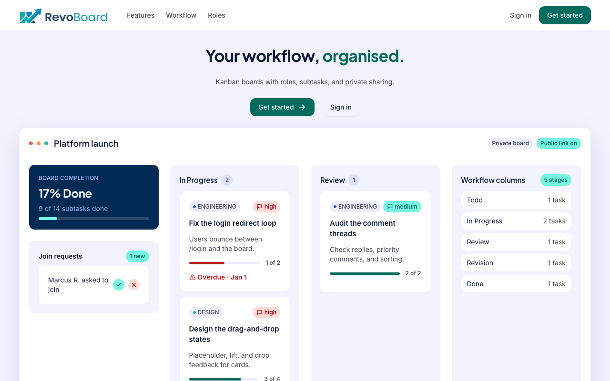

### Sign in

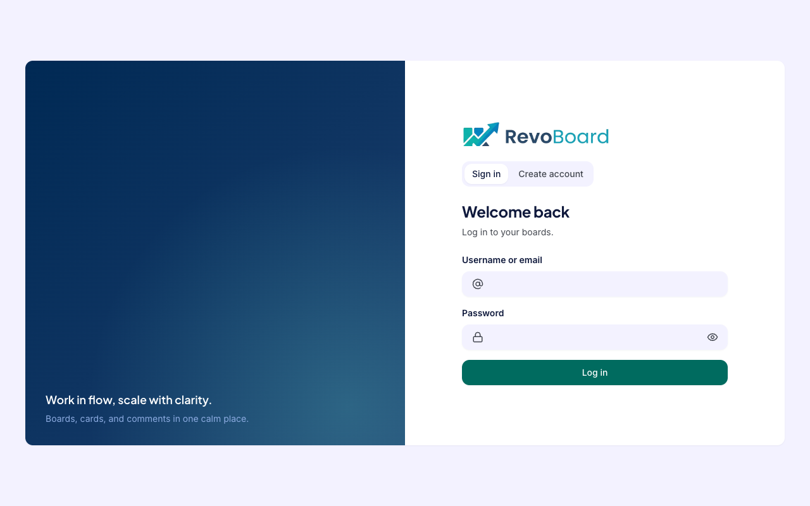

### Check your email

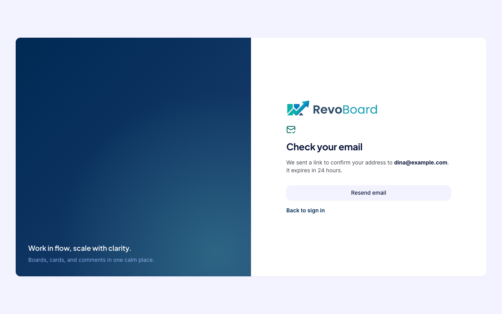

### Confirmation email

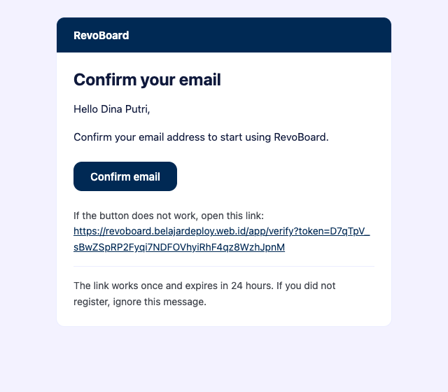

### Email confirmed

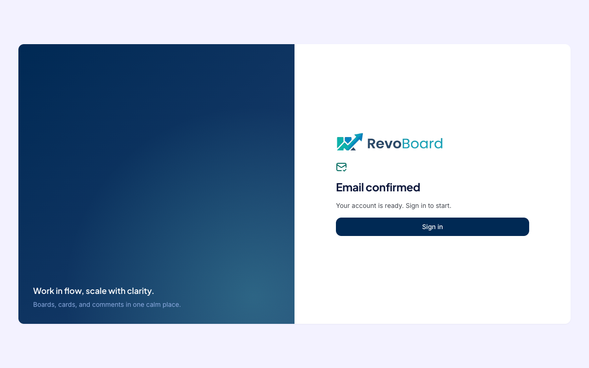

### Board

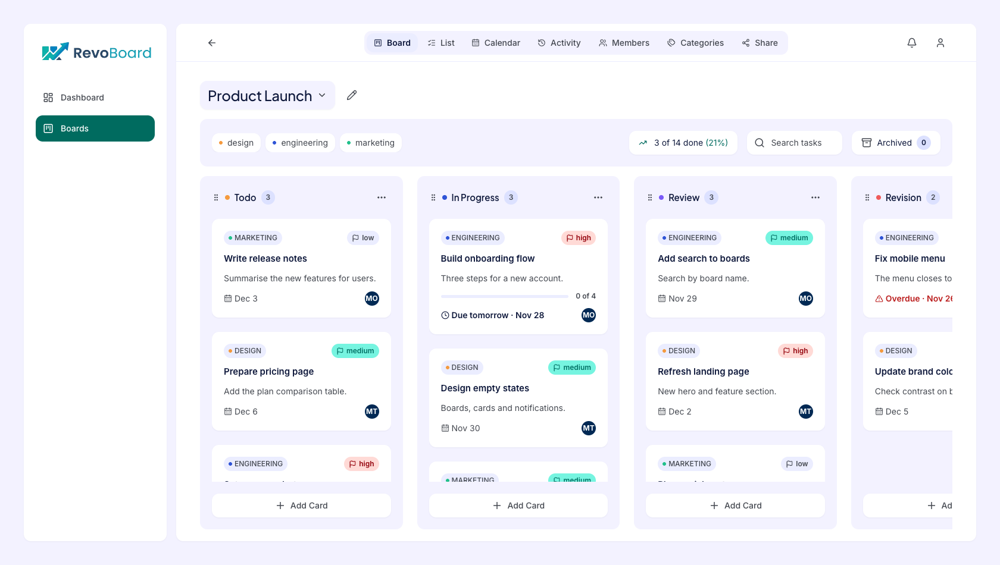

### Add a card

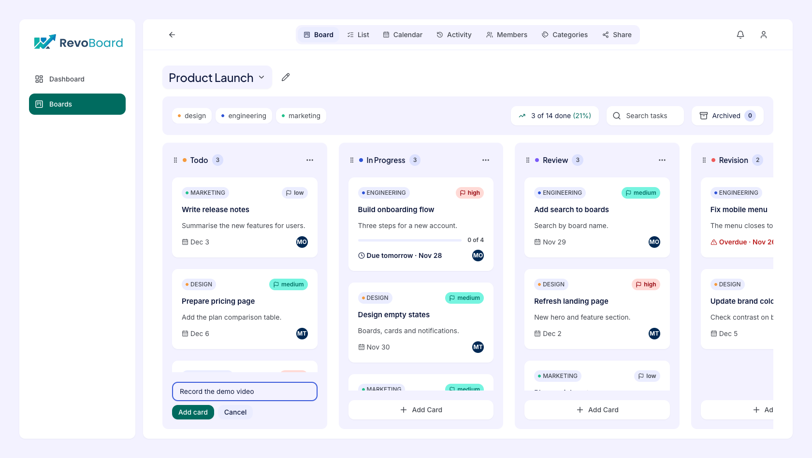

### Card modal

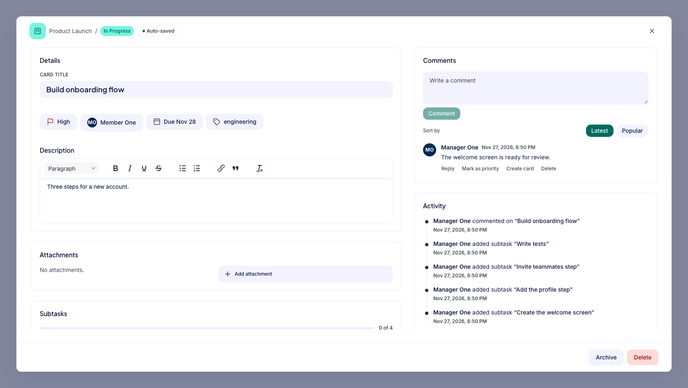

### Public board (read only)

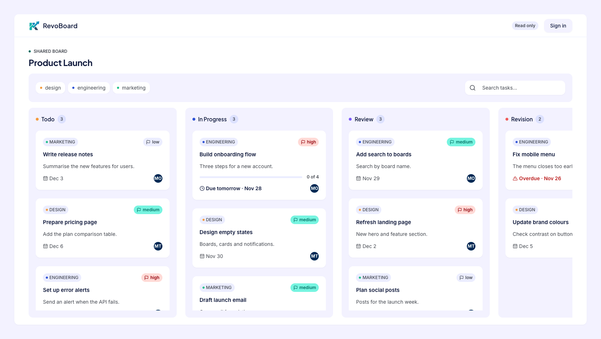

### List view

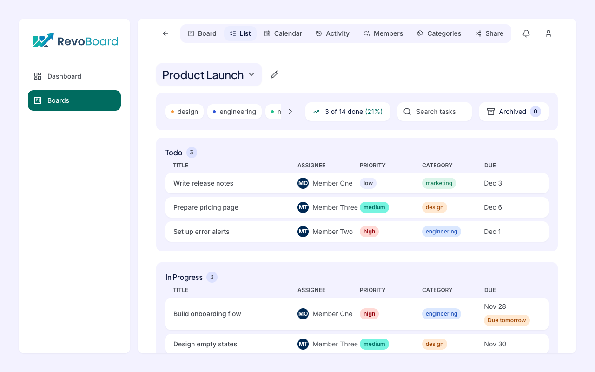

### Dashboard

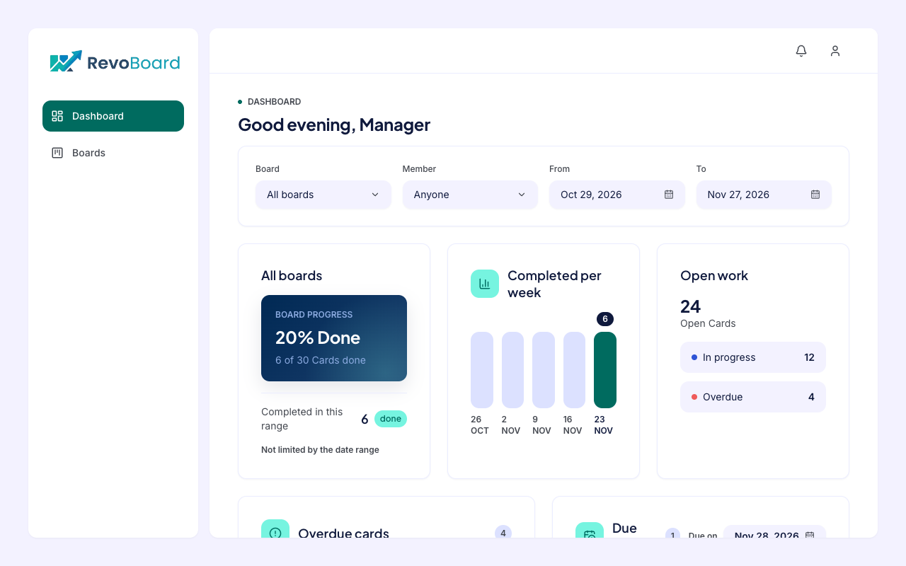

### User management

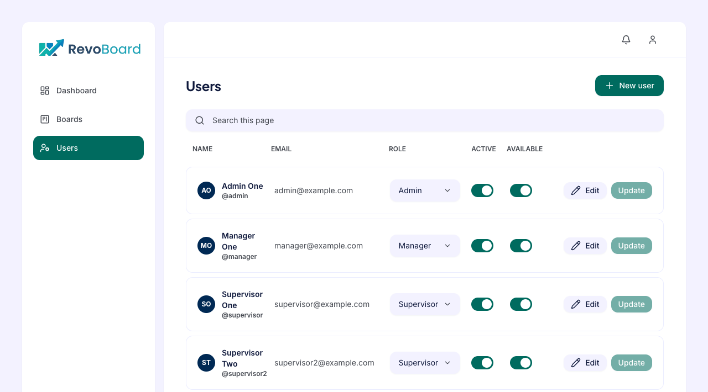

## Repository layout

```text
.
├── backend/            Flask API: app/blueprints/<domain>/{routes,service,repository,schema}.py, models, migrations, tests
├── frontend/           Next.js app: app/ (routes), components/, lib/, styles/ (design tokens), tests/ (Vitest), e2e/ (Playwright)
├── deploy/             nginx, server deploy scripts and the smoke test; see deploy/README.md
├── compose.yaml        Docker services for the CI smoke test
├── specs/              Versioned specifications (v1 to v18) and the changelog
├── .kiro/              Requirements, design, tasks, and steering documents
└── guidelines/         Coding standards for backend, frontend, and database
```

## Run it locally

You need Python 3.15, Node.js 22 or later, PostgreSQL 16 or later, and Google Chrome (for the end-to-end tests).

### 1. Backend (port 5001)

```bash
cd backend
python3 -m venv .venv
.venv/bin/pip install -r requirements.txt
cp .env.example .env          # set DATABASE_URL, JWT_SECRET, FILE_URL_SECRET; APP_ENV=development; MAIL_BACKEND=console
.venv/bin/flask --app app:create_app db upgrade
SEED_PASSWORD=12345678 .venv/bin/flask --app app:create_app seed-data
.venv/bin/flask --app app:create_app run -p 5001
```

`seed-data` creates one user per role and sample boards. Every seeded user has the password from `SEED_PASSWORD`:
`admin@example.com`, `manager@example.com`, `supervisor@example.com`, `supervisor2@example.com`, `member@example.com`, `member2@example.com`, `member3@example.com`.

With `MAIL_BACKEND=console` the confirmation emails are written to the backend log instead of being sent; open the link from there to confirm a new account. Production uses Gmail SMTP (`MAIL_BACKEND=smtp` and the `SMTP_*` variables).

Due-date reminders: `flask notify-due` runs once; `flask run-scheduler` runs it every 15 minutes.

### 2. Frontend (port 3000)

```bash
cd frontend
npm install
cat > .env.local <<'ENV'
NEXT_PUBLIC_API_URL=/app/api
INTERNAL_API_URL=http://localhost:5001/api
ENV
npm run dev
```

Open http://localhost:3000. `npm run dev` and `npm run build` first copy TinyMCE into `public/tinymce` (not committed).

## Tests

| Suite | Command | What it covers |
|---|---|---|
| Backend unit (pytest) | `cd backend && APP_ENV=testing .venv/bin/python -m pytest -q tests/unit` | Every domain's `service.py` and `dto.py`, `app/common`, and the due-date job in isolation: repositories mocked, `db.session` a MagicMock, no database or HTTP |
| Unit coverage (pytest-cov) | `cd backend && APP_ENV=testing .venv/bin/python -m pytest -q tests/unit --cov` | Line coverage of the logic layer set in `backend/.coveragerc` (`service.py`, `dto.py`, `app/common`, `app/jobs`), per file with the missed lines; fails under 90% |
| Backend integration (pytest) | `cd backend && APP_ENV=testing .venv/bin/python -m pytest -q` | Everything above plus the API through HTTP on a test database: permissions, property-based tests (Hypothesis), migrations |
| Frontend unit (Vitest) | `cd frontend && npx vitest run` | Components, routing helpers, and the design-system rules (`tests/design-system.test.ts`) |
| Type check | `cd frontend && npx tsc --noEmit` | TypeScript |
| End to end (Playwright) | `cd frontend && npm run e2e` | In a real browser: login and register (`e2e/tests/auth.spec.ts`) and the MVP flow (`e2e/tests/mvp.spec.ts`): create a board with the five columns, add a card, drag it to another column and keep it after a refresh, edit it in the card modal (priority, subtask, comment), a Member without staff controls, archive |
| Widths | `cd frontend && npm run e2e:widths` | Every page at 360, 414, 960, and 1280 pixels: no sideways scroll, no console error |

The Playwright and width checks need the stack running and seeded (steps 1 and 2). They use the locally installed Chrome; set `BASE` for another address and `PW` for another seed password.

### pytest coverage report

HTML report of the whole `app/` package, from the full backend suite (unit and integration):

```bash
cd backend
APP_ENV=testing .venv/bin/python -m pytest -q --cov=app --cov-report=html
open htmlcov/index.html
```

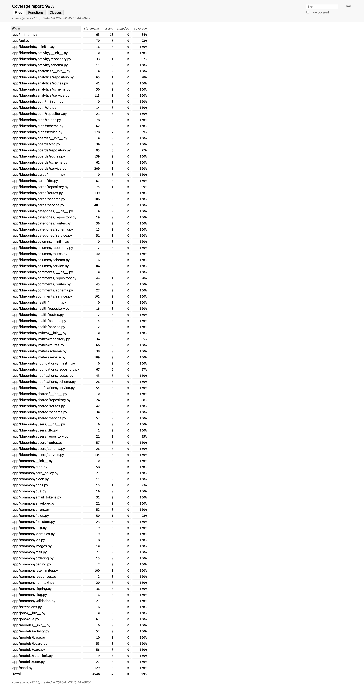

For the unit tests alone, use the `Unit coverage` command in the table above; add `--cov-report=html` for the same kind of report.

### Playwright end to end

With the stack running and seeded:

```bash
cd frontend
npm run e2e              # headless, in the terminal
npm run e2e -- --ui      # the Playwright UI below
```

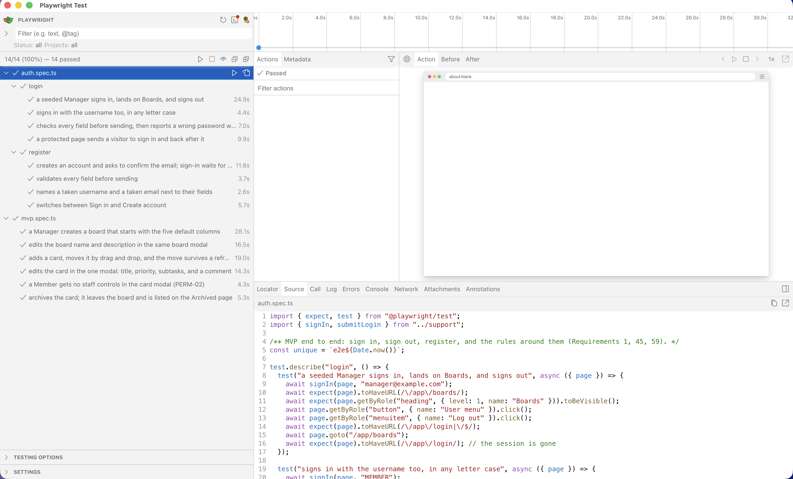

## Deploy

The server runs the app with supervisord, behind nginx on one origin; Docker is used only by the CI smoke test. Read [deploy/README.md](deploy/README.md) for the environment, TLS, SMTP, and the scheduler.

## Documentation

- API reference: [backend/API.md](backend/API.md) and the generated OpenAPI document `backend/openapi.json` (Swagger UI at `/api/docs` in development).
- Specifications: [specs/](specs/) (one folder per version) and [specs/CHANGELOG.md](specs/CHANGELOG.md).
- Requirements, design, and tasks: [.kiro/specs/](.kiro/specs/).

## Licence note

TinyMCE is self-hosted under its GPL-2.0-or-later licence (`licenseKey: "gpl"`). A closed-source deployment needs a commercial TinyMCE licence.
